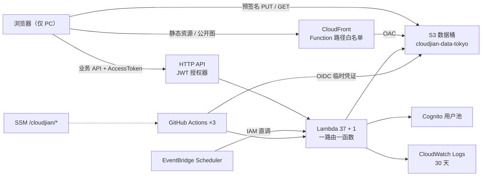
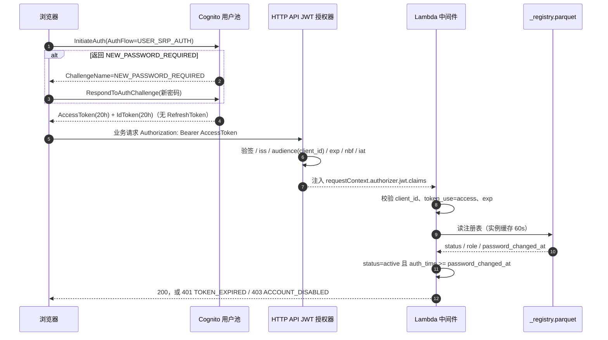
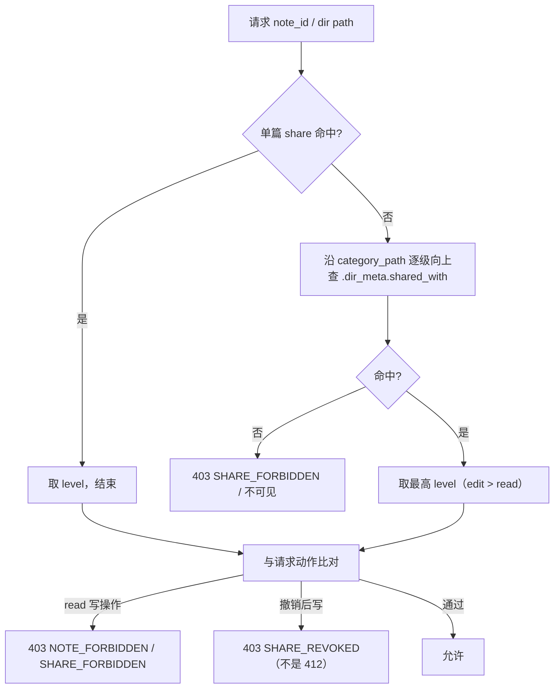
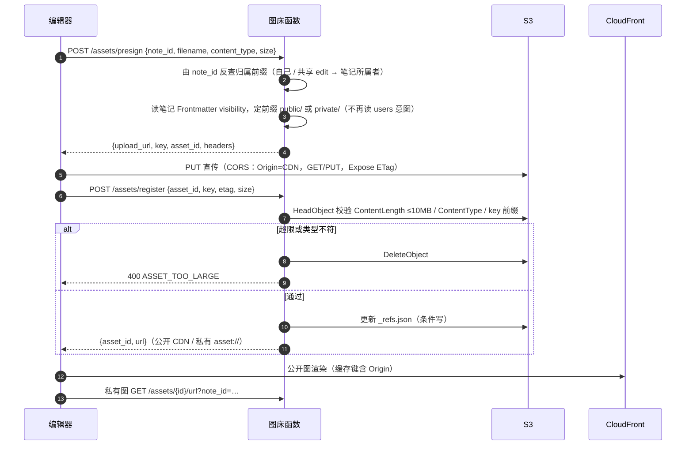
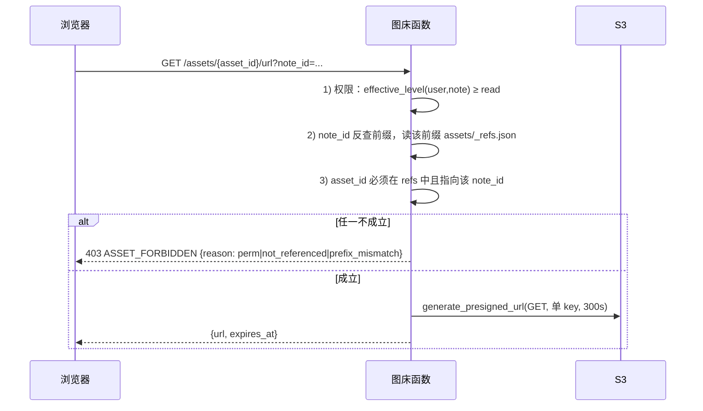
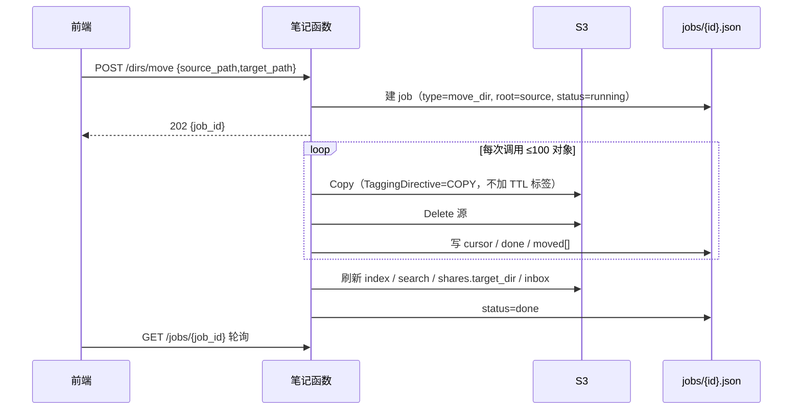

# 云笺（CloudJian）技术架构文档 v1.2

> **2026-11-26 修订（正文已同步）**：Lambda 由 6 个按域合并改为**一条路由一个函数**（37 个接口函数 + 1 个维护函数），逐条清单见契约 §2.6；字段、路由键、错误码未变。

> **新人入口**：先读 [docs/README.md](README.md)（阅读顺序 + 当前有效版本）。
> 变更史见 [云笺-修订史归档.md](云笺-修订史归档.md)；**实现只认正文**。

| 项 | 内容 |
|-|-|
| 文档角色 | 开发可执行的技术基线（契约 + 时序 + 接口 + 数据模型 + 部署 + 门禁） |
| 技术基线来源 | 《云笺 CloudJian — 方案设计文档 v1.13.7》**正文**（第 1–14、17、19 章） |
| 产品口径来源 | 《云笺轻量 PRD / 原型输入包 **v0.3.5**》+《页面清单与关键流程图 **v0.6**》 |
| 部署区域 | AWS ap-northeast-1（东京），单环境 dev（dev 分支即线上） |
| 架构基调 | 全 Serverless、单数据桶 + 独立 state 桶、无独立数据库服务、Terraform + GitHub Actions |
| 目标读者 | 前端 / 后端 / 基础设施三个工程的开发与评审者 |
| 修订记录 | 变更史见 [云笺-修订史归档.md](云笺-修订史归档.md)；实现以正文为准 |
| 标记约定 | **TODO-xx** = 需确认或需实测项；**【派生】** = 方案未显式给出、本文为可实现性补齐的契约，须在首个接口 PR 上确认 |

---

## 1. 文档说明与有效版本

### 1.1 有效版本判定

1. 本文件的**规范来源是方案设计文档 v1.13.7 的正文**：第 1–14 章为架构与实现规则，第 17 章为已确认事项与实现约束，第 19 章为 T-01…T-13 与 T-A…T-H 的决议落点。文首修订说明已归档，**不作为实现依据**。
2. 方案文档开头的 v1.13.4 / v1.13.3 / … / v1.2 **修订说明仅作变更线索，不作为实现依据**；凡修订说明与正文冲突，以正文为准。第 15 章「审核整改记录」记录的是历史缺陷收敛过程，本文件**不复制审核流水**，只在需要时引用其结论性约束（如「生命周期用标签不用通配前缀」「Lambda 不碰 JWKS」）。
3. 产品口径以 **PRD v0.3.5 + 页面清单与流程图 v0.6** 为准。**两项已拍板并已随方案 v1.13.5 回写正文**（P-A 共享目录写边界、P-B 密码策略）；P-A 与实现一致（TODO-SYNC-01 关闭），P-B 仍有「Cognito 配最大长度」的措辞问题（TODO-PWD-01，20 位上限只能由前端 + Lambda 保证）。v0.3.4 推翻旧版「回收站不做清空 / 无多选批量删除」，本文件按新版落地（多选只在回收站视图内）。
4. 本文件不新增任何未确认功能。凡为实现性必须补齐、但方案未定义的契约，一律标【派生】并进第 12.3 节 TODO 汇总；凡方案内部矛盾，标 TODO 并写来源章节。

### 1.2 输入清单

| 输入 | 版本/状态 | 说明 |
|-|-|-|
| 方案设计文档 | v1.13.7（完整正文） | 技术基线；图片可见性跟随笔记；文首修订史已归档 |
| 轻量 PRD | v0.3.5（完整） | 页面 ID、US、异常态与产品规则（含图片随笔记） |
| 页面清单与关键流程图 | v0.6（完整） | 路由模型、权限矩阵、状态清单、用户流程图、P0/P1 线框顺序 |
| 线框规格 | v1.2（线框与页面状态规格） | 仅作交互细节参考，不改变本文契约 |

### 1.3 文档结构

第 2–3 章定系统边界与运行时；第 4 章定认证鉴权；第 5 章是接口与页面的唯一契约表；第 6 章是数据模型与真源关系；第 7–8 章定权限与图床；第 9 章定异步任务；第 10–11 章定部署与安全；第 12 章列风险、实测项与 TODO；第 13 章给三仓任务拆解输入。每章末尾的「契约/门禁」是该章必须由 CI、Terraform 或代码断言保证的点，**不接受口头承诺**。

#### 契约/门禁

- 任何实现若与本文件冲突，必须先改本文件并说明来源章节，不能「按代码为准」。
- CI 中的契约断言必须可在本地复跑（脚本入库，不依赖控制台手工操作）。
- TODO 未关闭前，对应模块只能进 dev 做小范围造数验证，不得对外宣称「完成」。

---

## 2. 系统上下文

### 2.1 上下文图



### 2.2 组件职责

| 组件 | 职责 | 明确不负责 |
|-|-|-|
| 浏览器 | 渲染、Vditor 编辑、ETag 条件写、412 差异面板、预签名直传、401 兜底 | 不直读任何私有 S3 对象 |
| CloudFront + Function | 静态资源与公开图分发；路径白名单、SPA rewrite、私有路径终态 403 | 不做鉴权（Function 无网络、无法验 JWT） |
| S3 数据桶 | 全部业务数据与静态产物；条件写与版本兜底 | 不承担访问控制以外的权限判断 |
| HTTP API | 路由、JWT 授权器前置过滤、CORS 预检、512KB 计量 | 不区分 Access/ID Token（见 4.3） |
| Lambda（37 接口函数 + 1 维护） | 每个函数只接一条路由；业务逻辑、注册表与权限判定、Parquet 读写、异步 job | 不做 JWKS 验签；不自造 CORS 头 |
| Cognito | 账号、SRP 登录、Token 签发、Group、禁用/重置 | 不作为权限真源（role 以注册表为准） |
| Scheduler | 三个定时任务（对账、契约校验、索引抽查） | 不承载用户请求 |
| SSM | 三仓参数总线（桶、域名、API、池、角色） | 不存业务数据 |

### 2.3 三仓边界

| 工程 | 只负责 | 明确不做 |
|-|-|-|
| cloudjian-frontend | React 构建产物发布到 `web/`、CloudFront 失效、前端冒烟 | 不创建 AWS 资源、不碰 Lambda / IAM / 桶策略 |
| cloudjian-backend | Lambda 全生命周期（函数、Layer、别名、集成授权、冒烟、回滚）、`add-permission` | 不改桶策略、不改 OIDC 角色、不建分发、不改 API 路由结构 |
| cloudjian-infra | S3（生命周期/策略/OAC/CORS）、CloudFront、Function、Cognito、API GW 路由与 Stage、Scheduler、IAM、SSM、日志告警、Budgets | 不创建/更新任何 Lambda 与 Layer、不部署 VPC、不 `s3 sync` 前端产物 |

跨仓只通过两条通道耦合：**固定资源命名**（Lambda ARN 字符串可推导）与 **SSM 参数总线**。

#### 契约/门禁

- infra 的 Terraform 中不得出现 `aws_lambda_function` / `aws_lambda_layer_version`；backend 的 Terraform/CLI 中不得出现桶策略、分发、Cognito 资源变更。
- 路由先于函数存在是设计内的窗口：infra 先建集成，backend 首次发布补齐函数，冒烟必须覆盖「路由存在但函数未就绪」的 5xx 并给出可读提示。
- 三仓不得共享代码包；共享常量只能走 SSM 或各自仓库内的契约文件（值必须一致，由 CI 比对）。

---

## 3. 运行时基线

### 3.1 版本矩阵

| 层 | 版本 | 落地约束 |
|-|-|-|
| Lambda 运行时 | `python3.14`（Amazon Linux 2023，弃用日 2029-06-30） | 全部函数同版本；不得混用 3.12 |
| Parquet Layer | 构建镜像 `public.ecr.aws/lambda/python:3.14` | 与 runtime **同版本同 ABI**，跨版本会 `ModuleNotFoundError` 或 C 扩展 ABI 不匹配 |
| 前端构建 | Node.js 24 LTS | `.nvmrc`=24、`package.json engines`=`>=24 <25`、CI `node-version: 24` 三处一致 |
| 依赖 | fastparquet + python-snappy（含 numpy/pandas/cramjam） | Layer 压缩后数十 MB，冷启动 +80–150ms（待实测） |
| 包管理 | npm + `package-lock.json` | `npm ci`，禁止 `npm install` 漂移 |
| 内存 / 超时 | 512 MB / 25 秒 | 网关集成 30 秒，留 5 秒；批处理预算按 15 秒设计 |

### 3.2 Layer 构建与 ABI 校验

1. CI 用官方镜像构建依赖，产出兼容 Amazon Linux 2023 的二进制；若 3.14 无 manylinux wheel，则在镜像内源码编译（需 gcc-c++/make，构建 +约 40 秒）。
2. 缓存键 = `hash(requirements.lock + runtime_version)`，产物存 `deploy/layers/{hash}.zip`，命中即跳过编译；升级 Python 自动失效旧缓存。
3. 硬校验（L1）：镜像内先 `assert sys.version_info[:2] == (3, 14)`，再 `import fastparquet, numpy, snappy` 成功，才算 Layer 合格。
4. 部署后在别名上真实调用一次读 `index.parquet` 的路径，确认依赖可加载（不能只看 `publish-layer-version` 成功）。

### 3.3 函数规格

| 项 | 值 |
|-|-|
| 函数名 | 37 个接口函数 + 1 个维护函数；命名 `cloudjian-<域>-<动作>-api`；逐条清单见契约 §2.6 |
| 别名 | `live`（集成指向别名 ARN，不指 `$LATEST`） |
| 环境变量 | `CJ_BUCKET`、`CJ_REGION`、`CJ_USER_POOL_ID`、`CJ_LAYER_MODE=parquet` |
| 执行角色 | `cloudjian-lambda-role`（ARN 从 `/cloudjian/lambda-exec-role-arn` 读） |
| 日志组 | 与函数同名（`cloudjian-<域>-<动作>-api`），保留 30 天 |

#### 契约/门禁

- CI 断言 `python --version` 为 3.14，且 Layer 与函数 runtime 字符串完全一致；任一不符即阻断发布。
- 函数创建必须带 `live` 别名；`UpdateAlias` 失败时别名回指上一版本并输出回滚结果。
- 冒烟必须真实读一次 Parquet（`index.parquet`），不能只 `invoke` 健康检查返回 200。
- 版本升级只允许改 `.nvmrc` / `engines` / CI 一行（Node）或镜像 tag + 缓存键（Python），不得夹带业务改动。

---

## 4. 认证鉴权时序

### 4.1 登录与首登改密



### 4.2 Token 契约

| 项 | 规则 |
|-|-|
| AccessToken | 20 小时；调 API、`GlobalSignOut` 用 |
| IdToken | 20 小时；仅本地展示用户信息，**不得用于业务 API** |
| RefreshToken | 配置上不申请、代码里不使用；到期清空跳登录 |
| 有效期真值 | 以 AccessToken 的 `exp` 为准（前端本地预判 + 服务端 401 双保险） |
| 密码明文 | 不出网：`USER_SRP_AUTH` |
| App Client | `WriteAttributes` 为空集；`EnableTokenRevocation=true`（作用有限，见 4.5） |

### 4.3 网关 JWT 授权器

| 配置 | 值 |
|-|-|
| Issuer | `https://cognito-idp.ap-northeast-1.amazonaws.com/<pool-id>` |
| Audience | App Client ID（AccessToken 无 `aud`，缺省回退校验 `client_id`） |
| Identity source | `$request.header.Authorization` |
| 算法 | RSA，公钥来自 issuer 的 `jwks_uri`，缓存最长 2 小时 |
| Scope | 暂不声明；**TODO-AUTH-01**：实测 SRP 返回的 scope 后决定是否启用 `authorizationScopes=["aws.cognito.signin.user.admin"]`（启用后 ID Token 会在网关被拒，`token_use` 降为第二道防线） |
| 覆盖范围 | 8 组业务路由全部 `authorization_type=JWT`；`cloudjian-maintenance-api` 不挂、不暴露 |

### 4.4 Lambda 中间件校验链

**方案 A：Lambda 不碰 JWKS，完全信任网关注入的 claims。** 原因：claims 是已解码集合、不含原始 JWT；本地验签需重新从 header 取原 Token 并拉 JWKS，等于第二份缓存与第二套逻辑。代价是「漏挂授权器的路由会裸奔」，由 CI 路由门禁兜住，不靠运行时。

| # | 检查项 | 失败返回 | 位置 |
|-|-|-|-|
| 1 | `requestContext.authorizer.jwt.claims` 存在 | 401 `AUTH_UNAUTHORIZED` | 中间件首行 |
| 2 | `token_use == "access"` | 401 `AUTH_TOKEN_TYPE_INVALID` | 中间件 |
| 3 | `client_id` == 本 App Client | 401 `AUTH_UNAUTHORIZED` | 中间件 |
| 4 | `iss` 为本用户池 | 401 `AUTH_UNAUTHORIZED` | 中间件（网关注入值二次比对） |
| 5 | `exp` / `nbf` 未过期 | 401 `AUTH_TOKEN_EXPIRED` | 中间件 |
| 6 | 注册表 `status == active` | 403 `ACCOUNT_DISABLED` | 注册表（60s 缓存） |
| 7 | `auth_time >= password_changed_at`（**同为秒**） | 401 `AUTH_SESSION_REVOKED` | 注册表 |
| 8 | `role` 满足路由要求（admin 路由） | 403 `AUTH_FORBIDDEN` | 注册表 |

单位陷阱：`auth_time` 是 Unix 秒，`password_changed_at` 统一存秒；若沿用毫秒必须先 `// 1000`。第一条单测用例即「改密后同一秒内的旧 Token 必须 401、新 Token 必须 200」。

### 4.5 禁用 / 改密 / 降权收敛

| 场景 | 机制 | 收敛时间 |
|-|-|-|
| 管理员禁用/启用 | 注册表 `status` + 实例缓存 | ≤60 秒 |
| 用户自助改密 | `ChangePassword` → `GlobalSignOut` → 清本地 Token；服务端靠 `auth_time` 比对 | ≤60 秒 |
| 管理员重置密码 | Lambda 以自身 IAM 调 `AdminResetPassword` + `AdminUserGlobalSignOut`，并写 `password_changed_at` | ≤60 秒 |
| 角色调整 | 注册表 `role`（Group 只影响前端菜单） | ≤60 秒 |
| GlobalSignOut 后的旧 JWT | 网关离线验签看不见撤销，**只能**靠 `auth_time` | ≤60 秒 |

注意：`EnableTokenRevocation` 的真实作用是「换 Token 的接口会被 Cognito 拒绝」，不是「旧 AccessToken 立刻失效」。不要把它写成双保险验收项。

### 4.6 401 无 CORS 的前端兜底

授权器在集成之前拒绝，HTTP API 没有 gateway responses 机制，业务 API 又不经 CloudFront → 浏览器可能把 401 表现为 CORS error，读不到 status。三层缺一不可：

1. **本地 exp 预判**（正常路径）：解析 AccessToken `exp`，过期即清 Token 跳 `/login?next=<deep-link>`。
2. **401 分支**：能读到 401 时按 `AUTH_*` 处理。
3. **网络/CORS 兜底**：`fetch` 抛 TypeError 且本地 `exp` 已过 → 视为 Token 失效，跳登录；未过期则提示 `NETWORK_OFFLINE`，不误清 Token。

到期体验（T-G）：AccessToken 剩 ≤10 分钟时顶栏出现**单行横幅**（不弹模态），只给「立即保存」，**不提供「续期」**（无 RefreshToken，续期是伪承诺）；文案按 `{{count}}` 插值、三语，弹性宽度不写死像素。已到期直接清 Token 跳 `/login?next=` 并保留本地草稿（≤256KB、最近一篇、debounce 5 秒），重登后版本一致则回填、不一致进 P-05 差异面板。

### 4.7 密码策略（PRD v0.3.3 / v1.13.5 P-B）

| 项 | 规则 | 落点 |
|-|-|-|
| 长度 | 8–20 位 | Cognito 只能设 `MinimumLength=8`（**无 MaximumLength 参数**）；20 位上限由前端统一校验 + 管理端开号/重置的 Lambda 前置校验保证 |
| 字符 | 至少 1 大写、1 小写、1 数字 | Cognito `RequireUppercase/Lowercase/Numbers=true` |
| 符号 | **不强制** | `RequireSymbols=false`；前端提示文案不得暗示必须符号 |
| 生效面 | 首登改密、自助改密、管理员开号初始密码 | 三处共用同一前端校验函数；管理端另有一份服务端前置校验（Cognito 不管上限） |
| 错误映射 | 前端超 20 位 → `PASSWORD_POLICY`（400，本地拦截）；Cognito `InvalidPasswordException` → `PASSWORD_POLICY`（400） | `params` 带 `min_length/max_length/requirements` 供三语渲染 |

**TODO-PWD-01**：方案 v1.13.5 已把密码策略写进 4.5，但措辞仍是「Cognito 统一配置为长度 8–20」——Cognito 密码策略**没有最大长度字段**，20 位是产品层约束。实现按「Cognito 管下限与字符类别、前端与 Lambda 管 20 位上限」；后续修订把 4.5 措辞改准，不要写成 IaC 能配出 20 位上限。
**TODO-SYNC-01 已关闭**：P-A（7.4 共享目录写边界）、P-B（4.5 密码策略）均已随方案 v1.13.5 写入正文，与本文件实现口径一致；P-B 的措辞细节转入 TODO-PWD-01，不改实现。

#### 契约/门禁

- `get-routes` 门禁：8 组业务路由 `AuthorizationType=JWT` 且 `AuthorizerId` == SSM `/cloudjian/jwt-authorizer-id`；不得存在 `$default` 路由；唯一 NONE 例外是显式 OPTIONS 预检。
- 中间件单测必须覆盖：无 `authorizer` 的 event → 401；ID Token（`token_use=id`）→ 401；禁用用户 → 403；改密同秒旧 Token → 401；新 Token → 200。
- 冒烟：无 Authorization / 篡改签名 / 过期 Token 三种请求均断言 **status=401**；ACAO 只记录、不作阻断（按官方机制 401 本就不带 CORS 头）。
- 前端拦截器单测覆盖三层兜底，禁止只写 `if (status === 401)` 一条分支；断网时 `fetch` 抛 TypeError 且 Token 未过期 → `NETWORK_OFFLINE` 提示并转只读，**不清 Token、不做乐观保存**。
- `token_use=access` 是硬门槛，注释里必须写明「网关无法区分 Access/ID Token」。
- Cognito 密码策略由 IaC 定义，CI 断言 `MinimumLength=8`、`RequireUppercase/Lowercase/Numbers=true`、`RequireSymbols=false`；前端常量 `PASSWORD_MAX=20` 与后端管理端前置校验一致；三处入口共用同一前端校验函数（边界 7/8/20/21 位单测）。

---

## 5. API 契约

### 5.0 通用约定

| 项 | 约定 |
|-|-|
| 基址 | `https://<api-id>.execute-api.ap-northeast-1.amazonaws.com`（Stage `dev`），由 `/cloudjian/api-url` 注入前端 |
| 认证 | 全部业务路由带 `Authorization: Bearer <AccessToken>` |
| 错误信封 | 所有非 2xx：`{"code": "...", "params": {...}, "data": {...}?}`；`data` 仅用于必须携带结构化上下文（412/409/403 转存） |
| 成功体 | 直接返回资源对象或 `{items, page, page_size, has_more}`，不再包一层 `data` |
| 语言 | 后端不返回自然语言；`code → errors.code.<小写蛇形>` 由脚本生成 |
| 时间 | 存储与接口一律 UTC 毫秒 int64；Frontmatter 落盘 ISO8601 + 偏移 |
| 分页 | `page`（1 起）+ `page_size`（默认 20，可选 **20/50/100**，上限 100）；列表默认 `updated_at` 倒序 |
| 标题 | `title` 允许为空串/null；服务端落库为「未命名笔记」（按 `ui_lang` 取三语之一），**不返回** `NOTE_TITLE_REQUIRED` |
| ETag（读） | `GET /notes/{note_id}` 响应头 `ETag`，body 内同时给 `version` |
| ETag（写） | 请求头 `If-Match`，Lambda 原样透传 S3 `PutObject`；响应头回新 `ETag`；**不放 body 字段** |
| 条件写失败 | 412 `NOTE_CONFLICT`（正文）/ 索引内部重试 3 次；409 `DELETE_CONFLICT`（并发删除）；404 `NOTE_NOT_FOUND` |
| 响应上限 | 搜索单次 ≤512KB（HTTP API 计量口径）；同步 ≤6MB；网关负载 10MB |
| CORS | 网关 `AllowOrigins`=CDN 域名、`AllowMethods`=GET/POST/PUT/PATCH/DELETE/OPTIONS、`AllowHeaders`=authorization/content-type/if-match、`ExposeHeaders`=etag、`MaxAge`=600；Lambda 不输出 CORS 头 |
| 幂等 | `POST /assets/register` 按 `asset_id` 幂等；共享收件箱条件写 + 指数退避；job 按 `cursor` 续跑；**purge 靠 `purged[]` + `DeleteObject` 幂等**（9.3.1） |

### 5.0.1 路由 → 目标函数（一条路由一个函数）

> **2026-11-26 架构变更**：Lambda 由「6 个按域合并」改为「一条路由一个函数」，共 **37 个接口函数 + 1 个维护函数**；函数名 `cloudjian-<域>-<动作>-api`，别名固定 `live`。逐条映射以 [契约 §2.6](云笺-ALL-契约-接口契约-v0.1.md) 为准，CI 门禁 `verify_routes_structure.sh` / `verify_lambda_inventory.sh` 保证 1:1。
>
> `GET /public/notes/{public_token}` 是**无鉴权路由**（不挂 JWT 授权器），由 `cloudjian-notes-public-get-api` 按 token 只读返回；其余路由全部需要登录。

| 域 | 函数数 | 名称前缀 |
|-|-|-|
| 笔记 | 7 | `cloudjian-notes-*` |
| 回收站 | 1 | `cloudjian-trash-purge-api` |
| 版本 | 3 | `cloudjian-versions-*` |
| 搜索 | 1 | `cloudjian-search-query-api` |
| 目录 | 6 | `cloudjian-dirs-*` |
| 任务查询 | 1 | `cloudjian-jobs-get-api` |
| 共享 | 3 | `cloudjian-shares-*` |
| 图床 | 5 | `cloudjian-assets-*` |
| 管理 | 6 | `cloudjian-admin-*` |
| 个人设置 | 2 | `cloudjian-profile-*` |
| 导出 | 2 | `cloudjian-exports-*` |
| 运维 | 1 | `cloudjian-maintenance-api`（定时，不挂网关） |

【派生】路由（页面清单 v0.5 已冻结页面行为，但以下路由键不在 12.1；须随首个接口 PR 定稿后并组）：`GET/POST/PATCH/DELETE /dirs`、`POST /dirs/restore`（组 4）、`GET /jobs/{job_id}`（组 4）、`GET/PUT /profile`（组 7 或独立）、`GET/PUT /admin/team-config`（组 7）、`GET /assets`（组 6）、`GET /notes/{note_id}/versions/{ts}`（组 3）。**冻结的是「页面要什么」，不是「路由长什么样」**——后者由 12.3 的 TODO-API-02/03/04/05/09/10/12 收口。

### 5.1 笔记与列表

| # | 方法 | 路径 | 入参 | 出参 | 错误码 | ETag 位置 | 分页 |
|-|-|-|-|-|-|-|-|
| N1 | GET | `/notes` | `category_path?`、`tag?`、`sort=updated\|created\|title`、`page`、`page_size` | `{items:[{note_id,title,slug,category_path,tags,updated_at,version,own_share,visibility}],page,page_size,has_more}` | 400 `NOTE_QUERY_INVALID`；401 `AUTH_*`；403 `ACCOUNT_DISABLED`；404 `DIR_NOT_FOUND`；409 `JOB_RUNNING`；500 `INTERNAL_ERROR` | 无（列表不返回 ETag） | 有，默认 20 |
| N2 | POST | `/notes` | `{title?, category_path, content?, tags?, lang?}`；`title` 空 → 「未命名笔记」 | 201 `{note_id, slug, category_path, version:1}` + `ETag` | 400 `NOTE_PATH_INVALID` / `NOTE_TAG_LIMIT` / `NOTE_TAG_TOO_LONG`；403 `NOTE_FORBIDDEN`（read 共享禁新建）；404 `DIR_NOT_FOUND`；409 `JOB_RUNNING`；500 | 响应头 `ETag` | 无 |
| N3 | GET | `/notes/{note_id}` | `include=content\|meta`（默认 content） | `{note_id,title,slug,category_path,tags,lang,visibility,created_at,updated_at,version,content}` | 404 `NOTE_NOT_FOUND`；403 `SHARE_FORBIDDEN` / `SHARE_REVOKED`；401/403 `AUTH_*` | 响应头 `ETag` | 无 |
| N4 | PUT | `/notes/{note_id}` | Header `If-Match`（必填）；body `{content, title?, tags?, lang?, base_version}` | 200 `{note_id, version, updated_at}` + `ETag` | 400 `NOTE_IF_MATCH_REQUIRED`【派生】；403 `SHARE_REVOKED` / `NOTE_FORBIDDEN`（read）；404 `NOTE_NOT_FOUND`；409 `DELETE_CONFLICT` / `JOB_RUNNING`；412 `NOTE_CONFLICT` + `data{server_content,server_etag,client_content,diff,server_version}`；413 `NOTE_TOO_LARGE`【派生】 | 请求 `If-Match`，响应 `ETag`；412 的 `data.server_etag` | 无 |
| N5 | DELETE | `/notes/{note_id}` | Header `If-Match`（可选，建议必填） | 200 `{note_id, trashed:true, deleted_at}` | 403 `NOTE_FORBIDDEN`（非 owner / read）；404；409 `DELETE_CONFLICT`；412 `NOTE_CONFLICT`【派生】 | `If-Match` | 无 |
| N6 | POST | `/trash/purge` | `{scope:"note"\|"notes"\|"dir"\|"all", note_ids?[], category_path?, ack?:true, confirm?}` | 202 `{job_id, accepted:{notes:N,dirs:M}, rejected:[{note_id,code}]}` | 400 `TRASH_PURGE_SCOPE_INVALID` / `TRASH_BATCH_EMPTY` / `TRASH_BATCH_TOO_LARGE`；403 `TRASH_FORBIDDEN`；404 `TRASH_ITEM_NOT_FOUND`（单篇/dir 不存在）；409 `JOB_RUNNING`；500 `TRASH_PURGE_FAILED` | 无（不复用 If-Match，原因见 9.3.1） | 无 |
| N7 | POST | `/notes/{note_id}/visibility` | `{visibility:"private"\|"public"}` | 202 `{job_id, visibility}` | 400 `NOTE_VISIBILITY_FORBIDDEN`（团队强制私有且请求 public）；403 `NOTE_FORBIDDEN`（非 owner / read 共享）；404 `NOTE_NOT_FOUND`；409 `JOB_RUNNING`；500 | 无（异步 job，写正文链接改写） | 无 |
| N8 | GET | `/public/notes/{public_token}` | `{}`（**无鉴权**，匿名） | 200 `{title, content, updated_at, images:[{asset_id, url}]}`（`url` 为 CDN 直链） | 404 `PUBLIC_NOTE_NOT_FOUND`（token 不存在或已撤销）；429 `PUBLIC_RATE_LIMITED`【派生】；500 | 无（公开内容不可写） | 无 |

**N6 要点（回收站彻底删除）**：

- **唯一入口，四种 scope**：`note`（单篇，`note_ids` 长度 1）、`notes`（批量，≤200）、`dir`（整目录子树，带 `category_path`）、`all`（清空）。不做 `DELETE /trash`，因为网关对带 body 的 DELETE 语义与 CORS 预检都不友好（与 TODO-API-06 同一理由）。
- **一律 202 + job**：即使单篇也不做同步删除。一篇笔记牵连 `versions/{note_id}/` 整前缀、`_refs.json` 与 `assets/_trash/`、`shares/` 与收件箱条目，对象数不可预估，同步必撞 25 秒函数超时（9.1）。
- **确认强度由服务端复核**：`scope=notes` 必须 `ack=true`；`scope=all` 必须 `confirm="EMPTY_ALL"`（**固定常量，不随语言变化**；前端展示的「清空 / Empty / 空にする」只是 UI 文案，提交时映射成该常量）。
- **幂等**：`purged[]` 记录已删对象；`DeleteObject` 本身幂等。重复提交已不存在的 `note_id` 返回 `rejected` 而非 409；单篇 scope 直接 404 `TRASH_ITEM_NOT_FOUND`。
- **不做批量回滚**：某项失败只进 `failed[]`，成功项照常提交，job 最终 `status=partial`。

要点：新建同目录重名自动追加 `-1/-2`，**不返回冲突错误**；`note_id` 为 ULID，由服务端生成，`slug` 仅文件名。

### 5.2 版本

| # | 方法 | 路径 | 入参 | 出参 | 错误码 | ETag | 分页 |
|-|-|-|-|-|-|-|-|
| V1 | GET | `/notes/{note_id}/versions` | `page`、`page_size` | `{items:[{ts,size,created_at}],page,page_size,has_more}` | 403 `SHARE_FORBIDDEN`；404 `NOTE_NOT_FOUND`；401 | 无 | 有 |
| V2 | POST | `/notes/{note_id}/versions/{ts}/restore` | `{base_version}` | 200 `{note_id, version, restored_from}` + `ETag` | 403 `NOTE_ROLLBACK_FORBIDDEN`（read 可看不可回滚）/ `SHARE_REVOKED`；404 `VERSION_NOT_FOUND`；409 `JOB_RUNNING`；412 `NOTE_CONFLICT` | 响应 `ETag` | 无 |
| V3 | GET | `/notes/{note_id}/versions/{ts}` | — | `{ts, content}` | 404 `VERSION_NOT_FOUND`；403 | 无 | 无 |

**TODO-API-09**：方案 6.4 要求「与当前版本对比」、PRD P-06 有对比态，但 12.1 未列版本内容读取/对比路由。V3 为【派生】最小实现（前端复用 `react-diff-view` 本地比对），须随首个接口 PR 定稿（P-06 已是冻结页面）。

### 5.3 搜索与目录

| # | 方法 | 路径 | 入参 | 出参 | 错误码 | ETag | 分页 |
|-|-|-|-|-|-|-|-|
| S1 | GET | `/search` | `q`（必填）、`page`、`page_size`≤20 | `{items:[{note_id,title,category_path,snippet,origin,owner_name?,updated_at}],has_more,total_hint?}`；`origin=own\|shared`；共享结果 `category_path` 只给相对共享根一段 | 400 `SEARCH_QUERY_TOO_SHORT`【派生】；403 `SHARE_REVOKED`（跳过该条，不整体失败）【派生】；401；500 | 无 | 有，20/页，响应 ≤512KB |
| S2 | GET | `/dirs` | `path?`、`depth?`、`scope=mine\|shared` | `{items:[{path,name,type:dir\|note,note_id?,updated_at,has_children}]}` | 404 `DIR_NOT_FOUND`；403 `SHARE_FORBIDDEN`；409 `JOB_RUNNING` | 无 | 按 `depth`/`page`【派生】 |
| S3 | POST | `/dirs/move` | `{source_path, target_path, mode=move\|rename}` | 202 `{job_id}` | 400 `DIR_PATH_INVALID` / `DIR_MOVE_INTO_SELF`；403 `DIR_FORBIDDEN`；404 `DIR_NOT_FOUND`；409 `JOB_RUNNING` | 无 | 无 |
| S4 | POST | `/dirs` | `{path, name}`【派生】 | 201 `{path}` | 400 `DIR_NAME_INVALID`；403 `DIR_FORBIDDEN`（**grantee edit 不可建子目录**，v1.13.5 P-A）；409 `DIR_EXISTS` / `JOB_RUNNING` | 无 | 无 |
| S5 | PATCH | `/dirs` | `{path, description?, shared_with?}`【派生】 | 200 `{.dir_meta}` | 403 `DIR_FORBIDDEN`（grantee 禁改共享设置）；404 | 无 | 无 |
| S6 | DELETE | `/dirs` | `{path}` → 子树进 `trash/`，异步【派生】 | 202 `{job_id}` | 403；404；409 `JOB_RUNNING` | 无 | 无 |

**TODO-API-02（P1）**：方案 6.1 明确目录「新建、重命名、移动、删除」，但 12.1 的 8 组路由只有 `GET /dirs` 与 `POST /dirs/move`。S4–S6 为【派生】，删除目录复用搬移 job 机制（`type=trash_dir`）。必须随首个接口 PR 定稿路由键，避免与 `POST /dirs/move` 冲突。

### 5.4 共享

| # | 方法 | 路径 | 入参 | 出参 | 错误码 | ETag | 分页 |
|-|-|-|-|-|-|-|-|
| H1 | GET | `/shares` | `scope=outgoing\|incoming`、`page`、`page_size` | `{items:[{share_id,owner_uuid?,owner_name?,target_type,target_note_id?,target_dir,level,created_at}],page,page_size}` | 403 `AUTH_FORBIDDEN`；401；500 `SHARE_INBOX_CONFLICT` | 无 | 有 |
| H2 | POST | `/shares` | `{target_type, target_note_id?\|target_dir?, grantee, level}` | 201 `{share_id}` | 400 `USER_NOT_FOUND` / `USER_DISABLED` / `SHARE_SELF` / `SHARE_TARGET_INVALID`；403 `SHARE_FORBIDDEN`；404 `NOTE_NOT_FOUND` / `DIR_NOT_FOUND`；500 `SHARE_INBOX_CONFLICT`（3 次 412 后） | 无 | 无 |
| H3 | DELETE | `/shares/{share_id}` | — | 204 | 403 `SHARE_FORBIDDEN`；404 `SHARE_NOT_FOUND`；500 `SHARE_INBOX_CONFLICT` | 无 | 无 |

**TODO-API-06**：12.1 写的是 `GET/POST/DELETE /shares`（无路径参数），DELETE 带 body 在 HTTP API 上语义差。H3 用路径参数为【派生】细化，需确认后回写方案 12.1 的路由键。

成员选择：共享面板读 `_registry.parquet` 的 `username/user_uuid/role` 做**成员列表 + 前缀搜索**，不显示在线状态；仅允许 `status=active` 且不等于本人。**TODO-API-08**：成员搜索是否需要独立 `GET /admin/users?q=`（admin 专属）还是复用 `GET /users?q=`（普通用户只读子集，仅返回 username+uuid），PRD P-09 未定义 → 倾向前者复用 admin 只读投影，避免新开用户目录接口。

### 5.5 图床

| # | 方法 | 路径 | 入参 | 出参 | 错误码 | ETag | 分页 |
|-|-|-|-|-|-|-|-|
| A1 | POST | `/assets/presign` | `{note_id, filename, content_type, size}`（**v1.2 删除 `visibility`**） | `{upload_url, method:"PUT", headers, key, asset_id, expires_in, asset_visibility}` | 400 `ASSET_TYPE_UNSUPPORTED`；403 `ASSET_NOTE_FORBIDDEN`（无 edit）/ `SHARE_REVOKED`；404 `NOTE_NOT_FOUND` | 无（预签名 URL 内含签名，不回 ETag） | 无 |
| A2 | POST | `/assets/register` | `{note_id, asset_id, key, etag, size, content_type}`（**v1.2 删除 `visibility`**） | 201 `{asset_id, url, visibility}`（`visibility` 由所属笔记派生；公开笔记返回 CDN URL，私有笔记返回 `asset://{asset_id}` 占位） | 400 `ASSET_TOO_LARGE` / `ASSET_NOT_UPLOADED` / `ASSET_KEY_MISMATCH`；403；409 `ASSET_ALREADY_REGISTERED`（幂等返回 200 亦可）【派生】 | 无（用 `etag` 字段校验直传结果） | 无 |
| A3 | GET | `/assets/{asset_id}/url` | Query `note_id`（必填） | `{url, expires_at}`（TTL 300s） | 403 `ASSET_FORBIDDEN`（权限不足 / asset 不在该 note 的 `_refs.json` / 前缀不一致三种同码不同 `params.reason`）；404 `ASSET_NOT_FOUND`；400 `ASSET_NOTE_REQUIRED` | 无 | 无 |
| A4 | POST | `/assets/urls` | `{note_id, asset_ids[]}`（≤50） | `{items:[{asset_id,url,expires_at}],failed:[{asset_id,code}]}` | 400 `ASSET_BATCH_TOO_LARGE`；403 `ASSET_FORBIDDEN`（整批无权限）/ 单条进 `failed`；404 | 无 | 无 |
| A5 | GET | `/assets` | `note_id?`、`page`【派生】 | `{items:[{asset_id,filename,size,created_at,visibility,ref_count,public_ref_count,url?}],page}`（`visibility` 为派生值，`public_ref_count` 为引用它的公开笔记数） | 403；404 | 无 | 有 |

**TODO-API-10**：8.4 图片管理面板要求「列出 assets/ 下所有图片 + 被引用数」，12.1 无列表路由，A5 为【派生】。`ref_count` 来自 `_refs.json`，仅本人前缀；共享笔记的插图不显示在插图者面板（K3 取舍，见 8.2）。

`presign` 的职责边界（K2；v1.2 调整）：**按笔记当前 `visibility` 决定目标前缀、锁 Content-Type、校验笔记写权限**；不做换签授权，也不做「是否想公开」的判断（判断在 N7）。上传预签名 TTL 方案未给值，按 300 秒实现（与私有图换签一致）→ **TODO-API-11** 实测是否够大文件直传。

### 5.6 管理后台

| # | 方法 | 路径 | 入参 | 出参 | 错误码 | ETag | 分页 |
|-|-|-|-|-|-|-|-|
| M1 | GET | `/admin/users` | `page`、`q?`、`status?` | `{items:[{user_uuid,username,role,status,created_at,last_login_at}],page}` | 403 `AUTH_FORBIDDEN`（非 admin）；401 | 无 | 有 |
| M2 | POST | `/admin/users` | `{username, initial_password, email?, role}` | 201 `{user_uuid, status:"FORCE_CHANGE_PASSWORD"}` | 400 `USER_INVALID` / `PASSWORD_POLICY`；409 `USER_EXISTS`；500 `COGNITO_ERROR` | 无 | 无 |
| M3 | PATCH | `/admin/users/{sub}` | `{status?:active\|disabled, role?:admin\|user}` | 200 `{user_uuid, status, role}` | 403；404 `USER_NOT_FOUND`；409 `USER_LAST_ADMIN`【派生】；500 `COGNITO_ERROR` | 无 | 无 |
| M4 | DELETE | `/admin/users/{sub}` | — | **不实现**（产品确认后台不删用户，PRD v0.3.3 §5 P-12） | 路由不挂载，网关返回 404；即使误配也由 Lambda 拒绝 | 无 | 无 |
| M5 | POST | `/admin/users/{sub}/reset` | `{new_password?}`（缺省则随机生成并一次性展示） | 200 `{user_uuid, password_changed_at}` | 400 `PASSWORD_POLICY`；404；500 | 无 | 无 |
| M6 | GET | `/admin/team-config` | — | `{default_note_visibility, force_private, version}`【派生】 | 403；404 `TEAM_CONFIG_NOT_FOUND` | 响应 `ETag`（`_team_config.json`） | 无 |
| M7 | PUT | `/admin/team-config` | `{default_note_visibility, force_private}`，`If-Match` 可选 | 200 `{...}` + `ETag` | 403；409 `TEAM_CONFIG_CONFLICT`【派生】 | `If-Match` / `ETag` | 无 |

**TODO-API-03（P1）**：8.1 要求管理员开关「默认可见性 / 强制私有」，PRD P-13 有页面，但 12.1 无团队配置路由。M6/M7 为【派生】。
**TODO-API-07 已关闭**：PRD v0.3.3 明确「后台不删用户」，只提供禁用；12.1 的 `DELETE /admin/users` 不挂载（路由不存在比 501 更安全，避免前端误以为可扩展）。

### 5.7 导出

| # | 方法 | 路径 | 入参 | 出参 | 错误码 | ETag | 分页 |
|-|-|-|-|-|-|-|-|
| E1 | POST | `/exports` | 三选一：`{note_id}` / `{category_path, recursive:true}` / `{category_path, recursive:false}` | 同步 200 `{download_url, expires_at}`；异步 202 `{job_id}` | 400 `EXPORT_SCOPE_INVALID` / `EXPORT_SCOPE_AMBIGUOUS`；403 `EXPORT_FORBIDDEN`（共享目录/非 owner）；404 `NOTE_NOT_FOUND` / `DIR_NOT_FOUND`；409 `JOB_RUNNING`；500 `EXPORT_JOB_FAILED` | 无（`download_url` 自带签名） | 无 |
| E2 | GET | `/exports/{job_id}` | — | `{job_id,status:running\|done\|failed,progress,total,download_url?,error?}` | 404 `EXPORT_NOT_FOUND`；410 `EXPORT_EXPIRED`【派生】 | 无 | 无 |

阈值：单篇同步，预签名 5 分钟；ZIP 写 `exports/{job_id}.zip`、打 `cj:retention=1d`、下载 URL 10 分钟；>200 篇或 >20MB 异步。共享内容一律不可导出（不是我的资产）。

口径说明：页面清单 P-22 写「链接 10 分钟过期可重新生成」是 ZIP/异步的统一说法；单篇同步下载按方案 6.6 为 **5 分钟**，前端文案按实际 `expires_at` 展示，不写死「10 分钟」。

### 5.8 异步任务轮询（J1，独立函数）

| # | 方法 | 路径 | 入参 | 出参 | 错误码 | ETag | 分页 |
|-|-|-|-|-|-|-|-|
| J1 | GET | `/jobs/{job_id}` | — | `{job_id,type,status,progress,total,cursor,error?,result?}` | 404 `JOB_NOT_FOUND`；403 `JOB_FORBIDDEN`；410 `JOB_EXPIRED`【派生】 | 无 | 无 |

**TODO-API-04（P1）**：方案 6.1/6.5/6.6/10 都要求「轮询 jobs/{job_id}.json」，但 12.1 的 8 组路由只给了 `GET /exports/{job_id}`。J1 为【派生】统一入口；`GET /exports/{job_id}` 保留为导出专用视图，两者可共存但要统一 `status` 枚举。

### 5.9 Profile（【派生】）

| # | 方法 | 路径 | 入参 | 出参 | 错误码 | ETag | 分页 |
|-|-|-|-|-|-|-|-|
| P1 | GET | `/profile` | — | `{ui_lang,tz,theme,editor_mode,list_sort,page_size}` | 404 `PROFILE_NOT_FOUND`（首次登录由服务端初始化）【派生】；401 | 响应 `ETag` | 无 |
| P2 | PUT | `/profile` | 上述 6 项子集（`page_size` ∈ {20,50,100}） | 200 `{...}` + `ETag` | 400 `PROFILE_FIELD_INVALID`；412 `PROFILE_CONFLICT`【派生】 | `If-Match` / `ETag` | 无 |

**TODO-API-05（P1）**：2.6/9.3/10 要求语言/主题跨设备同步，`profile.json` 是唯一真源，但 12.1 没有读写路由。P1/P2 为【派生】。每次写产生一个 S3 版本，故只允许 6 项、禁止把 UI 状态塞进来。

### 5.10 错误码表（节选，唯一真源为 `backend/app/errors/error_codes.py`）

| code | HTTP | params | 说明 / 来源 |
|-|-|-|-|
| `AUTH_UNAUTHORIZED` | 401 | `{}` | 缺 authorizer / iss 不符 |
| `AUTH_TOKEN_EXPIRED` | 401 | `{}` | exp 过期 |
| `AUTH_TOKEN_TYPE_INVALID` | 401 | `{token_use}` | ID Token 冒充（4.6） |
| `AUTH_SESSION_REVOKED` | 401 | `{}` | auth_time < password_changed_at（4.6） |
| `AUTH_FORBIDDEN` | 403 | `{required_role}` | 非 admin 访问后台 |
| `ACCOUNT_DISABLED` | 403 | `{}` | 注册表 status=disabled（4.6） |
| `NOTE_NOT_FOUND` | 404 | `{note_id}` | 5.3.5 / 9.4 |
| `NOTE_CONFLICT` | 412 | `{note_id}` + `data` 五件套 | 版本冲突（7.5） |
| `DELETE_CONFLICT` | 409 | `{note_id}` | 并发删除（5.3.5） |
| `NOTE_FORBIDDEN` | 403 | `{note_id}` | read 共享禁写（7.4） |
| `NOTE_IF_MATCH_REQUIRED` | 400 | `{note_id}` | 缺 If-Match【派生】 |
| `NOTE_TAG_LIMIT` / `NOTE_TAG_TOO_LONG` | 400 | `{limit}` / `{max_len}` | 2.2 / T-03 |
| `DIR_NOT_FOUND` | 404 | `{path}` | 6.1 |
| `DIR_PATH_INVALID` / `DIR_MOVE_INTO_SELF` | 400 | `{path}` | 6.1【派生】 |
| `DIR_MOVE_FAILED` | 500/409 | `{job_id, failed_keys}` | 6.1 / PRD P-15 |
| `SHARE_FORBIDDEN` | 403 | `{share_id?, reason}` | 7.4 |
| `SHARE_REVOKED` | 403 | `{note_id}` | 撤销后保存（7.3） |
| `SHARE_NOT_FOUND` | 404 | `{share_id}` | 撤销不存在的共享【派生】 |
| `SHARE_INBOX_CONFLICT` | 500 | `{retries}` | 收件箱 3 次 412（7.2 / PRD P-09） |
| `USER_NOT_FOUND` / `USER_DISABLED` | 400 | `{user_uuid}` | 共享成员选择（7.2）。**注意**：登录态禁用返回的是 `ACCOUNT_DISABLED`(403)，见 TODO-ERR-04 |
| `PASSWORD_POLICY` | 400 | `{min_length,max_length,requirements}` | 8–20 位、大小写+数字、不强制符号（4.7 / v1.13.5 P-B） |
| `NOTE_VISIBILITY_FORBIDDEN` | 400 | `{visibility}` | 团队开启强制私有后请求把笔记设为公开（8.1 / 9.3.2）【派生】 |
| `ASSET_TOO_LARGE` | 400 | `{max_mb}` | 8.2 / T-05 |
| `ASSET_FORBIDDEN` | 403 | `{asset_id, reason}` | 换签三情形（8.1） |
| `PUBLIC_NOTE_NOT_FOUND` | 404 | `{}` | 公开 token 不存在或已撤销（N8 / 8.1）【派生】 |
| `PUBLIC_RATE_LIMITED` | 429 | `{retry_after}` | 匿名读取限流（按 IP + token）【派生】 |
| `ASSET_NOT_FOUND` | 404 | `{asset_id}` | 8.1 |
| `ASSET_BATCH_TOO_LARGE` | 400 | `{max}` | 批量 ≤50（8.1） |
| `EXPORT_FORBIDDEN` | 403 | `{reason}` | 共享不可导出（6.6） |
| `EXPORT_JOB_FAILED` | 500 | `{job_id}` | 6.6 |
| `JOB_RUNNING` | 409 | `{job_id, progress}` | 搬移/恢复/彻底删除同一 root 冲突（6.1 / T-08 / 9.3.1） |
| `TRASH_PURGE_SCOPE_INVALID` | 400 | `{scope}` | scope 与入参不匹配【派生】（9.3.1） |
| `TRASH_BATCH_EMPTY` | 400 | `{}` | 批量未带 `note_ids`【派生】 |
| `TRASH_BATCH_TOO_LARGE` | 400 | `{max}` | 单次批量 ≤200【派生】 |
| `TRASH_FORBIDDEN` | 403 | `{reason}` | 跨用户前缀 / 非 owner【派生】 |
| `TRASH_ITEM_NOT_FOUND` | 404 | `{note_id?, path?}` | 目标已不在回收站（可能已恢复或已自动清理）【派生】 |
| `TRASH_PURGE_FAILED` | 500 | `{job_id, failed_keys}` | 提交阶段或 job 内失败【派生】 |
| `JOB_NOT_FOUND` | 404 | `{job_id}` | 9 章【派生】 |
| `QUOTA_EXCEEDED` | 429/400 | `{quota}` | PRD P-12/P-23 出现 `QUOTA_*`，方案未给阈值与维度 → **TODO-ERR-02** |
| `INTERNAL_ERROR` | 500 | `{request_id}` | 兜底 |
| `NETWORK_OFFLINE` | —（前端本地） | `{}` | 断网时所有写操作明确失败、编辑器转只读、本地草稿保留；**不入后端码表**（PRD T-H、页面清单 P-18） |

**TODO-ERR-01 已关闭**：PRD v0.3.3 已统一使用 `NOTE_CONFLICT`，与方案 7.5/9.4 一致，`NOTE_VERSION_CONFLICT` 不再出现。
**TODO-ERR-03（按 PRD T-A 定稿）**：错误码全表随**首个业务接口 PR** 一次性产出并冻结（`error_codes.py` 为唯一真源，每行 code / HTTP / params / 三语 key），之后只增不改；新增行缺 HTTP 状态或 `params` 契约即 CI 失败。因此本文 5.10 是「现有契约快照」，不是最终全表。
**TODO-ERR-04（新增）**：`USER_DISABLED` 一词两义——登录页 P-01 用它提示「账号禁用」（应为 403），共享成员选择 P-09 用它表示「目标成员已禁用」（400）。建议登录统一用 `ACCOUNT_DISABLED`(403)，前端在 P-01 把 `ACCOUNT_DISABLED` 映射为「账号已禁用」文案；码表冻结时确认，避免同名码两种 HTTP 语义。

### 5.11 页面契约（以页面清单 v0.5 冻结）

前端只有三条应用路由 + 一条深链；`view`/`q`/`step` 均为视图参数，**不新增子路由，不设 `/error`**（P-24 页内渲染，URL 不变）。下表是前端与后端对齐的最小契约，任何页面不得自造码值语义。

| 页面ID | 路由 / 触发 | 主要 API | 关键错误码 | 写权限 / 契约要点 |
|-|-|-|-|-|
| P-01 登录 | `/login` | Cognito `InitiateAuth(USER_SRP_AUTH)` | `AUTH_*`、`ACCOUNT_DISABLED` | 不调业务 API；密码不出网 |
| P-02 首登改密 | `/login?step=new-password` | `RespondToAuthChallenge` | `AUTH_*`、`PASSWORD_POLICY` | 8–20 位、大小写+数字；challenge 阶段无 Token |
| P-03 目录列表 | `/notes` | `GET /notes`、`GET /dirs` | `JOB_RUNNING`、`NOTE_NOT_FOUND` | 分页 20/50/100；**列表页无多选、无批量删除（回收站视图除外，见 P-10）** |
| P-04 编辑器 | `/notes/{note_id}` | `GET/PUT/DELETE /notes/{note_id}` | `NOTE_CONFLICT`、`NOTE_NOT_FOUND`、`SHARE_REVOKED`、`NETWORK_OFFLINE` | `If-Match` 必填；断网转只读、不做乐观保存 |
| P-05 冲突面板 | 412 自动弹出 | 复用 `PUT /notes/{note_id}` | `NOTE_CONFLICT`（`data` 五件套） | 三选项：覆盖 / 放弃 / 手动合并 |
| P-06 版本抽屉 | 编辑器内 | `GET /notes/{note_id}/versions`、`POST .../restore` | `NOTE_NOT_FOUND`、`NOTE_ROLLBACK_FORBIDDEN` | read 仅「对比」，**回滚按钮不渲染也不置灰** |
| P-07 图片抽屉 | 编辑器内 | `POST /assets/presign`、`POST /assets/register`、`GET /assets/{id}/url`、`POST /assets/urls` | `ASSET_TOO_LARGE`、`ASSET_FORBIDDEN` | edit 仅可插图（落 owner 前缀），不可删既有图；**不提供切换可见性**（v1.2），面板只读展示「随笔记」 |
| P-08 共享给我 | `/notes?view=shared` | `GET /shares?scope=incoming`、`GET /notes`（按共享根过滤） | `SHARE_FORBIDDEN`、`SHARE_REVOKED` | 目录级共享一条虚拟节点，点开才展开，不摊平 |
| P-09 共享设置 | 笔记/目录行内 | `GET/POST/DELETE /shares`、`POST /notes/{note_id}/visibility` | `USER_NOT_FOUND`、`USER_DISABLED`、`SHARE_FORBIDDEN`、`NOTE_VISIBILITY_FORBIDDEN` | 仅 owner；成员搜索仅 active、非本人、无在线状态、最多 20 条；v1.2 新增「公开链接」区（生成/复制/撤销），撤销即回私有 |
| P-10 回收站 | `/notes?view=trash` | `GET /dirs`（trash 分支）、单篇/目录恢复 job、**`POST /trash/purge`（N6）** | `DIR_*`、`JOB_RUNNING`、`DIR_MOVE_FAILED`、**`TRASH_*`** | 仅 owner 本人；恢复与彻底删除均异步、可断点续跑；彻底删除后主动失效树缓存 |
| P-25 彻底删除确认 | 回收站行内/工具条/目录节点 | `POST /trash/purge` | `TRASH_PURGE_SCOPE_INVALID`、`TRASH_BATCH_TOO_LARGE`、`TRASH_ITEM_NOT_FOUND`、`TRASH_FORBIDDEN`、`JOB_RUNNING` | 仅 owner；`notes` 需 `ack=true`、`all` 需 `confirm="EMPTY_ALL"`；UI 文案本地化，常量不本地化 |
| P-11 搜索 | `/notes?q=` | `GET /search` | `INTERNAL_ERROR` | 仅返回有权限内容；响应 ≤512KB，`has_more` 续查 |
| P-12 后台用户列表 | `/admin` | `GET/POST/PATCH /admin/users`、`POST .../reset` | `AUTH_FORBIDDEN`、`USER_EXISTS`、`QUOTA_*` | 不删用户；禁用/重置 ≤60 秒生效 |
| P-13 团队设置 | `/admin` 内切换 | `GET/PUT /admin/team-config`【派生】 | `TEAM_CONFIG_CONFLICT`【派生】 | 新建笔记默认可见性（`default_note_visibility`）+ 强制私有（`force_private`），作用于笔记而非单图 |
| P-14 个人设置 | 账号菜单弹层 | `GET/PUT /profile`【派生】、Cognito `ChangePassword` + `GlobalSignOut` | `PROFILE_FIELD_INVALID`、`AUTH_*` | 6 项偏好；改密成功清 Token 跳登录 |
| P-15 异步任务面板 | 顶栏常驻 | `GET /jobs/{job_id}`【派生】、`GET /exports/{job_id}` | `JOB_NOT_FOUND`、`EXPORT_JOB_FAILED` | 必须展示轮询进度；失败给原因与续跑 |
| P-16 属性面板 | 编辑器内 | 随 `PUT /notes/{note_id}` 落 Frontmatter | `NOTE_TAG_LIMIT`、`NOTE_TAG_TOO_LONG` | 标签 ≤20 个、单个 ≤24 字符；read 只读展示 |
| P-17 到期横幅 | 顶栏单行 | 本地 `exp` 预判 | `AUTH_TOKEN_EXPIRED` | 剩余 ≤10 分钟；只给「立即保存」，**无「续期」**；弹性宽度 |
| P-18 断网条 | 顶栏单行 | 无（前端网络状态） | `NETWORK_OFFLINE` | 编辑器转只读；本地草稿 ≤256KB；恢复后回填/差异 |
| P-19 新建弹层 | 列表/树「新建」 | `POST /notes`、`POST /dirs`【派生】 | `DIR_EXISTS`、`JOB_RUNNING` | owner 可建笔记/子目录；**共享目录内 edit 仅可建笔记**；标题可空 → 落「未命名笔记」 |
| P-20 删除确认 | 行内/编辑器 | `DELETE /notes/{note_id}`、`DELETE /dirs`【派生】 | `DELETE_CONFLICT`、`NOTE_NOT_FOUND` | 仅 owner；进回收站保留 30 天 |
| P-21 另存为 | 403 撤销后 | `POST /notes` | `SHARE_REVOKED` | 保留编辑器内容；转存为本人新笔记 |
| P-22 导出弹层 | 列表/编辑器 | `POST /exports`、`GET /exports/{job_id}` | `EXPORT_*`、`SHARE_FORBIDDEN` | 共享内容不可导出；单篇 5 分钟、ZIP 10 分钟 |
| P-23 新建用户 | `/admin` 内 | `POST /admin/users` | `USER_EXISTS`、`PASSWORD_POLICY`、`QUOTA_*` | 初始密码同 4.7；创建即 `FORCE_CHANGE_PASSWORD` |
| P-26 公开笔记确认 | 笔记菜单 / 共享弹层 | `POST /notes/{note_id}/visibility` | `NOTE_VISIBILITY_FORBIDDEN`、`JOB_RUNNING` | 仅 owner；明确告知「持链接者可匿名阅读，含正文与全部图片」；提交后 202 + 任务面板显示迁移进度；`force_private` 时按钮不可用并说明原因 |
| P-24 页内错误态 | 路由守卫/拦截器 | 无（复用失败请求 code） | `NOTE_NOT_FOUND`、`SHARE_FORBIDDEN`、`INTERNAL_ERROR`、未知 code | URL 不变；未知 code 回退 `errors.unknown` + 原文；未知路径回落 `/notes` |

页面契约带来的三个硬约束：**（1）P-15 需要统一 job 轮询接口**，否则四类 job 各写一套轮询；**（2）P-13/P-14/P-07/P-06/P-19/P-20/P-25/P-26 共 8 处只有页面行为、没有 12.1 路由键**，必须随首个接口 PR 一并定稿（见 12.3）；**（3）所有页面错误位只认 `{code, params}`**，前端禁止按 HTTP 状态猜语义。

### 5.12 网关与会话层约束（非业务路由）

| 项 | 约定 |
|-|-|
| `$default` 路由 | **禁止创建**；否则 OPTIONS 会被授权器拦成 401，CORS 失效 |
| OPTIONS | 由网关直接应答（不带 Token 也不 401），Lambda 不处理 |
| maintenance | 不挂授权器、不暴露到 HTTP API，只由 Scheduler 以 IAM 直调 |
| 512KB | 搜索响应硬约束；超过按 2 个请求计费 |
| 10MB / 6MB | 网关负载 10MB；同步响应 ≤6MB，大结果一律走下载链接 |

#### 契约/门禁

- OpenAPI/路由清单与 12.1 的 8 组路由逐条比对；任何新增路由必须在本文 5 章登记后才可挂网关。
- 所有非 2xx 响应 schema 校验：必须含 `code`、`params`，`data` 只允许 412/409/403 转存三类使用。
- CI 断言 `If-Match` 在 `AllowHeaders`、`etag` 在 `ExposeHeaders`；前端保存必须走 header 不走 body。
- 每个路由的错误码必须在 `error_codes.py` 与三语语言包双向存在（9.7 双向校验）。
- 搜索/列表压测断言单响应 ≤512KB、分页 `page_size` 不超上限。
- 8 组路由 + J1/P1/P2/M6/M7 的鉴权类型全部 JWT；`get-routes` 输出存档为发布证据。

---

## 6. 数据模型

### 6.1 桶与前缀

```text
cloudjian-data-tokyo/
├── web/                              # 前端静态资源（匿名公开）
└── users/
    ├── _registry.parquet             # 全局用户注册表
    ├── _share_inbox.parquet          # 共享收件箱反向索引（读取侧唯一入口）
    ├── _team_config.json             # 团队配置（新建笔记默认可见性 / 强制私有）
    └── {user_uuid}/
        ├── notes/{category_path}/{slug}.md
        ├── notes/{category_path}/.dir_meta.json
        ├── trash/{category_path}/...           # 保留原相对路径
        ├── versions/{note_id}/{timestamp}.md
        ├── assets/public/{fingerprint}/{file}
        ├── assets/private/{asset_id}/{file}
        ├── assets/_trash/{asset_id}/{file}
        ├── assets/_refs.json
        ├── shares/{share_id}.json
        ├── search/shard-{n}.json.gz            # n ∈ [0,31]
        ├── jobs/{job_id}.json
        ├── exports/{job_id}.zip
        ├── index.parquet
        └── profile.json
```

状态桶 `cloudjian-tfstate-tokyo` 只放 Terraform state，与业务数据物理分离；数据桶内不再有 `tf-state/`。

### 6.2 笔记 Frontmatter（真源）

| 字段 | 类型 | 约束 |
|-|-|-|
| `note_id` | string | ULID 26 位，主键，永不变 |
| `title` | string | 非空，≤200 字符【派生上限】 |
| `slug` | string | 英文小写连字符 / 中文无声调拼音；同目录重名 `-1/-2` |
| `category` | string | 多级路径，如 `工作/技术/AWS` |
| `tags` | list\<string\> | ≤20 个/篇，单个 ≤24 字符；**唯一真源** |
| `lang` | string | `zh-CN`/`en-US`/`ja-JP`/`unknown`，仅检索提示，缺失不报错 |
| `created_at` | ISO8601+offset | 落盘可读；索引存毫秒 |
| `updated_at` | ISO8601+offset | 同上 |
| `version` | int | 单调递增，冲突检测用 |
| `visibility` | string | `private`（默认）/ `public`；**笔记可见性唯一真源**，图片可见性由它派生（v1.2 / 8.1） |
| `public_token` | string? | 仅 `visibility=public` 时存在；随机 22 位，映射对象见 6.11；切回私有时一并删除 |

Frontmatter **不记录任何共享信息**（共享真源是 `shares/{share_id}.json`）。

### 6.3 `index.parquet`（派生缓存，可重建）

| 字段 | 类型 | 说明 |
|-|-|-|
| `note_id` | string | 主键 |
| `title` | string | 标题 |
| `slug` | string | 文件名主体 |
| `category_path` | string | 完整路径 |
| `tags` | list\<string\> | 派生自 Frontmatter |
| `lang` | string | 缺失/unknown 时由建索引阶段启发式推断，不回写、不校验 |
| `created_at` | int64 | 毫秒 UTC |
| `updated_at` | int64 | 毫秒 UTC |
| `version` | int64 | 单调递增 |
| `is_deleted` | boolean | 软删除标记 |
| `deleted_at` | int64 | 未删除为 0 |
| `visibility` | string | `private/public`，派生自 Frontmatter；列表与公开徽标用【v1.2】 |
| `purge_state` | string | `none/pending`，彻底删除 job 的中间态：先标 `pending` 再动对象，收尾物理移除行【派生】（9.3.1） |
| `own_share` | string | `none/read/edit`，聚合缓存 |
| `file_size` | int32 | 字节 |

写入模型：全量读 → 内存改 → 全量写；`If-Match` + 失败重读重试 3 次。1000 篇约 40–80KB，10000 篇约 400–800KB。

### 6.4 `_registry.parquet`（全局真源）

| 字段 | 类型 | 说明 |
|-|-|-|
| `user_uuid` | string | Cognito `sub`，主键 |
| `username` | string | 唯一 |
| `role` | string | `admin/user`，**权限真源** |
| `status` | string | `active/disabled` |
| `created_at` | int64 | 秒或毫秒必须全表统一（建议秒） |
| `last_login_at` | int64 | 同上 |
| `password_changed_at` | int64 | **秒**，与 `auth_time` 同单位 |

### 6.5 `_share_inbox.parquet`（读取侧唯一入口）

| 字段 | 类型 | 说明 |
|-|-|-|
| `grantee` | string | 接收者 UUID（过滤键） |
| `share_id` | string | 关联 `shares/{share_id}.json` |
| `owner_uuid` | string | 共享者 |
| `target_type` | string | `note/dir` |
| `target_note_id` | string | 单篇时有值 |
| `target_dir` | string | 目录共享时为目标路径 |
| `level` | string | `read/edit` |
| `updated_at` | int64 | 毫秒 |

热对象：全队共享创建/撤销都写这一个对象 → 乐观锁串行化，`If-Match` + 指数退避 3 次，失败返回 500 `SHARE_INBOX_CONFLICT` 并打点告警；每日对账修正。

### 6.6 `shares/{share_id}.json`（我发出的共享，单写者）

| 字段 | 类型 | 说明 |
|-|-|-|
| `share_id` | string | `sh_` + ULID |
| `target_type` | string | `note/dir` |
| `target_note_id` | string | 单篇 |
| `target_dir` | string | 目录路径；搬移/恢复时同步改写 |
| `grantee` | string | 接收者 UUID |
| `level` | string | `read/edit` |
| `created_at` | int64 | 毫秒 |
| `status` | string | **TODO-DATA-01**：6.5 要求恢复后标记 `target_missing`，但 schema 未列该字段 → 需补 `status: active\|target_missing` |

500 篇目录共享给 3 人 = 3 条目录级记录，不展开。

### 6.7 `assets/_refs.json`（按笔记前缀归属）

| 字段 | 类型 | 说明 |
|-|-|-|
| `asset_id` | string | 图片 ID |
| `note_ids` | list\<string\> | 引用它的笔记；**只在本前缀内** |
| `orphan` | boolean | 无引用标记，保留不删 |
| `updated_at` | int64 | 毫秒 |

保存笔记时按正文解析结果重建/增量更新，条件写；前端无法直接写。删除笔记时读它决定哪些图片进 `_trash/`。**彻底删除笔记时（9.3.1）同样读它：只有 `ref_count` 归零的 asset 才物理删除 `assets/_trash/{asset_id}/`，仍有其他笔记引用的只清本笔记的引用条目，对象保留。**

### 6.8 `profile.json`（跨设备偏好唯一真源）

| 字段 | 类型 | 说明 |
|-|-|-|
| `ui_lang` | string | `zh-CN/en-US/ja-JP` |
| `tz` | string | IANA 时区 |
| `theme` | string | `dark/light`（默认 dark） |
| `editor_mode` | string | `edit/split/wysiwyg` |
| `list_sort` | string | `updated/created/title` |
| `page_size` | int | 默认 20，**枚举 20/50/100** |

只 6 项。目录展开态、面板宽度、滚动位置走 `localStorage`，不进 `profile.json`（每写一次产生一个 S3 版本）。

### 6.9 `jobs/{job_id}.json`

方案 6.1 只给了 `{status, cursor, total, moved}`，**不足以支撑只读态与前端进度** → **TODO-DATA-02（P1）**，建议补为：

| 字段 | 类型 | 说明 |
|-|-|-|
| `job_id` | string | ULID |
| `type` | string | `move_dir/restore_dir/trash_dir/purge_note/purge_notes/purge_dir/purge_all/visibility_migrate/export/reconcile/rebuild_index` |
| `status` | string | `running/done/failed/partial` |
| `root` | string | 受影响子树根路径（用于 409 `JOB_RUNNING` 判定） |
| `target` | string | 搬移/恢复目标路径 |
| `cursor` | string | 续跑游标（S3 key 或序号） |
| `total` / `done` | int | 进度 |
| `moved` / `restored` | list\<string\> | 幂等已处理清单（分批落盘，避免单对象过大） |
| `purged` | list\<string\> | 彻底删除已处理 key（含正文/版本/图片/共享记录），续跑跳过【派生】 |
| `rejected` | list\<object\> | 提交时即判无效的项 `{note_id?, path?, code}`【派生】 |
| `freed_bytes` | int64 | 已释放字节数，供前端 toast「释放 X MB」【派生】 |
| `migrated` | list\<string\> | `visibility_migrate` 已迁移的 asset_id（续跑跳过）【v1.2】 |
| `visibility` | string? | `visibility_migrate` 的目标可见性 `private/public`【v1.2】 |
| `error` | object? | `{code, failed_keys[]}` |
| `created_at` / `updated_at` | int64 | 毫秒 |

### 6.10 `exports/`

| 项 | 规则 |
|-|-|
| 对象 | `exports/{job_id}.zip`，以所选目录为根，空目录保留 `dir/` 条目 |
| 标签 | `cj:retention=1d` |
| 下载 | 预签名 10 分钟 |
| 命名 | `slug.md`，同层同名用 `note_id` 前缀消歧 |

### 6.11 其他对象

| 对象 | 字段/规则 |
|-|-|
| `.dir_meta.json` | `description`、`shared_with:[{grantee,level}]`、`created_at`；目录共享递归生效 |
| `_team_config.json` | `default_note_visibility:private\|public`、`force_private:bool`、`version`；5 分钟缓存 + `If-None-Match`（v1.2：作用于笔记，不再有图片级开关） |
| `public_tokens/{token}.json` | `{note_id, created_at}`；公开链接的唯一解析入口。切回私有即删除该对象（链接立即失效），重新公开生成新 token【v1.2】 |
| `search/shard-{n}.json.gz` | `note_id,title,category_path,tags,text,updated_at`；每片 ≤256 篇；`shard_count=32` 固定；归属 `hash(note_id)%32` |

### 6.12 真源与派生关系

| 数据 | 真源 | 派生/缓存 | 重建方式 |
|-|-|-|-|
| 笔记内容与元数据 | `.md` Frontmatter + 正文 | `index.parquet`、`search/*` | `rebuild_index.py` |
| 目录与目录共享配置 | `.dir_meta.json` | 索引 `category_path` | 同上 |
| 我发出的共享 | `shares/{share_id}.json` | `index.own_share`、`_share_inbox.parquet` | 对账任务 |
| 团队配置 | `_team_config.json` | Lambda 5 分钟内存缓存 | 过期重读 |
| 用户与角色 | `_registry.parquet` | Lambda 60 秒实例缓存 | 过期重读 |
| 图片引用 | `assets/_refs.json` | 面板 `ref_count` | 保存时增量更新 |
| 偏好 | `profile.json` | 前端 localStorage 镜像 | 登录拉取 |
| 笔记可见性 | `.md` Frontmatter `visibility` / `public_token` | 索引 `visibility`、`public_tokens/{token}.json` | 保存与 visibility_migrate 同步 |
| 图片可见性 | **无独立真源**：由引用它的笔记聚合派生（公开优先） | `_refs.json` 的引用集合 + 各笔记 `visibility` | `visibility_migrate` 重算 |

冲突一律以真源为准；派生数据可随时重建，不允许「派生数据回写真源」。

#### 契约/门禁

- 任何写 `index.parquet` / `shard-*.json.gz` / `_share_inbox.parquet` / `_refs.json` 的代码必须走条件写封装（`If-Match` + 3 次重试），CI grep 禁止裸 `put_object`。
- `_registry.parquet` 的 `password_changed_at` 单测断言为秒；与 `auth_time` 比较前不得隐式转换。
- 索引/分片/jobs 的 schema 变更必须带版本字段与双读兼容（旧字段缺失有默认值）。
- 目录搬移、恢复、导出三类 job 的 `root` 字段必须写入，否则 409 `JOB_RUNNING` 无法判定。
- 每类派生数据必须有对应重建脚本；`rebuild_index.py` 支持按用户/目录限定，禁止全库 LIST。

---

## 7. 共享权限模型

### 7.1 权限来源与优先级

| 粒度 | 存放 | 生效方式 |
|-|-|-|
| 单篇共享 | `shares/{share_id}.json` | 最高优先级，覆盖目录继承 |
| 目录共享 | `.dir_meta.json.shared_with` | 递归作用于该目录下全部子目录与笔记 |
| 共享给我（读取） | `_share_inbox.parquet` | 只读入口，禁止遍历 `shares/` |
| 有效权限 | 登录/树变更时预计算 | 会话缓存 15 分钟 |

规则：单篇 > 目录（逐级向上查）> 无；同一用户命中多处取最高（`edit > read`）。

### 7.2 判定流程



### 7.3 「共享给我」读取路径

1. 读 1 次 `_share_inbox.parquet`，按 `grantee` 过滤，实例缓存 15 分钟。
2. 目录共享渲染为**一条虚拟目录**（`共享给我 / 项目A`）；点进去用该记录的 `owner_uuid` + `category_path` **直接读 owner 的 `index.parquet` 按前缀过滤分页**（Y6 定稿），不再逐级读 `.dir_meta.json`。
3. 单篇共享渲染为一条独立笔记。
4. 结果按 `owner + category_path` 缓存 15 分钟。
5. 任何路径都不得触发 `users/*/shares/` 遍历或全库 LIST。

### 7.4 操作边界（跨用户写白名单）

`edit` 对被共享内容的所有写入，只允许落在 owner 前缀下 **六处**：

1. `notes/{category_path}/{slug}.md`（正文）
2. `versions/{note_id}/{timestamp}.md`
3. `index.parquet`
4. `search/shard-{n}.json.gz`
5. `assets/_refs.json`（按笔记前缀归属）
6. `assets/public|private/…` 的新增上传（插图随笔记前缀）

除此之外一律无权写：不能删/批量切换 owner 既有图片、不能写 `_share_inbox.parquet`、不能写 `.dir_meta.json`、不能改目录共享设置、不能删根共享目录、不能把笔记移出共享范围、不能导出。

**TODO-PERM-01 已关闭**：PRD v0.3.3 与页面清单 v0.5（D.1、P-19）明确「共享目录内 `edit` 只能新建笔记，不能新建子目录」——`edit` 无 `.dir_meta.json` 写权限，与 7.4 的禁写边界一致；子目录创建与 `.dir_meta.json` 写入仅 `owner` 可做。v1.13.5 P-A 只是把该结论回写方案正文（TODO-SYNC-01），不改变实现。

版本边界：`read` 可看版本列表与对比、不可回滚，**前端「回滚」按钮不渲染、也不置灰**（T-E，避免用户误以为可申请权限）；`edit` 可回滚；删除/永久清除版本仅 owner。

### 7.5 撤销收敛与已打开页面

| 状态 | 行为 |
|-|-|
| 编辑中保存 | 403 `SHARE_REVOKED`；前端保留全部内容并提供「另存为我的笔记」 |
| 只读浏览 | 15 分钟缓存到期转只读并提示「共享已结束」，不强制清屏 |
| 预签名私有图 | 最多再活 5 分钟，TTL 天然收敛，无额外吊销 |
| 审计 | 撤销方/被撤销方各写一条 CloudWatch 结构化 JSON（`share_id/action/actor/target/ts`），保留 30 天，不落 S3 |

#### 契约/门禁

- 权限判定只有一个入口函数（`authz.effective_level(user, target)`），禁止各 handler 自行读 `.dir_meta.json` 拼逻辑；CI 单测覆盖「单篇覆盖目录」「多级继承」「read 写」「撤销写」四类。
- 任何跨用户写必须在写前显式校验 `shares/` 记录有效 + `level=edit`；**不得因 IAM 有整桶权限就放行**。
- 禁止出现 `list_objects` 扫 `users/*/shares/` 的代码路径；CI grep 拦 `list_objects_v2(Bucket=..., Prefix="users/")` 这类全库调用。
- 「共享给我」只读 `_share_inbox.parquet`；目录展开只读 owner 的 `index.parquet` 前缀分页。
- 撤销只写 CloudWatch，不新增 S3 审计对象（K4）。

---

## 8. 图床与 CDN

### 8.1 笔记可见性与图片跟随（v1.2 重写）

**唯一真源是笔记的 `visibility`**，图片没有自己的可见性开关。`.md` Frontmatter 里 `visibility ∈ {private(默认), public}`：

| 笔记可见性 | 谁能读 | 图片前缀 | 图片访问方式 |
|-|-|-|-|
| `private`（默认） | 仅 owner + 已共享成员 | `assets/private/{note_id}/{asset_id}/{file}` | Lambda 签发预签名 GET，TTL 5 分钟，**不经 CloudFront** |
| `public` | 任何持公开链接者，**匿名可读** | `assets/public/{note_id}/{asset_id}/{file}` | `https://<cf-domain>/users/{uuid}/assets/public/...`，匿名可访问 |

公开链接：`visibility=public` 时在 `public_tokens/{token}.json` 落 `{note_id, created_at}`，token 随机 22 位；前端 `/p/{token}` 调 `GET /public/notes/{token}`（N8）拿标题、正文、`updated_at` 与图片直链。切回私有即删 token 对象，链接立即失效；重新公开生成新 token，**不复用旧值**。编辑后匿名读者即见最新版本（无快照）。

**图片派生规则：取引用方中最宽的可见性（public 优先）**。一张图可被多篇笔记引用（`_refs.json`、P-07 的「被 N 篇引用」）；若某篇 `public` 笔记引用了它而图存 `private`，公开页必然裂图，所以只要有**任一**引用笔记为 `public`，图就落 `public/`。代价必须写明：同一张图同时被公开笔记与私有笔记引用时，在私有笔记里**也不再受登录保护**——P-07 面板要提示「该图同时被 N 篇笔记引用，其中 M 篇为公开笔记」，让用户先解除引用再降级。

**旧形态对照**：正文其余小节里出现的 `assets/private/{asset_id}/{file}`，一律理解为 `assets/private/{note_id}/{asset_id}/{file}`（按笔记隔离，便于按篇迁移与失效）。

团队开关（`_team_config.json`，作用于**笔记**可见性）：

| 配置 | 新建笔记默认 | 能否把笔记设为 public |
|-|-|-|
| `default_note_visibility=private` + `force_private=false` | private | 可以 |
| `default_note_visibility=public` + `force_private=false` | public | 可以（默认即公开，需明确提示） |
| `force_private=true`（任意默认值） | private | 不可以，400 `NOTE_VISIBILITY_FORBIDDEN` |

只拒绝、不静默改写：`force_private=true` 时 `POST /notes/{note_id}/visibility` 请求 `public` 直接 400，不会偷偷存成 private。`default_note_visibility` 只影响**新建笔记的初值**，不触发任何存量迁移；校验位置在 N7（设置可见性接口），**不在 presign**。

### 8.2 上传时序



**图片随笔记前缀（K3）**：共享目录里插图必须落到**笔记所属者**前缀，不是插图者前缀。否则 owner 的 `_refs.json` 查不到该 asset → 换签必失败 → 裂图。代价：插图存储与配额计在笔记 owner 头上；插图者自己的图片面板看不到这张图；被共享者只可新增与登记，不可删/批量切换 owner 既有图片。

**首次插图提示（T-D）**：`grantee` 在共享笔记中**首次**插图时，前端给一行轻提示「图片存储计入笔记所有者」，每个会话只出现一次，**不阻断上传**、不做二次确认。文案三语化，宽度自适应。

### 8.3 私有图换签（仅 private 笔记）



批量：`POST /assets/urls`，body `{note_id, asset_ids[]}`，≤50 张，单条失败进 `failed[]`，不整体失败。

私有图渲染：正文存 `asset://{asset_id}` 占位；渲染时换签；`error` 事件**静默重签一次**，不弹错误；再失败显示破图占位。

### 8.4 CloudFront 配置要点

| 项 | 配置 |
|-|-|
| 默认 Behavior | `*` 指向 S3（必须存在，绕不过） |
| viewer-request Function | 放行 `/web/*`、`/users/{uuid}/assets/public/*`；其余 `/users/*`、`index.parquet`、`.dir_meta.json`、`assets/private/*` → 403 终态；无扩展名路径 rewrite 到 `/web/index.html`；`/web/missing.js` → 交源站 404 |
| 公开图缓存策略 | **转发 Origin 并进入缓存键**（`headers_config` 含 Origin），否则首个无 Origin 响应会把「无 ACAO」缓存住，canvas 缩略图间歇失败 |
| 失效 | 删图/删笔记按用户批处理，1 条通配 `/users/{uuid}/assets/public/*`；月度控制在 1,000 条免费额度内 |
| 私有路径 | 本就不在 CDN 提供服务；白名单不是「堵」而是「无入口」 |
| SPA | 不配任何 403/404 → 200 映射（与函数 403 互斥） |

### 8.5 「被引用数」口径（T-C）

| 项 | 定义 |
|-|-|
| 数据来源 | **当前前缀** `assets/_refs.json` 中引用该 `asset_id` 的 note 条数 |
| 去重 | 同一篇笔记内多次引用只计 1；同篇多段落不重复计数 |
| 不含 | 跨前缀引用（共享笔记的插图计在 owner 前缀）、外链图片、已删笔记（随 `_refs.json` 清理） |
| 展示 | UI 固定写「被 N 篇笔记引用」，不写「被引用 N 次」；三语支持复数插值 |
| 一致性 | 计数是派生值，允许 15 分钟内滞后；不做实时精确计数 |

### 8.6 笔记公开/私有切换（原「图片切换」已取消）

用户只能通过**笔记**切换，入口在笔记菜单（P-05 更多菜单「公开 / 设为私有」）与共享弹层的「公开链接」区（P-09）；图片面板不提供切换。

1. `POST /notes/{note_id}/visibility {visibility}` → 202 `{job_id}`，异步 `visibility_migrate`（9.3.2）。
2. job 内重算该笔记所有引用图的派生可见性，需要变更的做 `public/` ↔ `private/` 的 Copy + Delete（`TaggingDirective=REPLACE`，不带 `cj:retention`）。
3. 改写该篇正文的图片链接形态（公开写 CDN 路径，私有写 `asset://`），走正常保存路径（版本 + 索引 + 分片）。
4. `public` → `private`：删 `public_tokens/{token}.json`，并对 `/users/{uuid}/assets/public/{note_id}/*` 做 CloudFront 失效，旧链接立即不可读。
5. 与 purge / restore / move 互斥（`JOB_RUNNING`，409）；job `partial` 可重试，不整篇回滚。

#### 契约/门禁

- 可见性判定必须发生在**笔记可见性设置**这一步（N7），presign 只按笔记当前 `visibility` 决定前缀；不要在 presign 里判断「用户这次是不是想公开」，那个位置拿不到意图，也容易出现「先落 public/ 再补救」（v1.2）。
- `register` 必须 `HeadObject` 校验 `ContentLength` 与 `ContentType`；超限即删对象并 400；不声称「服务端强制限流」。
- 换签三情形（权限不足 / 不在 refs / 前缀不一致）必须分别 403，单测 + 冒烟覆盖；正常返回 200 且 URL 5 分钟有效。
- 公开图 CORS：CI 用带 Origin 请求冷/热缓存各断言一次 `Access-Control-Allow-Origin`。
- 桶 CORS 必须含 `ExposeHeaders=[ETag]`，否则前端直传后登记必失败。
- 私有图不得经过 CloudFront；任何签发给前缀/目录级权限的实现视为缺陷。

---

## 9. 异步任务

### 9.1 通用模型

- 任务状态一律落 `jobs/{job_id}.json`（schema 见 6.9），**不依赖内存或 Step Functions**。
- 单次调用预算 15 秒（函数超时 25 秒，留 10 秒余量）；超时前写回 `cursor`。
- 幂等键：`moved[]` / `restored[]` 记录已处理 key，续跑跳过。
- 任务收尾统一刷新：`index.parquet` → `search/shard-*` → `shares/*.json.target_dir` → `_share_inbox.parquet`。
- 索引未刷新前，受影响子树进入只读态：列表按旧路径展示，新建/编辑/删除/移动/共享变更/导出统一 409 `JOB_RUNNING`；前端按 job 状态直接禁按钮，不做「先允许再报错」。

### 9.2 目录搬移



关键：搬移的 Copy **不加** `cj:retention` 标签（与回收站 `copy_with_retention` 是两个封装，禁止复用）；搬移完成后必须改写 `shares/*.json` 的 `target_dir`，否则已共享目录指向不存在路径。

### 9.3 目录级恢复

- 提交入口：`POST /dirs/restore`（【派生】，TODO-API-12；页面清单 P-10 只写「复用 jobs 机制」，12.1 无路由键）→ 202 `{job_id}`。
- 任务体 `{type: restore_dir, root, cursor, restored[]}`；从 `trash/` 反向 Copy 回 `notes/`。
- Copy 必须 `TaggingDirective=REPLACE` 且**不带** `cj:retention`（否则恢复后 30 天又被生命周期删）。
- 单篇恢复不读 `.dir_meta.json`，按 `trash/{category_path}/{slug}.md` 反推路径；目录级恢复才读随迁的 `.dir_meta.json`。
- 重名自动 `-1`；若原路径是共享目标，同步更新 `shares/*.json.target_dir`；共享记录失效则重建或标 `target_missing`（需 TODO-DATA-01 的 `status` 字段）。
- 图片：仅被该笔记引用的图从 `assets/_trash/` 移回并去标签。

### 9.3.1 回收站彻底删除（purge）

**提交入口**：`POST /trash/purge`（N6）→ 202 `{job_id, accepted, rejected}`。四种 `scope` 全部异步，**不做同步删除**（对象数不可预估，见下）。

**任务体**：`{type: purge_note|purge_notes|purge_dir|purge_all, scope, root, cursor, purged[], rejected[], failed[], freed_bytes}`。`root` 取 `trash/{category_path}`（目录级）或 `trash/`（清空），用于 409 `JOB_RUNNING` 判定。

**互斥与只读**：

- purge 与 restore 读写同一批 key，**同一用户同一 `root` 只允许一个 job**；已有 running job 时新请求一律 409 `JOB_RUNNING`，带 `job_id/progress`。
- 受影响子树在 job 期间只读：新建/编辑/删除/移动/共享/导出一律 409，前端按 job 状态直接禁按钮（与 9.1 同一口径）。
- 不采用 `DELETE /trash`：带 body 的 DELETE 在 HTTP API 与 CORS 预检上都不友好（同 TODO-API-06 的理由）。

**删除顺序（以 `index.parquet` 为状态机，S3 删除幂等）**：

1. **校验并标记**：读 index，目标行必须 `is_deleted=true`；条件写 `purge_state=pending`。已不在 trash 的项进 `rejected`（`TRASH_ITEM_NOT_FOUND`）。
2. **删对象**（每批 ≤100 个 key，写回 `cursor`）：
   - `trash/{category_path}/{slug}.md`（正文）
   - `versions/{note_id}/` 整前缀（版本历史，**不保留最后一份**——彻底删除语义）
   - `assets/_trash/{asset_id}/`（仅 `_refs.json` 中 `ref_count` 归零的图片）
   - `shares/{share_id}.json` 中 `target_note_id` 命中的记录；目录级按 `target_dir` 前缀命中
   - `_share_inbox.parquet` 按 `share_id` 精确删行（禁止全表重写）
3. **重建搜索分片**：只重建 `search/shard-{hash(note_id) % 32}` 受影响的分片，不全量重建。
4. **提交索引**：以 `purge_state=pending` 为条件，物理移除 index 行。
5. **失效缓存**：主动失效该用户回收站树缓存（15 分钟 TTL）与列表缓存；计数立即 −N。

**为什么顺序不能反**：若先删索引行再删对象，一旦中途失败会留下「用户看不见、但对象仍在」的僵尸数据，且没有任何入口能再次触发清理（只能等 30 天生命周期）。反过来，对象先删、索引后提交，重试时 `DeleteObject` 幂等、索引条件写也幂等，最坏结果是「多跑一次空删除」。

**图片与共享的边界**：

- 软删除时图片已迁入 `assets/_trash/`（6.5、8.3）；purge 只删**引用计数归零**的那些。若同一张图仍被其他笔记引用，只清本笔记的引用条目，对象保留——与 8.3「无引用才迁」同一口径，不因一次 purge 弄裂别人的笔记。
- 公开图同理：不因为 purge 就删掉仍被他人引用的公开对象；外部链接不在 `_refs.json` 内，本就不做「全站引用」判定（8.4 取舍）。
- 共享记录在软删除时已失效，purge 只做**兜底清理**；对方最长 15 分钟内从「共享给我」消失（7.3 缓存收敛）。

**幂等与部分成功**：

- `purged[]` 记录已处理 key，续跑跳过；`DeleteObject` 与条件写本身幂等。
- 单项失败进 `failed[]`，不整批回滚；job 收尾 `status=partial`，重试只重跑 `failed[]`。
- **不用 If-Match**：回收站内容不可编辑，版本号没有意义；并发保护由 `purge_state=pending` + `JOB_RUNNING` + 删除幂等三者承担（这与 N4/N5 的乐观锁不是同一场景，不要照抄）。

**审计与配额**：

- 写一条 CloudWatch 结构化日志：`{event:"trash_purge", actor, scope, note_count, dir_path, job_id, freed_bytes, elapsed_ms}`，保留 30 天；**不写业务桶**，避免审计数据与用户数据混存。
- 配额按索引聚合，索引移除即释放，不额外维护配额对象。

**生命周期关系**：`cj:retention=30d` 规则保留不动；purge 是「提前 DeleteObject」，不是「绕过 30 天」。job 失败时对象仍在，30 天后由规则兜底清理，不会永久滞留（10.6）。

### 9.3.2 笔记可见性迁移（visibility_migrate）

**提交入口**：`POST /notes/{note_id}/visibility`（N7）→ 202 `{job_id, visibility}`。仅 owner 本人；团队 `force_private=true` 且请求 `public` 时直接 400 `NOTE_VISIBILITY_FORBIDDEN`（**在提交阶段拒绝，不做静默改写**）。

**触发场景**：①笔记 private ↔ public 切换；②保存后引用集合变化导致某图片的派生可见性需要「公开 → 私有」降级（8.3）。

**任务体**：`{type: visibility_migrate, note_id, visibility, root: assets/, cursor, migrated[], failed[], freed_bytes}`。

**执行顺序**：

1. 读该笔记的 `_refs.json` 条目，得到它引用的 `asset_id` 集合。
2. 逐个 asset 重算派生可见性：`public` 当且仅当**存在至少一篇 `visibility=public` 的引用笔记**（公开优先）。读引用方笔记的 Frontmatter 即可判定，不需要扫全库。
3. 需要变更的：`Copy` 目标对象到另一端前缀（`TaggingDirective=REPLACE`，**不带** `cj:retention`），再 `Delete` 源对象；`migrated[]` 记录 asset_id。
4. 改写笔记正文中的图片链接形态：公开 → CDN 路径；私有 → `asset://{asset_id}` 占位（只改这一篇，不动其他引用方的正文）。
5. 文本保存走正常 `PUT`（带 `If-Match`）：job 内的正文改写必须复用保存路径，不能直接覆盖对象，否则会跳过版本留存与索引/分片更新。
6. 公开 → 私有时：删除 `public_tokens/{token}.json`，并对该笔记旧的公开图片路径做 CloudFront 失效（`/users/{uuid}/assets/public/{note_id}/*`）。
7. 重建该笔记所在搜索分片（只该片），并失效列表与回收站树缓存。

**幂等与部分成功**：`Copy` 可重入、`Delete` 幂等；重复提交同一目标可见性时，若已是目标态直接 200 `{already:true}`；item 失败进 `failed[]`，job 收尾 `partial`，重试只补未完成项。**不做整体回滚**（回滚要把已改写的正文再改回去，成本高于重试）。

**互斥**：与 purge / restore / move 共用 `JOB_RUNNING` 口径（同一 user + root 单 job）。

**为什么必须异步**：一篇笔记可能引用几十张图，每张要 Copy + Delete + 可能的 CDN 失效，同步做必撞 25 秒；且正文改写需要 If-Match 重试，放进 job 才有续跑空间。

### 9.4 批量导出

| 条件 | 行为 |
|-|-|
| 单篇 | 同步，预签名 5 分钟 |
| 目录 ≤200 篇且 ≤20MB | 同步 ZIP（仍写 `exports/`，1 天标签） |
| >200 篇或 >20MB | 异步 job，轮询 `GET /exports/{job_id}` |
| 共享目录 | 403 `EXPORT_FORBIDDEN`，提示联系 owner |

ZIP 以所选目录为根，空目录保留 `dir/`；文件名 `slug.md`，同层同名用 `note_id` 前缀消歧。

### 9.5 收件箱对账（每日）

- `cloudjian-daily-reconcile` → `cloudjian-maintenance-api`：扫描 `shares/*`，按 `grantee` 重建 `_share_inbox.parquet`，修正漏写/错写/撤销残留。
- 丢失窗口 1 天（已知取舍）；对账失败只告警，不影响读（读侧 15 分钟缓存）。
- 对账不得全库 LIST：按用户前缀范围扫描（`rebuild_index.py` 支持按用户限定）。

### 9.6 索引重建

- `rebuild_index.py`：全量扫描 `notes/` Frontmatter，重建 `index.parquet` 与 `search/` 分片；以 Frontmatter 为准，索引/`tags` 均为派生。
- 支持按用户/目录限定，避免故障时全库 LIST。
- `cloudjian-daily-index-check`：只读抽查（条数、`note_id` 唯一性、`is_deleted` 一致性），不写。
- 扩容 `shard_count`（32→64）属一次性全量重建，归 14.2 升级路径，不动态调整。

### 9.7 轮询与前端行为

| job 状态 | 前端 |
|-|-|
| `running` | 进度条 + 可离开页面；受影响子树只读；禁二次搬移 |
| `done` | 刷新列表/树，解除只读 |
| `failed` / `partial` | 展示失败项与原因，提供重试/续跑 |
| 404 `JOB_NOT_FOUND` | 提示任务不存在或已过期，回列表 |

#### 契约/门禁

- 三类 job（move/restore/export）共用一套状态机，禁止各写一套 `status` 枚举。
- 搬移 Copy 必须 `TaggingDirective=COPY`；恢复必须 `REPLACE` 且无标签；CI 单测断言标签差异。
- 任何 job 收尾必须调用统一 `refresh_derived(job)`，漏刷新视为缺陷（尤其 `shares.target_dir`）。
- 只读态判定以 `jobs.root` 前缀匹配，必须覆盖「共享变更/导出」两类动作，不只拦写正文。
- 单次搬移 ≤100 对象、预算 15 秒；CI 用 120 对象用例验证续跑与幂等。

---

## 10. 部署与运维

### 10.1 三仓流水线

| 触发 | 是否部署 | 动作 |
|-|-|-|
| `feat/*` PR | 否 | lint / 类型 / 单测；infra 在 PR 上贴 plan 摘要 |
| `dev` push（PR 合入） | 是 | 唯一环境部署；冒烟即上线门禁 |
| `main` push（dev PR 合入） | 否 | 打 tag、CHANGELOG、写 `/cloudjian/release/archive` |

硬约束：**所有需要 AWS 凭证的 job 必须声明 `environment: dev`**（含 infra 的 PR plan），否则 OIDC sub 不匹配；纯 lint/单测不需要。部署前二次校验 `gh pr list --search <sha> --state merged`，防 admin 旁路直推。三仓 public，`dev/main` 开原生分支保护 + 必过 CI + Include administrators；单人 0 批准。

### 10.2 SSM 参数总线（`/cloudjian/<key>`，单环境无 env 段）

| 参数 | 写入方 | 读取方 |
|-|-|-|
| `bucket` | infra | backend、frontend |
| `cdn-domain` | infra | frontend、infra（CORS / SourceArn 派生） |
| `cdn-arn` | infra | infra（OAC Condition） |
| `api-url` | infra | frontend |
| `user-pool-id` | infra | frontend、backend |
| `client-id` | infra | frontend |
| `region` | infra | 全部 |
| `lambda-exec-role-arn` | infra | backend |
| `lambda-alias` | infra | backend（固定 `live`） |
| `api-id` | infra | backend（集成授权） |
| `jwt-authorizer-id` | infra | infra CI（get-routes 门禁期望值） |
| `release/backend`、`release/frontend` | 各仓 | 排障 |
| `release/archive` | **infra 唯一写入** | 归档 |

前后端 CI 第一步校验所需参数存在，缺失即失败并提示「先跑 infra」。

### 10.3 OIDC 三角色

| 角色 | sub（StringEquals 精确） | 关键权限 |
|-|-|-|
| `cloudjian-gha-frontend-role` | `repo:org/cloudjian-frontend:environment:dev` | `s3:Put/Delete/List`（限 `web/*`）、`cloudfront:CreateInvalidation`、`ssm:GetParameter`、`ssm:PutParameter`（仅 `release/frontend`） |
| `cloudjian-gha-backend-role` | `repo:org/cloudjian-backend:environment:dev` | `s3:Put/Get/Delete`（限 `deploy/*`）、Lambda 全套发布动作、`iam:PassRole`（限执行角色）、`ssm:PutParameter`（限 `release/*`、`lambda-*`） |
| `cloudjian-gha-terraform-role` | `repo:org/cloudjian-infra:environment:dev` | IAM/S3/CloudFront/Cognito/APIGW/Logs/SSM/Budgets/Scheduler（显式列举），`iam:PassRole`（仅调度角色）；**不含 `lambda:*`** |

**TODO-OPS-01**：2026-07-15 后新建仓库可能启用 immutable subject claims（`repo:org@id/repo@id:environment:dev`），首次配置必须 `assume-role-with-web-identity` 回读实际 sub 再定稿，禁止照抄模板。

### 10.4 Lambda 命名与别名契约

| 契约 | 值 |
|-|-|
| 函数名 | 37 个接口函数 + 1 个维护函数；命名 `cloudjian-<域>-<动作>-api`；清单见契约 §2.6 |
| 别名 | `live`，集成指向别名 ARN |
| 执行角色 | `cloudjian-lambda-role`（信任 lambda.amazonaws.com） |
| 调用授权 | 每个函数一条 `add-permission`，`SourceArn` 到 `arn:aws:execute-api:ap-northeast-1:<acct>:<api-id>/*` |
| 运行时 | `python3.14`；Layer 同镜像 |
| 环境变量 | 4 个 `CJ_*` |

执行角色权限：`s3:Get/Put/Delete/List`（限 `users/*`，**不含 `deploy/*`**）、`logs:*`（限 `cloudjian-*`）、Cognito 9 个动作（限本池）、无 `s3:*`、无 `iam:*`。

### 10.5 Scheduler

| 调度 | 频率 | 目标 |
|-|-|-|
| `cloudjian-daily-reconcile` | 每日 | 收件箱对账 |
| `cloudjian-weekly-contract` | 每周 | 函数版本/别名/Layer ARN 契约校验 |
| `cloudjian-daily-index-check` | 每日 | 索引完整性抽查（只读） |

角色 `cloudjian-scheduler-role`：信任 `scheduler.amazonaws.com` + `aws:SourceAccount`/`aws:SourceArn`（限 `cloudjian-*` 调度组）；权限仅 `lambda:InvokeFunction`（限 `...:cloudjian-maintenance-api:live`）。maintenance 不挂 API GW、不暴露。

### 10.6 生命周期（标签，不用通配前缀）

| 对象 | 写入侧标签 | 规则 |
|-|-|-|
| `trash/` 任意对象（含 Copy 移入） | `cj:retention=30d`（Copy 必须 `REPLACE`） | 当前版本 30 天过期 |
| `versions/` 任意对象 | `cj:retention=30d` | 30 天过期 |
| `assets/_trash/` 任意对象 | `cj:retention=30d`（`REPLACE`） | 30 天过期 |
| `exports/` 任意对象 | `cj:retention=1d` | 1 天过期 |
| 全桶兜底 | 无标签 | 非当前版本 7 天 + 保留 3 份；未完成分片上传 7 天；`ExpiredObjectDeleteMarker=true` |

S3 生命周期 `prefix` 是字面匹配、不支持 `*`：`users/*/trash/` 会被接受但命中 0 个对象且不报错。因此**一律用标签过滤**，写入统一走 `put_with_retention()` / `copy_with_retention()`；标签值只允许 `30d` / `1d`，新增档位必须同步新增规则。

**「回收站彻底删除」与生命周期规则的关系**：purge 是**提前 `DeleteObject`**，不是新增一条删除策略，也不允许改写标签来「延期」或「加急」。标签规则的价值恰恰是兜底——purge job 因超时或部分失败中断时，未被删掉的对象仍会在 30 天后由规则清理，不会永久滞留。因此 CI 门禁**不新增** `DELETE /trash` 类豁免：purge 的删除走 `storage/purge.py`（与 `retention.py` 同属白名单），仍禁止裸 `delete_object(`。

### 10.7 可观测性与告警

- 每个函数一个同名日志组（`cloudjian-<域>-<动作>-api`），保留 30 天；审计事件为同组内单行 JSON。
- 告警：Lambda 错误率、API 5xx、CloudFront 5xx、412 冲突率异常、发布失败、Budgets。
- `JOB_RUNNING` 与 `SHARE_REVOKED` 打独立计数指标（任务卡死/权限抖动），但**不计入 5xx 错误率**（属正常业务分支）。
- S3 Server Access Logging 开启（本身免费，付日志存储），保留 30 天；CloudTrail 只开管理事件，数据事件排障时临时开。
- Budgets $5/月，80% / 100% 邮件；激活 Cost Allocation Tags（Project/Component/Environment/ManagedBy）。

### 10.8 成本口径

- 三档中心值：**$0.61 / $1.38 / $2.67**（明细逐项加总，截断到分，区间 ±10%）。
- 若 CloudWatch Logs 不享 5GB 免费额度：$0.91 / $1.98 / $3.87（仍 <$5）。
- 口径：每月 22 个工作日；A/B/C = 6.6 万 / 13.2 万 / 26.4 万请求；不含 GitHub Actions（三仓 public 标准 runner 免费）。
- 成本大头是人力，不是云费；任何「优化」不得以牺牲契约正确性换钱。

#### 契约/门禁

- `terraform apply` 成功不算生命周期验收：必须造 4 类对象（Copy 进 trash、versions、exports、普通笔记）逐個 `get-object-tagging` 确认标签，`list-objects-v2` 确认命中 >0；8 天后非当前版本 ≤3；31 天后 trash/versions 清空。
- CI grep 门禁：除 `storage/retention.py` 与目录搬移封装白名单外，出现 `put_object(` / `copy_object(` / `upload_file(` / `upload_fileobj(` 即失败。
- `get-routes` 断言 8 组路由 JWT + AuthorizerId 与 SSM 一致 + 无 `$default`。
- 部署冒烟：无 Token / 篡改签名 / 过期 Token → 401；合法 ID Token → 401；合法 AccessToken → 200；OPTIONS → 200 + ACAO；Function 行为矩阵全通过。
- 三仓公开仓约束：禁 `pull_request_target` 带 AWS 凭证、Actions 按 SHA 锁、secret scanning + push protection、sub 用 StringEquals。

---

## 11. 安全隔离

### 11.1 CloudFront 三道闸

**闸 1 · Bucket Policy 精确前缀**

仅两条 Resource：
`arn:aws:s3:::cloudjian-data-tokyo/web/*`
`arn:aws:s3:::cloudjian-data-tokyo/users/*/assets/public/*`
Condition `AWS:SourceArn` = 本分发 ARN（从 `/cloudjian/cdn-arn` 注入，禁止写死）。

**闸 2 · Function 白名单**

放行 `/web/*`、`/users/{uuid}/assets/public/*`；拒绝 `/users/*` 其余、`index.parquet`、`.dir_meta.json`、`assets/private/*`（403 终态）；无扩展名路径 rewrite `/web/index.html`（含公开笔记页 `/p/{token}`）；`/web/*` 缺失文件如实 404。匿名读正文只走 API `GET /public/notes/{token}`，不经 CDN 读 `notes/`。

**闸 3 · CI 匿名穿透**

用真实 sub、真实笔记路径、真实 `index.parquet`、`.dir_meta.json`、`assets/private/*` 发匿名请求，断言全部 403；任一 200 阻断发布。

### 11.2 API 越权防护

1. 私有数据只经 Lambda；前端永不直读 S3。
2. 每请求验 Token → 取 `sub` → S3 路径强制拼接该 `sub` 前缀。**`POST /trash/purge` 的 `note_ids`／`category_path` 只用于在该前缀内定位，任何跨前缀目标直接 403 `TRASH_FORBIDDEN`；不接受前端传入的 owner uuid。**
3. 路径参数规范化（消 `../`、URL 编码回溯），最终路径必须落在允许命名空间。
4. 跨用户访问只走 `shares/` 链路，逐级校验；无权限直接 403，不发起 S3 读。
5. 角色以注册表为准，不信 Token 内 `groups`。
6. 共享笔记私有图换签必须双条件（权限 ≥ read + `asset_id` 在 `_refs.json` 且指向该 note）。

### 11.3 返回数据最小化

- 不下发完整 `index.parquet`，只给分页结果。
- 共享笔记只返回该篇元数据，不返回对方索引。
- `.dir_meta.json` 只返回共享必要字段。
- 搜索只返回命中分页 + 前后 60 字摘要；共享结果 `path` 只给相对共享根一段 + `owner_name`，不泄露 owner 目录树。
- 错误只返回 `code/params`，不回显内部 key、桶名、堆栈。

### 11.4 公开仓的暴露面

桶名、账户 ID、角色 ARN、OIDC sub 全部公开。缓解不是「没人看」，而是：账户 ID 用 `data.aws_caller_identity` 推导、桶名靠 BPA + OAC + 白名单而非保密、每次 apply 后跑匿名穿透、`terraform plan` 只贴资源计数摘要不贴策略内容。

#### 契约/门禁

- Bucket Policy 的 Resource 只允许上述两条；CI 解析 policy JSON 断言无 `bucket/*` 通配。
- Function 行为矩阵（PRD 6 类异常态之外）作为发布门禁：`/` `/login` `/notes` `/admin` `/notes/abc` → 200 同一 index；`/users/x/notes/a.md`、`index.parquet`、`.dir_meta.json`、`assets/private/x.png` → 403；`/users/x/assets/public/x.png` → 200；`/web/missing.js` → 404。
- 越权换签用例：read 身份请求未被该 note 引用的 asset → 403；引用列表内 → 200。
- 账户 ID 不得出现在 Terraform 字面量；CI grep 拦 12 位数字账户号。
- 公开仓安全项由 GitHub 设置 + CI 断言双保证，不能只写文档。

---

## 12. 风险与 TODO

### 12.1 技术风险

| # | 风险 | 触发 | 影响 | 缓解 |
|-|-|-|-|-|
| R1 | `_share_inbox.parquet` 热对象 | 多人同时共享/撤销 | 3 次 412 后 500 | 幂等 + 指数退避 + 每日对账 + 告警；读侧 15 分钟缓存 |
| R2 | `index.parquet` 全量覆盖 | 高频保存 | 写放大、412 重试 | 条件写 + 3 次重读；1000 篇仅 40–80KB |
| R3 | 生命周期漏打标签 | 任何裸 `put/copy` | 30 天后不回收、成本隐性上涨 | grep 门禁 + 造数命中测试 + 封装白名单 |
| R4 | Parquet Layer 冷启动 | 首次/低流量 | 首请求 +80–150ms（3.14 待实测） | Layer 缓存 + 真实读烟测；不预设性能结论 |
| R5 | 20 小时硬到期 | 长时间写作 | 未保存内容丢失 | 10 分钟提示 + 5 秒 debounce 草稿 + 重登回填/差异面板 |
| R6 | 网关 401 无 ACAO | Token 过期/伪造 | 前端读不到 401 | 本地 exp 预判 + 401 分支 + 网络/CORS 兜底 |
| R7 | 共享撤销收敛 15 分钟 | 撤销后仍可读 | 权限延迟 | 已知取舍；写操作 403 `SHARE_REVOKED`；文案写「最长 15 分钟」 |
| R8 | 目录搬移半完成 | 函数超时 | 子树只读、路径不一致 | cursor 续跑 + `root` 只读态 + 收尾刷新 shares |
| R9 | 512KB / 6MB / 10MB 限制 | 大搜索结果/导出 | 翻倍计费或 413 | 分页 20 + 摘要 60 字 + 导出走预签名 |
| R10 | ETag ABA | 内容改回原值 | 条件写误通过 | S3 Versioning 事后追溯，接受为「已缓解」 |
| R11 | 单环境无预发 | 破坏性变更 | 直接影响线上 | dev 小范围造数验证；演练栈用 `cloudjian-drill-*` 独立前缀 |
| R12 | Python 3.14 wheel 缺失 | 构建期 | Layer 构建失败/变慢 | 镜像内源码编译（+约 40 秒）；缓存按 lock+runtime |
| R13 | 公开仓信息暴露 | 长期 | 定向尝试 | 策略正确 + 自动断言 + 分支保护；必要时转 private |
| R14 | 跨用户写越界 | edit 权限滥用 | owner 数据被删/改 | 六处白名单 + 写前 share 校验 + IAM 不作为授权依据 |
| R15 | 共享插图配额归属 | edit 在他人目录插图 | 存储计在 owner | K3 已拍板；改点只在 8.2 presign 定前缀 |
| R16 | purge 中途失败留僵尸 | 先删索引后删对象，或对象删一半超时 | 用户看不见但仍占存储；无入口再清 | 索引标 `purge_state=pending` 后再删对象、最后条件提交；`DeleteObject` 幂等 + 30 天标签兜底（9.3.1、10.6） |
| R18 | 公开链接泄露后无法收敛 | 用户误发链接 | 隐私内容被匿名读取 | 撤销公开即删 token + CDN 失效，立即断链；P-26 提交前明确告知「持链接者可读」 |
| R19 | 共用图被公开笔记抬高可见性 | 同图被 public 与 private 两篇引用 | 私有笔记里该图匿名可读 | 公开优先是刻意选择（否则公开页裂图）；P-07 显示 `public_ref_count` 并提示先解除引用 |
| R17 | purge 误删他人引用图片 | 只按本笔记 `_refs.json` 判断 | 他人笔记裂图 | 仅 `ref_count` 归零才物理删；仍有引用只清本条引用（6.7、8.3） |

### 12.2 需实测项（冻结后逐条验证）

1. SRP 返回的 AccessToken `scope` 实际值 → 决定是否启用 `authorizationScopes`。
2. 网关 401 的响应头与 ACAO 实测 → 确认软口径与前端三层兜底。
3. 首月账单确认 CloudWatch Logs 是否计费 → 回填 $0 或上修档。
4. 生命周期造数命中（含 Copy 进 trash）与 31 天清理。
5. Function 行为矩阵全通过。
6. 公开图 ACAO 冷/热缓存各一次。
7. OPTIONS 预检 200 + `get-routes` 授权类型断言。
8. 声明 `environment: dev` 后回读实际 sub（push 与 PR 两种事件；含 immutable subject claims 形式）。
9. 直推 dev 的 commit 不触发部署（部署门禁生效）。
10. frontend 写 `release/frontend` 成功、写其他 key 被拒。
11. 强制私有拦截断言：`force_private=true` 时 N7 设 public 返回 400 `NOTE_VISIBILITY_FORBIDDEN`，`public_tokens/` 无新对象、笔记仍为 private（只拒绝不静默改写）。
11b. 公开笔记匿名读：不带任何凭证 `GET /public/notes/{token}` 200 且图片为 CDN 直链；私有笔记 token 404 `PUBLIC_NOTE_NOT_FOUND`；`/p/{token}` SPA 直达不 404。
11c. 图片跟随迁移：private → public 后 `assets/public/{note_id}/` 齐备、`assets/private/{note_id}/` 无残留且不带 `cj:retention`；public → private 后旧 CDN 路径 403、`public_tokens` 已删。
11d. 共用图不下沉：同一 asset 被 public 与 private 两篇引用，`ref_count` 与 `public_ref_count` 正确，任一方切 private 不触发下沉。
12. 删除笔记后图片进 `_trash` 且 30 天清理；恢复后图片可读。
12b. 彻底删除四型验收：单篇/批量/整目录/清空各跑一次，断言 ①回收站与搜索不再出现 ②`GET /notes/{id}` 404 ③`versions/{note_id}/` 为空 ④仅被它引用的图对象消失、仍被他人引用的图仍在 ⑤收件箱对应行消失 ⑥左树计数立即 −N（不等 15 分钟）⑦重复提交幂等。
12c. purge 中断续跑：人为在删除阶段超时，断言 `cursor` 续跑、`status=partial` 可重试、未删对象 30 天后仍被生命周期清掉。
13. Python 3.14 + Parquet Layer 冷启动实测（首请求、连续请求各 3 次）。
14. 512KB 搜索响应实测（20 条 × 60 字摘要的实际体积）。
15. 共享笔记私有图换签三情形 + edit 在 owner 目录插图后 owner 可渲染。
16. 断网：编辑器转只读、写操作返回/提示 `NETWORK_OFFLINE`、本地草稿可恢复、**无乐观假保存**。
17. 密码 8/20/21 位边界：前端与 `POST /admin/users` 前置校验一致；Cognito 侧只挡住 <8 位与字符类别。
18. 共享目录内 `edit`：建子目录 403、建笔记 201 且落 owner 前缀、插图后 owner 可换签渲染。

### 12.3 与冻结清单的差异 / TODO 汇总

| ID | 状态 | 级别 | 事项 | 来源 | 建议 |
|-|-|-|-|-|-|
| TODO-IN-01 | **已关闭** | 输入 | 页面清单与流程图未提供 | 任务输入 | 已获取 v0.4（583 行，24 个页面 ID + 9 张流程图），1.2 已更新 |
| TODO-VER-01 | **已关闭** | 文档 | PRD 依据版本落后 | PRD 头部 | PRD v0.3.3 已声明依据 v1.13.4；技术基线同步升级 |
| TODO-PAGE-01 | **已关闭** | 页面 | 页面 ID 数量与映射不一致 | PRD §5 / 页面清单 C | 统一为 P-01…P-24（23 页面 + 1 类页内错误态），见 5.11 |
| TODO-PERM-01 | **已关闭** | 权限 | edit 在共享目录新建子目录 | 7.4 vs PRD US-16 | PRD v0.3.3 / v1.13.5 P-A 定稿：edit 只能新建笔记，不可建子目录；7.4 已改写 |
| TODO-ERR-01 | **已关闭** | 错误码 | `NOTE_VERSION_CONFLICT` vs `NOTE_CONFLICT` | PRD P-04/P-05 vs 7.5/9.4 | PRD v0.3.3 已统一为 `NOTE_CONFLICT` |
| TODO-API-07 | **已关闭** | 接口 | `DELETE /admin/users` 语义未定义 | 12.1 / P-12 | PRD 明确「后台不删用户」；路由不挂载，见 5.6 |
| TODO-SYNC-01 | **已关闭** | 文档 | 方案 v1.13.5 已把 P-A / P-B 写入 7.4 与 4.5 正文 | PRD 头部 / 4.7 / 7.4 | 已核对：正文与本文件实现一致 |
| TODO-PWD-01 | **开放** | P3 | 方案 v1.13.5 4.5 仍称「Cognito 统一配置 8–20」，但 Cognito 无 MaximumLength 字段 | 方案 4.5 / 4.7 / PRD P-02 | 20 位上限由前端 + Lambda 前置校验保证；下次修订改准措辞 |
| TODO-API-02 | **开放** | P1 | 目录新建/改名/删除无路由 | 6.1 vs 12.1 / P-19、P-20 | 补 S4–S6；删除复用 `type=trash_dir` job；路由键随首个接口 PR 定稿 |
| TODO-API-03 | **开放** | P1 | 团队配置读写无路由 | 8.1 / P-13 | 补 M6/M7（admin 专属） |
| TODO-API-04 | **开放** | P1 | job 轮询无统一接口 | 6.1/6.5/6.6/10 / P-15 | 补 J1；`/exports/{job_id}` 保留为导出视图；`status` 枚举统一 |
| TODO-API-05 | **开放** | P1 | `profile.json` 读写无路由 | 2.6/9.3/10 / P-14 | 补 P1/P2，只 6 项；`page_size` 枚举 20/50/100 |
| TODO-API-06 | **开放** | P3 | `DELETE /shares` 无路径参数 | 12.1 / 页面清单 B.3 | 页面清单仍写 `DELETE /shares`；H3 的 `/shares/{share_id}` 需回写方案或反向兼容 |
| TODO-API-08 | **开放** | P2 | 共享成员搜索接口未定义 | 7.2 / P-09 | 复用 admin 用户只读投影；本地过滤、最多 20 条、不分页 |
| TODO-API-09 | **开放** | P2 | 版本内容/对比接口缺失 | 6.4 / P-06 | 补 V3（read 也可读），前端本地 diff；read 不渲染回滚 |
| TODO-API-10 | **开放** | P2 | 图片面板列表接口缺失 | 8.4 / P-07 | 补 A5；`ref_count` 按 8.5 口径 |
| TODO-API-11 | **开放** | P3 | 上传预签名 TTL 未定 | 8.2 | 暂 300s，实测大文件直传 |
| TODO-API-12 | **开放** | P2 | 目录级恢复 job 无提交路由 | 6.5 / P-10 | 页面只说「复用 jobs 机制」；建议 `POST /dirs/restore`，与 S6 同 PR 定稿 |
| TODO-API-13 | **开放** | P1 | 彻底删除路由键归组与命名 | 6.5 / P-10、P-25 | 本文 N6 给 `POST /trash/purge`【派生】；须随首个接口 PR 与 `POST /dirs/restore` 一并定稿，避免两个 `trash/` 前缀路由抢注册 |
| TODO-API-14 | **开放** | P1 | 公开笔记与可见性路由未进 12.1 | 8.1 / P-09、P-26 | 本文 N7 `POST /notes/{note_id}/visibility`、N8 `GET /public/notes/{public_token}`【派生】；N8 **必须挂无鉴权路由**（单独 authorizer=None），与其余笔记路由分注册；公开路径前缀 `/public/` 需在 CloudFront 与 11.1 白名单口径同步确认 |
| TODO-API-15 | **开放** | P2 | 公开读限流阈值未定 | 8.1 / N8 | `PUBLIC_RATE_LIMITED`(429) 的维度（IP / token / IP+token）与阈值需实测后回填，本文只定错误码契约 |
| TODO-ERR-02 | **开放** | P2 | `QUOTA_*` 无阈值与维度 | PRD P-12 / P-23 | 明确是「用户数 100 上限」还是存储配额；无定义则删码与文案 |
| TODO-ERR-03 | **开放（按 T-A 执行）** | P1 | 错误码全表未产出 | 9.4 / T-A | 随首个业务接口 PR 一次性冻结；之后只增不改，缺 HTTP/params 即 CI 失败 |
| TODO-ERR-04 | **开放** | P2 | `USER_DISABLED` 一词两义（登录 403 vs 成员选择 400） | P-01 / P-09 | 登录统一 `ACCOUNT_DISABLED`(403)；码表冻结时确认 |
| TODO-DATA-01 | **开放** | P2 | `shares` 缺 `status` 字段 | 6.5 / 6.6 | 补 `active\|target_missing` |
| TODO-DATA-02 | **开放** | P1 | `jobs` schema 只有 4 字段 | 6.1 | 补 `type/root/target/progress/error/timestamps` |
| TODO-DATA-03 | **开放** | P2 | `public_tokens/{token}.json` 与 `_refs.json` 的清理责任 | 6.11 / 9.3.1 | 笔记 purge 时须一并删 token 对象（同属该 note_id）；对账任务需补「token 指向已不存在笔记」的清理分支 |
| TODO-AUTH-01 | **开放** | P2 | 是否启用 `authorizationScopes` | 12.1 | 实测 scope 后定 |
| TODO-OPS-01 | **开放** | P1 | OIDC sub 可能为 immutable 形式 | 12.5 | 首次配置回读实际 sub |
| TODO-SEARCH-01 | **开放** | P3 | `total_hint` 是否返回未定 | 6.3 / P-11 | 可省，避免全量计数；页面只要求 `has_more` |

**与原型冻结清单的关系**：页面与交互形态已由页面清单 v0.5 冻结——三条应用路由 + `/notes/{note_id}` 深链、无 `/error`、24 个页面 ID、权限矩阵、9 张流程图。本文件**不重画原型**，只把清单中的页面行为翻译成后端可执行契约。上表仍开放的 API 缺口（02/03/04/05/09/10/12）是「页面已冻结、路由键未定」的 7 处，必须在首个接口 PR 上逐条拍板；否则前端只能 mock，联调必返工。

#### 契约/门禁

- TODO 表是发布准入清单：P1 项未关闭，不允许对外宣称对应模块「可联调」。
- 每个实测项必须有记录（日期、环境、结果、回填位置），不能只在 PR 描述里写「已验证」。
- 风险表每季度复核一次；新增风险必须同时给缓解手段与负责仓，不接受「观察」。
- 任何 TODO 关闭必须在表中留「结论 + 来源章节」，不得直接删行——关闭记录本身就是契约变更证据。

#### 契约/门禁

- TODO 表是发布准入清单：标 P1 的项未关闭，不允许对外宣称对应模块「可联调」。
- 每个实测项必须有记录（日期、环境、结果、回填位置），不能只在 PR 描述里写「已验证」。
- 风险表每季度复核一次；新增风险必须同时给缓解手段与负责仓，不接受「观察」。

---

## 13. 开发任务拆解输入摘要

### 13.1 依赖顺序（一次成型）

```text
infra 基座（桶/生命周期/标签 → OAC+CF+Function → Cognito → API GW 路由+授权器+CORS → IAM → SSM → 日志/预算 → Scheduler）
  ├─ backend 骨架（中间件 → 错误码 → 存储适配 → registry → notes → …）
  └─ frontend 骨架（壳/路由 → 登录 SRP → api client → i18n → 目录树 → 编辑器 → …）
```

前端可在 infra 产出 `api-url` 前用 mock 并行，但**契约字段以本文第 5 章为准**，mock 不得自造字段。

### 13.2 frontend 拆解

| 模块 | 内容 | 依赖 | 门禁 |
|-|-|-|-|
| F-01 壳与路由 | `/`、`/login`（含 `?step=new-password` 全屏态）、`/notes`、`/notes/{note_id}`、`/admin`；`view`/`q` 参数；**不设 `/error`**，P-24 页内渲染 | infra `cdn-domain` | 深链 200；未知路径回落 `/notes`；非 admin 重定向 |
| F-02 认证 | `amazon-cognito-identity-js` SRP、`NEW_PASSWORD_REQUIRED`、双 Token 20h、`GlobalSignOut`；密码校验 8–20 位/大小写+数字/不强制符号 | F-01、Cognito | 首登改密；改密后 ≤60s 被踢；边界 7/8/20/21 位单测 |
| F-03 Token 拦截器 | 本地 exp 预判 + 401 分支 + 网络/CORS 兜底；深链回跳 | F-02 | 三层单测；无 ACAO 场景可跳登录 |
| F-04 API client | `{code,params}` 信封、`If-Match`/`ETag` 头、分页 20/50/100、错误码查表、断网判定 | F-03、后端 5 章 | 412 只走冲突面板；不按 HTTP 状态猜语义 |
| F-05 i18n 与主题 | 三语、`errors.code.*`、即时切换、暗色默认 | F-01 | key 三语齐全；无硬编码中文 |
| F-06 目录树与列表 | 我的笔记 / 共享给我 / 回收站 / 标签筛选、分页 20/50/100、虚拟滚动、**列表页无多选（多选只在回收站视图，见 F-11）** | F-04、S1–S2 | 共享虚拟目录一条；>200 虚拟滚动；共享目录内 edit 不出现「新建子目录」 |
| F-07 编辑器 | Vditor 三模式、保存 ETag、草稿（≤256KB/debounce 5s）、插图、断网只读 | F-04、N3/N4、A1–A4 | 412 三选一；私有图静默重签；断网 `NETWORK_OFFLINE` 不做乐观保存 |
| F-08 版本抽屉 | 列表、对比、回滚 | V1–V3 | read 仅「对比」，**回滚按钮不渲染不置灰**；回滚先存当前 |
| F-09 图片抽屉 | 列表、引用数、`public_ref_count`、插入、删除、批量签发（**无可见性切换**） | A3–A5 | 只读展示「随笔记（公开/私有）」；被公开笔记引用时提示不可单独降级；批量 ≤50；edit 仅插图、不可删 owner 既有图 |
| F-10 共享 | 设置弹层、成员搜索、撤销、403 转存 | H1–H3、M1 | grantee 按钮禁用/403；撤销后另存 |
| F-11 回收站 | 树展示、剩余天数、单篇/目录恢复、**多选工具条、单篇/批量/目录彻底删除、清空回收站、确认弹层四型** | S6、N6、J1 | 重名 -1；job 进度；确认词与知情框；计数立即 −N |
| F-12 搜索 | 输入、分页、`origin` 徽标、摘要 | S1 | ≤512KB；共享路径相对 |
| F-13 管理后台 | 用户列表/新建/禁用/调角色/重置、团队设置；**不提供删除用户** | M1–M3、M5–M7 | 非 admin 重定向；开关矩阵；初始密码同 4.7 |
| F-14 个人设置 | 账号、改密、语言、主题、编辑器模式、排序、每页条数、时区 | P1/P2 | 6 项；`page_size` 仅 20/50/100；改密成功清 Token |
| F-15 任务面板 | 搬移/恢复/导出/**彻底删除**四类 job：进度、失败、续跑、完成下载 | J1 | 只读态禁按钮；必须有轮询反馈，不允许点击无响应 |
| F-16 全局状态条 | P-17 到期横幅（≤10 分钟、只有「立即保存」、无续期）、P-18 断网条、P-24 错误态 | F-03、F-04 | 单行弹性宽度、不写死像素；三语文案 |

前端 16 个模块覆盖 P-01…P-24；页面清单 G 章的 P0/P1 顺序可直接作为排期顺序。

### 13.3 backend 拆解

| 模块 | 内容 | 依赖 | 门禁 |
|-|-|-|-|
| B-01 骨架 | 37+1 函数、`live` 别名、环境变量、Layer 引用 | infra IAM/SSM | 冒烟读 `index.parquet` 200 |
| B-02 中间件 | 方案 A claims、8 项校验、401/403 | B-01 | 5 条单测（ID Token/禁用/改密/缺失 authorizer/新 Token） |
| B-03 错误与 i18n 码表 | `error_codes.py` 全表、`{code,params}`、三语 key 生成 | B-01 | 双向校验；未知码回退 |
| B-04 存储适配 | `parquet_store`（全量读写+条件写）、`retention`（put/copy） | B-01 | grep 门禁；标签单测 |
| B-05 registry | 60s 缓存、status/role/`password_changed_at`、成员搜索 | B-04 | 秒/毫秒单测；禁用 60s |
| B-06 notes | 列表/新建/读/写/删、slug 去重、ULID、tags 校验、空标题落「未命名笔记」 | B-04/B-05 | 412/409/404 分支；412 data 五件套；空标题不报错 |
| B-07 versions | 留存、列表、回滚、内容 | B-06 | 回滚先存当前；note_id 目录 |
| B-08 dirs/jobs | 树、建目录（仅 owner）、move/trash/restore/**purge** job、只读态、收尾刷新 | B-04/B-06 | 续跑幂等；`target_dir` 改写；grantee edit 建子目录 403；purge 以索引为状态机 |
| B-09 search | 32 分片、hash 归属、摘要 60 字、`origin` | B-04 | ≤512KB；共享不泄露目录树 |
| B-10 shares | shares 文件、inbox 条件写、撤销、审计日志 | B-04/B-05 | 3 次 412→500；读走 inbox |
| B-11 assets | presign/register/url/urls/列表、`_refs.json`、引用数、派生可见性重算 | B-04/B-06、B-12 | 换签三情形；10MB；`ref_count` 按 8.5 |
| B-12 visibility | N7 提交、`visibility_migrate` job、token 增删与 CDN 失效 | B-01、B-06 | 公开优先派生；与 purge/restore 互斥；部分失败可重试 |
| B-12 admin | 开号/禁用/调角色/重置、团队配置；不实现删号 | B-05 | Cognito 动作权限；60s 生效；初始密码 8–20 位校验 |
| B-13 exports | 同步/异步 ZIP、`exports/` 标签、预签名 | B-04/B-08 | 共享 403；>200 异步 |
| B-14 maintenance | 对账、契约校验、索引抽查、`rebuild_index.py` | B-04/B-08/B-10 | 不全库 LIST；对账可限定 |
| B-15 发布流水线 | Layer 构建缓存、函数发布、别名切换、冒烟、回滚 | B-01 | L1 ABI；写后即删 404 |

### 13.4 infra 拆解

| 模块 | 内容 | 依赖 | 门禁 |
|-|-|-|-|
| I-01 桶与生命周期 | 数据桶、状态桶、BPA、Versioning、标签规则 | — | 4 类造数命中；非当前 ≤3 |
| I-02 桶策略与 OAC | 两条 Resource、SourceArn、CORS（含 ETag） | I-01 | 无 `bucket/*`；Copy policy 断言 |
| I-03 CDN 与 Function | 默认 Behavior、白名单、rewrite、Origin 缓存键 | I-02 | 行为矩阵；403 终态 |
| I-04 Cognito | 池、App Client（20h/20h、WriteAttributes 空、Revocation）、密码策略（8–20、大小写+数字、不强制符号）、Groups、初始 admin | — | Token 20h；ID Token 不可调 API；策略与前端常量一致 |
| I-05 API GW | HTTP API、dev stage、8 组路由（不含 `DELETE /admin/users`；组 2 增 `POST /trash/purge`）、JWT 授权器、CORS、无 `$default` | I-04 | get-routes 断言；OPTIONS 200 |
| I-06 IAM | lambda-role、scheduler-role、3 条 GHA 角色 | I-01/I-04 | 最小权限；无 `lambda:*`（terraform 角色） |
| I-07 SSM | 参数全表（10.2）、单一写方 | 各资源 | 参数齐全；写入方矩阵 |
| I-08 Scheduler | 3 条调度、调度组、信任策略 | I-06 | 直调成功；不对公网 |
| I-09 可观测与预算 | 日志组、告警、Budgets、成本标签 | 全部 | 30 天保留；80/100% 告警 |
| I-10 流水线 | fmt/validate/tflint/checkov、plan 摘要、apply、漂移周检 | 全部 | environment: dev；匿名穿透 |

### 13.5 建议的首个迭代切分

| 迭代 | 目标 | 出口条件 |
|-|-|-|
| 0 | infra 基座 + backend 骨架 + 登录闭环 | 能登录、拿到 20h Token、`/notes` 空列表 200 |
| 1 | notes CRUD + 版本 + 单篇导出 | 412 三选一可演示；ETag 头正确 |
| 2 | 目录树 + 搬移 job + 回收站恢复 | 续跑与只读态可演示 |
| 3 | 共享（单篇/目录/撤销/收件箱） | 15 分钟收敛可解释；403 转存 |
| 4 | 图床（私有换签 / 公开 CDN / 面板 / 可见性迁移） | 私有图静默重签；图片跟随笔记；强制私有 400 |
| 5 | 搜索 + 管理后台 + 团队配置 + 三语收口 | ≤512KB；三语 key 100% |
| 6 | 硬化（安全断言、成本实测、生命周期验收） | 12.2 实测项全绿 |

#### 契约/门禁

- 每个模块的 PR 必须附对应「契约/门禁」条目的自检结果；没有对应门禁的模块不得合入 dev。
- 前端 mock 与后端契约的字段差异视为缺陷，联调前用 schema 对比脚本跑一次。
- 任务拆解粒度为「可独立合并 + 可独立回滚」，跨模块改动拆成多次 PR；infra 先行的参数缺口用 SSM 占位但不允许前端硬编码。

---

## 附录 A：自检对照

| 自检问题 | 结论 |
|-|-|
| 是否把方案文档的审核记录又抄了一遍？ | 未抄。第 15 章只引用结论性约束（标签生命周期、不碰 JWKS、方案 A），未复述 15.1–15.20 的整改流水。 |
| 所有接口是否都有错误码与 ETag 位置？ | 5.1–5.9 每条路由均有「错误码」列与「ETag 位置」列；无 ETag 语义的接口显式写「无」并说明原因（N6 因回收站内容不可编辑而不使用 If-Match，理由见 9.3.1）。 |
| 是否明确「Lambda 不碰 JWKS、信任网关 claims」？ | 是。4.4 首句即定方案 A，并写明代价与 CI 路由门禁兜底；4.6/5.12 重复约束。 |
| 是否明确生命周期用标签不用通配前缀？ | 是。10.6 表格 + 「prefix 不支持 `*`、命中 0 个对象且不报错」+ 写入封装 + grep 门禁 + 造数验收。 |
| 是否标注 TODO？ | 是。12.3 汇总 **26 条（20 条开放、6 条已关闭留痕）**，每条带级别、来源章节、建议动作与状态。 |
| 是否以 v1.13.4 为准、未把修订说明当依据？ | 是。1.1 明确只取正文，修订说明仅作线索；v1.13.4 的 T-A…T-H 已落到 4.6/4.7/5.2/5.10/7.4/8.2/8.5/12.3。 |
| 页面契约是否覆盖 24 个页面 ID？ | 是。5.11 逐页列路由/触发、主要 API、关键错误码、写权限；三条应用路由 + 深链，无 `/error`。 |
| 是否与冻结清单区分「页面行为」与「路由键」？ | 是。5.11 末段明确页面已冻结、7 处路由键未定；12.3 单列 API-02/03/04/05/09/10/12。 |
