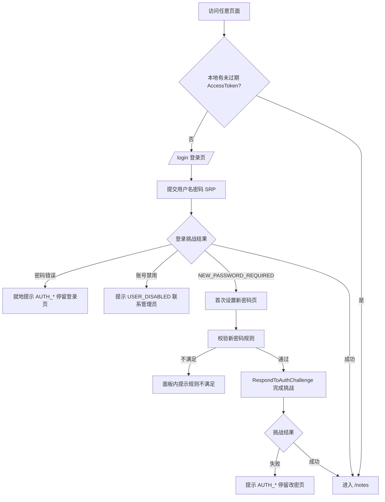
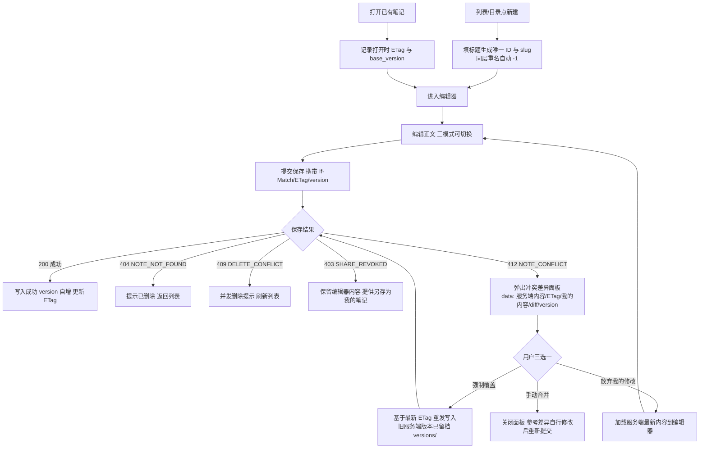
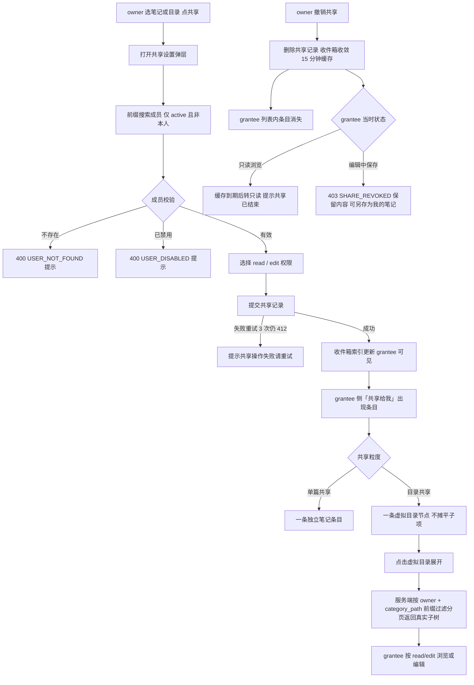
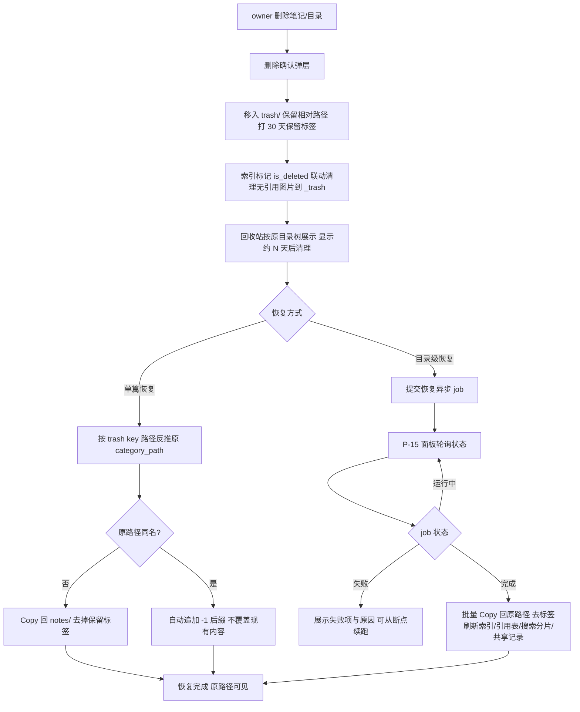
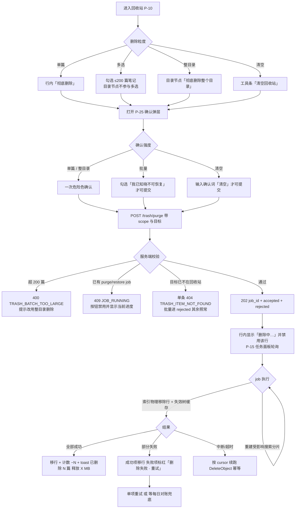
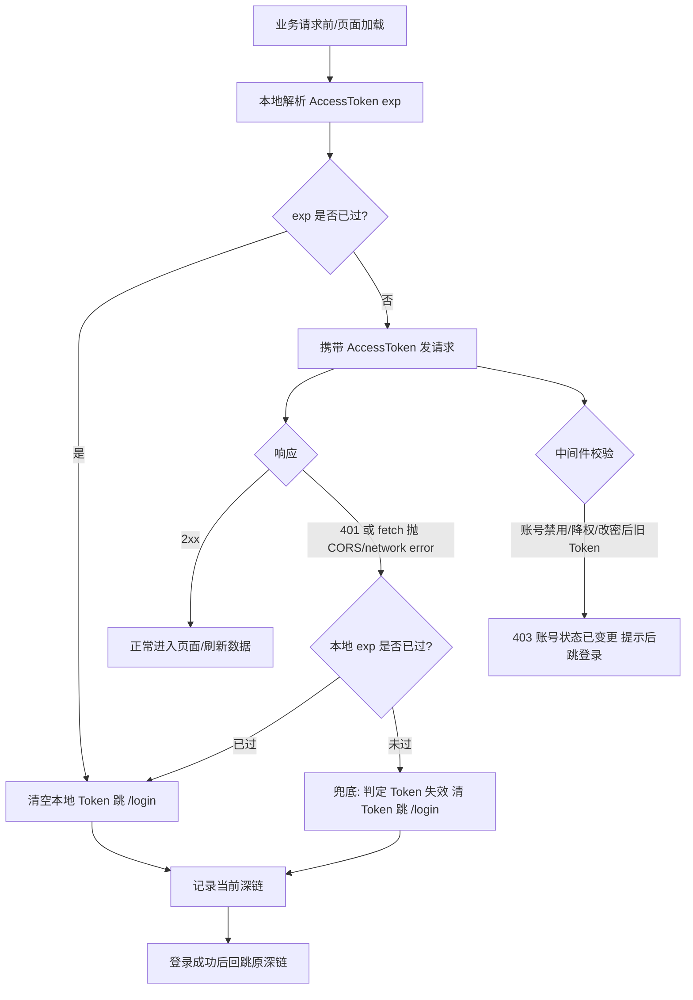

# 云笺 CloudJian — 页面清单与关键流程图 v0.6（线框输入版）

> **新人入口**：[docs/README.md](README.md)。

> 用途：直接开线框。本文档只列页面、面板、状态、流程与权限；**不画高保真、不写组件 CSS、不混入技术架构图**。
> 标注约定：
> - `TODO` = 方案/PRD 未定稿、需产品或前端路由设计确认的点。
> - 错误码为**示意**：全表随首个业务接口 PR 冻结（`error_codes.py` 为唯一真源，PRD T-A），原型不要自造码值语义。
> - 角色口径：`admin`/`user` 是账号角色（注册表为准）；`owner`/`grantee` 是内容角色；grantee 分 `read`/`edit`。

> **修订史**：文首变更说明已移至 [云笺-修订史归档.md](云笺-修订史归档.md)。


---

## A. 页面树

### A.1 应用路由（浏览器地址栏可直达、可刷新、可收藏）

```
/                          落地重定向：未登录 → /login；已登录 → /notes
/login                     登录页
/login?step=new-password   首次登录/重置后强制设置新密码（全屏状态，非独立路由；见 B.2 收口说明）
/notes                     主界面框架（目录树 + 中间区 + 右侧抽屉 + 顶栏）
/notes/:note_id            编辑器深链（打开指定笔记；来源 12.4 冒烟 /notes/abc）
/admin                     管理后台（非 admin 访问重定向 /notes）
（无 /error 路由：404/403/500 在主界面内渲染错误态 P-24，URL 保持原样；未知路径回落 /notes）
```

### A.2 页面内面板状态（不产生独立 URL 或仅带视图参数，属主界面内部状态）

```
/notes 主界面
├─ 左侧导航（树，可折叠）
│   ├─ 我的笔记（目录树，多级嵌套）
│   │   └─ 目录节点右键/行内操作：新建笔记、新建子目录、重命名、移动、共享、导出、删除
│   ├─ 共享给我（虚拟目录视图）
│   │   ├─ 目录级共享：一条虚拟目录节点，点进去才展开真实子结构（不摊平）
│   │   └─ 单篇共享：一条独立笔记条目
│   ├─ 回收站（按原目录树展示，不打平；支持恢复、彻底删除、多选、清空）
│   └─ 标签筛选（自由标签列表，点标签过滤）
├─ 中间区（同一框架内切换，非独立路由）
│   ├─ 目录列表态（默认）：笔记/子目录卡片或行列表、排序、分页、目录导出（无多选）
│   ├─ 编辑器态（对应 /notes/:note_id）
│   ├─ 搜索结果态：命中列表 + 摘要 + 「共享」徽标
│   ├─ 回收站树形态（顶部工具条：全选 / 已选 N 项 / 彻底删除所选 / 清空回收站）
│   └─ 共享给我展开态
├─ 右侧抽屉（互斥或并列，见 C 表）
│   ├─ 版本历史抽屉
│   ├─ 图片管理抽屉
│   └─ 笔记属性面板（标签 / 元信息 / 语言标注）
├─ 全局浮层 / 条
│   ├─ 会话到期横幅（顶栏单行）
│   ├─ 断网提示条（顶栏单行）
│   ├─ 异步任务面板（常驻入口 + 展开列表）
│   └─ 冲突差异面板（模态覆盖层）
└─ 弹层（Modal / Popover）
    ├─ 共享设置弹层
    ├─ 新建笔记 / 新建目录弹层
    ├─ 删除确认弹层
    ├─ 彻底删除确认弹层（单篇 / 批量 / 整目录 / 清空四型，含确认词与知情框）
    ├─ 另存为我的笔记弹层（共享被撤销后）
    ├─ 个人设置弹层（定稿：不做独立 /settings 路由）
    ├─ 导出参数弹层（范围选择：单篇 / 目录递归 / 仅该层）
    └─ 管理员新建用户弹层（/admin 内）

/admin 管理后台
├─ 用户列表视图（默认）
├─ 新建用户弹层
└─ 团队设置视图（新建笔记默认可见性、禁止公开）
```

### A.3 路由 vs 面板状态的判定规则

| 类别 | 判定 | 本文档落点 |
|---|---|---|
| 应用路由 | 浏览器可直接输入/刷新/回退；刷新后仍回到同一内容；登录态拦截发生在路由层 | B 章路由表 |
| 页面内面板状态 | 依附于某个路由存在；关闭后回到前一视图；刷新后由路由参数或默认视图重建 | A.2 树 + C 表「类型/触发方式」 |
| 全局条/横幅 | 不占路由，跨视图常驻；由全局状态（会话倒计时、网络状态）驱动 | C 表 P-17 / P-18 |

---

## B. 路由表

### B.1 CDN 深链 rewrite 的产品含义（源 10、11.1、12.4）

静态产物位于 CDN 后端 `/web/` 前缀；边缘 Function 把**无扩展名路径** `/`、`/login`、`/notes`、`/admin`、以及任意深链（如 `/notes/:note_id`）统一 rewrite 到 `/web/index.html` 返回 200。产品口径如下（不含 Terraform/Function 实现）：

1. **这是单页应用（SPA）**：所有业务深链由前端路由在浏览器侧解析；服务端不按路径返回不同 HTML。
2. **深链可刷新、可分享、可收藏**：用户从 `/notes/项目A/方案.md` 刷新浏览器不会白屏；登录态过期后重新登录，可回跳到原深链（US-02）。
3. **错误兜底必须由前端自己做**：服务端对合法深链恒返回同一份 index.html，因此「笔记不存在（404）」「无权限（403）」「路由不存在」都要前端路由守卫/接口状态落地到错误视图，不能依赖服务端 404 页面。
4. **例外边界（原型需知悉，不要画错）**：
   - `/web/` 下带扩展名但实际缺失的静态资源（如 `/web/missing.js`）由源站如实返回 404，**不**回退到 index.html；
   - 用户私有数据路径（`users/*`、`index.parquet`、`.dir_meta.json`、`assets/private/*`）在边缘直接 403 终态响应，不经过前端错误页；
   - 私有图不经 CDN，走服务端签发的临时预签名 URL（见 F.4）。
5. 前端 Router `basename="/"`，构建产物 base 指向 `/web/`，两者必须一致（源 10，P0-3）。

### B.2 前端路由一览

| 路由 | 类型 | 页面/面板 | 登录/权限要求 | 深链行为 | 关联 API（后端路由键，源 12.1） | 来源 |
|---|---|---|---|---|---|---|
| `/` | 应用路由 | 重定向：未登录→`/login`；已登录→`/notes` | — | 刷新/直达均先判登录态 | — | 源 10、11.1 |
| `/login` | 应用路由 | P-01 登录页 | 未登录；已登录访问则跳 `/notes` | 刷新停留登录页 | Cognito `USER_SRP_AUTH`（非 HTTP API 业务路由） | 源 4.2、10 |
| `/login?step=new-password` | 路由内全屏状态（已收口 R1） | P-02 首次设置新密码 | 登录 challenge `NEW_PASSWORD_REQUIRED`；无有效 Token | 刷新需重走 challenge，无有效 challenge 回 `/login`；完成后落 `/notes` | Cognito `RespondToAuthChallenge` | 源 4.2 |
| `/notes` | 应用路由 | P-03 目录列表（主界面默认视图） | 已登录；未登录重定向 `/login` | 刷新回到上次目录/视图（目录展开态仅存本地，PRD US-41） | `GET /notes`、`GET /dirs` | 源 6.2、10 |
| `/notes/:note_id` | 应用路由 | P-04 编辑器 | 已登录；对该笔记具备 read 及以上；无权限落 403 视图 | 直达打开指定笔记；404 落错误页；403 落无权限视图 | `GET /notes/{note_id}`、`PUT /notes/{note_id}`、`DELETE /notes/{note_id}` | 源 6.1、7.5、12.4 |
| `/notes?view=trash` | 路由内视图（已收口 R3，不拆子路由） | P-10 回收站 | 仅 owner 本人内容；彻底删除同样仅 owner | 刷新保留回收站树位置（树缓存 15 分钟，**彻底删除后服务端主动失效**） | `GET /dirs`（trash 分支）、`POST /trash/purge`（四型彻底删除）、目录恢复 job | 源 6.5、9.3.1 |
| `/notes?view=shared` | 路由内视图（已收口 R3，不拆子路由） | P-08 共享给我 | 已登录；有收件箱记录 | 刷新回到共享视图 | `GET /shares`（收件箱方向） | 源 7.2、7.3 |
| `/notes?q=<关键词>` | 路由内视图（已收口 R3） | P-11 搜索结果 | 已登录 | 刷新保留关键词与分页 | `GET /search` | 源 6.3 |
| `/notes/:note_id` 内触发 | 弹窗/抽屉 | P-05 冲突差异面板 | 同编辑器 | 不产生 URL；412 时弹出 | `PUT /notes/{note_id}`（412 `NOTE_CONFLICT`） | 源 7.5 |
| `/notes/:note_id` 内触发 | 抽屉 | P-06 版本历史抽屉 | 同编辑器；read 仅「对比」 | 不产生 URL | `GET /notes/{note_id}/versions`、`POST /notes/{note_id}/versions/{ts}/restore` | 源 6.4、7.4 |
| `/notes/:note_id` 内触发 | 抽屉 | P-07 图片管理抽屉 | 同编辑器；edit 仅可插图 | 不产生 URL | `POST /assets/presign`、`POST /assets/register`、`GET /assets/{asset_id}/url`、`POST /assets/urls`（批量，12.1 已登记） | 源 8.1、8.2、8.4、12.1 |
| `/notes` 内触发 | 抽屉/面板 | P-16 笔记属性面板 | 同编辑器；标签增删仅 owner/edit | 不产生 URL | 随 `PUT /notes/{note_id}` 落 Frontmatter | 源 2.2、5.2 |
| `/notes` 内触发 | 弹层 | P-09 共享设置弹层 | 仅 owner | 不产生 URL | `GET/POST/DELETE /shares` | 源 7.2 |
| `/notes` 内触发 | 全局面板 | P-15 异步任务面板 | 已登录；仅看本人 job | 不产生 URL；job 触发后常驻入口 | `POST /dirs/move`、`GET /exports/{job_id}`、目录恢复 job（`jobs/{job_id}.json` 轮询） | 源 6.1、6.5、6.6 |
| `/notes` 内触发 | 弹层/视图 | P-12b 导出任务进度 | 已登录；owner | 不产生 URL；同步导出直接下载，异步进面板 | `POST /exports`、`GET /exports/{job_id}` | 源 6.6 |
| `/admin` | 应用路由 | P-12 用户列表（后台默认）＋ P-13 团队设置视图 | 仅 `admin`；`user` 访问重定向 `/notes` 并提示无权限 | 刷新留在后台 | `GET/POST/PATCH/DELETE /admin/users`、`POST /admin/users/{sub}/reset` | 源 2.1、4.5、12.1 |
| 无独立路由（账号菜单弹层，已收口 R2） | 弹层 | P-14 个人设置 | 已登录；本人 | 刷新按路由重建 | `profile.json` 读写（语言/主题/时区/编辑器模式/排序/每页条数）；改密走 Cognito `ChangePassword` | 源 4.7、5.1、10 |
| 无独立路由（页内态） | 页面内视图 | P-24 错误态（404 笔记不存在 / 403 无权限 / 500 通用） | 已登录 | URL 不变，刷新沿用原路由；未知路径回落 `/notes` | 无（复用失败请求的 code） | 源 9.4、5.3.5 |


> **路由形态已收口（v0.2–v0.3）**：
> 1. **首登改密**用 `/login?step=new-password` 全屏状态，不新增独立路由。challenge 阶段没有 Token，独立 URL 被刷新只会得到一张死页；放在登录页的步骤里，回退与重试都天然归位。
> 2. **个人设置**保持账号菜单弹层，不做 `/settings`。它只有 6 项偏好 + 改密，没有深链与收藏需求，独立路由只会多一套权限与回填逻辑。
> 3. **回收站 / 共享给我 / 搜索**保持 `/notes` 视图参数，不拆 `/trash`、`/shared`。这三者都是主界面内的数据过滤，没有对外分享深链的场景；拆分会让「未登录、无权限、内容已删」三类判断各多一条分支。
> 4. **批量换签已登记**：`POST /assets/urls`（≤50 张）见方案 v1.13.3 K2、v1.13.4 12.1 路由表。v0.1 的 TODO-R4 称「12.1 未列」系误读，**该项撤销**（B.3 对照表同步补上）。
> 5. **不设 `/error` 路由**（v0.3）：404/403/500 统一用 P-24 页内错误态渲染，URL 保持原样，用户可直接改地址或后退；错误页做成独立路由会把「打开哪篇笔记失败」这个上下文丢掉，也会让 403 与 412 这两类专用态（无权限视图、冲突面板）多一条歧路。

### B.3 后端 8 组业务路由对照（源 12.1，仅作页面 ↔ API 溯源，非技术架构图）

| 后端路由键 | 服务对象页面/动作 |
|---|---|
| `GET /notes`、`POST /notes` | 目录列表分页、新建笔记 |
| `GET/PUT/DELETE /notes/{note_id}`、`POST /trash/purge` | 读正文、`If-Match` 更新、软删除；**回收站彻底删除（单篇/批量/目录/清空，202 + job）** |
| `GET /notes/{note_id}/versions`、`POST /notes/{note_id}/versions/{ts}/restore` | 版本列表、回滚 |
| `GET /search`、`GET /dirs`、`POST /dirs/move` | 搜索、目录树、目录搬移 job |
| `GET/POST/DELETE /shares` | 共享创建/查询/撤销 |
| `POST /assets/presign`、`POST /assets/register`、`GET /assets/{asset_id}/url`、`POST /assets/urls` | 上传签名、登记、单张换签、批量换签（≤50 张） |
| `GET/POST/PATCH/DELETE /admin/users`、`POST /admin/users/{sub}/reset` | 后台开号/禁用/调角色/重置密码 |
| `POST /exports`、`GET /exports/{job_id}` | 导出请求、导出任务轮询 |

---

## C. 页面清单表

> 优先级：P0 闭环必达；P1 应有；P2 可后置（对齐 PRD §1.2 成功标准）。
> 「权限要求」以服务端注册表/权限判定为准；界面隐藏入口不等于无权（源 4.3）。

| 页面ID | 名称 | 类型 | 路由/触发方式 | 可见角色 | 权限要求 | 入口 | 主要组件 | 主要状态 | 关联 API / 错误码（示意，待码表冻结） | 优先级 | 来源章节 |
|---|---|---|---|---|---|---|---|---|---|---|---|
| P-01 | 登录页 | 页面 | `/login`；401/Token 过期回跳 | 未登录 | 无 | 直接访问、过期跳转 | 用户名、密码、登录按钮、语言切换、错误提示区 | 默认 / 提交中 / 密码错(`AUTH_*`) / 账号禁用(`USER_DISABLED`) / 网络错 / 首登 challenge 跳转 | Cognito SRP；`AUTH_*`、`USER_DISABLED`、`INTERNAL_ERROR` | P0 | PRD §5 P-01；源 4.2、10 |
| P-02 | 首次设置新密码 | 页面（登录页内全屏状态，不新增路由） | 登录返回 `NEW_PASSWORD_REQUIRED` | 待改密用户 | challenge 未完成前不可进主界面 | 登录流程自动进入 | 新密码、确认密码、规则提示（8–20 位，含大写/小写/数字，不强制符号）、提交按钮 | 默认 / 规则不满足 / 提交中 / 失败(`AUTH_*`) | Cognito `RespondToAuthChallenge`；`AUTH_*` | P0 | PRD §5 P-02；源 4.2 |
| P-03 | 目录列表（主界面中间区） | 页面内视图 | `/notes`；左侧树点目录 | 全部已登录用户 | 可见自己的目录树；共享目录按权限 | 登录默认落地；树节点点击 | 目录/笔记列表、排序切换（更新时间/创建时间/标题）、分页器（20/50/100）、标签筛选、新建按钮、目录导出入口、搬移/共享/删除行内操作（无多选） | 正常 / 空态 / 骨架加载 / 分页 / 标签筛选结果空 / 搬移中子树只读(`JOB_RUNNING`) / 401 / 403 | `GET /notes`、`GET /dirs`、`POST /dirs/move`；`JOB_RUNNING`、`EXPORT_*`、`NOTE_NOT_FOUND` | P0 | PRD §5 P-03；源 6.1、6.2、6.6 |
| P-04 | 编辑器 | 页面（深链） | `/notes/:note_id`；列表点笔记；新建后进入 | owner、grantee(read/edit) | read 只读；edit/owner 可写 | 列表双击/新建按钮 | 三模式切换（纯编辑/分屏/WYSIWYG）、正文区、工具栏、保存状态、插图入口、版本/共享/导出/删除入口、归属提示行 | 未保存 / 保存中 / 已保存 / 412 冲突 / 403 撤销(`SHARE_REVOKED`) / 404 已删 / 网络错只读 / 只读态（read、搬移中、断网） | `GET/PUT/DELETE /notes/{note_id}`；`NOTE_CONFLICT`、`NOTE_NOT_FOUND`、`SHARE_REVOKED`、`JOB_RUNNING`、`NETWORK_OFFLINE` | P0 | PRD §5 P-04；源 2.4、7.5、7.3、10 |
| P-05 | 冲突差异面板 | 弹窗（模态覆盖层） | 保存返回 412 自动弹出 | 同编辑器 | 同编辑器权限 | P-04 保存触发 | 左右分屏 diff（服务端最新 vs 我的内容）、行级/字符级高亮、三选项：强制覆盖 / 放弃我的修改 / 手动合并 | 展示中 / 操作中 / 覆盖失败重试 | `PUT /notes/{note_id}`；`NOTE_CONFLICT`（data：服务端内容、ETag、我的内容、diff、version） | P0 | PRD §5 P-05；源 7.5、9.4 |
| P-06 | 版本历史抽屉 | 抽屉 | 编辑器右侧「历史版本」 | owner、grantee(read/edit) | read：仅「对比」，不渲染「回滚」（不置灰）；edit/owner：可回滚 | 编辑器工具栏/右侧入口 | 版本时间倒序列表、与当前版本对比视图、回滚按钮（按权限渲染） | 空（无历史）/ 加载 / 列表 / 对比态 / 回滚中 / 403 只读拦截 | `GET /notes/{note_id}/versions`、`POST .../restore`；`NOTE_NOT_FOUND`、`SHARE_FORBIDDEN` | P1 | PRD §5 P-06、US-11；源 6.4、7.4、T-E |
| P-07 | 图片管理抽屉 | 抽屉 | 编辑器右侧「图片库」 | owner；edit 仅在共享笔记插图；read 不可操作 | owner 可插入/删除；edit 不可删 owner 既有图；**任何角色都无可见性切换**（v0.6） | 编辑器右侧入口 | 缩略图（前端 canvas 生成）、大小、上传时间、**只读徽标「随笔记：公开/私有」**（点击无效，tooltip「想让这张图公开，请把笔记设为公开」）、「被 N 篇笔记引用，其中 M 篇为公开笔记」（M>0 时补一行黄色提示「该图在公开笔记中可见，无法单独收回」）、插入光标处、删除、上传中占位 | 空 / 加载 / 上传中 / 超限(`ASSET_TOO_LARGE`) / 私有图 URL 过期重签 / 越权 403 / M>0 共用提示 | `POST /assets/presign`、`POST /assets/register`、`GET /assets/{asset_id}/url`、`POST /assets/urls`；`ASSET_TOO_LARGE`、`ASSET_FORBIDDEN`、`SHARE_FORBIDDEN` | P1（上传/换签链路 P0） | PRD §5 P-07、US-22~25、US-39；源 8.1、8.2、8.4 |
| P-08 | 共享给我（虚拟目录视图） | 页面内视图 | 左侧树「共享给我」 | grantee（read/edit） | 按收件箱记录与命中权限；read 只读、edit 可写 | 左侧导航 | 虚拟目录节点（目录级共享一条）、独立笔记条目（单篇共享）、展开后真实子树、「共享」标识、owner 名 | 空 / 加载 / 已撤销只读态(`SHARE_REVOKED`) / 无权限 403 / 展开分页 | `GET /shares`（收件箱）、`GET /notes`（按共享前缀过滤）；`SHARE_FORBIDDEN`、`SHARE_REVOKED` | P0（视图与展开） | PRD §5 P-08、US-12~16；源 7.2、7.3 |
| P-09 | 共享设置弹层 | 弹窗 | 笔记/目录行内「共享」按钮 | 仅 owner | grantee 入口禁用；403 `SHARE_FORBIDDEN` | 编辑器工具栏、列表行操作、目录节点操作 | 成员搜索框（仅 active、非本人、无在线状态）、成员列表、read/edit 选择、已共享成员列表、撤销按钮；**笔记场景下方独立一段「公开链接」**：状态行（未公开 / 已公开）、「生成公开链接」按钮、链接只读框 + 复制、{{已公开时}}「收回」按钮 + 一行警告「收回后链接立即失效，正在访问的人刷新即打不开」；目录场景不显示该段 | 默认 / 搜索中 / 提交中 / 成员不存在(`USER_NOT_FOUND`) / 成员禁用(`USER_DISABLED`) / 提交失败 / **公开：生成中（job 轮询）/ 已公开（复制成功反馈「已复制」2 秒）/ 收回确认 / 禁止公开（整段置灰 + 「管理员已禁止公开笔记」）** | `GET/POST/DELETE /shares`、`POST /notes/{note_id}/visibility`；`USER_NOT_FOUND`、`USER_DISABLED`、`SHARE_*`、`NOTE_VISIBILITY_FORBIDDEN`、`JOB_RUNNING` | P0 | PRD §5 P-09、US-38、US-45；源 7.2、8.1、T-07 |
| P-10 | 回收站 | 页面内视图 | 左侧树「回收站」 | owner（仅本人已删内容） | grantee 不可见；彻底删除仅 owner 本人 | 左侧导航 | 顶部工具条（全选 / 已选 N 项 / 彻底删除所选 / 清空回收站）、原目录树（不打平）、行内复选框、单篇/目录条目、「约 N 天后清理」、单篇恢复、**单篇彻底删除**、目录级一键恢复、**整目录彻底删除**、剩余天数 | 空 / 加载 / 树展开 / 多选态 / 无选中（工具条禁用）/ 恢复 job 进行中 / **删除中(job)** / **部分成功** / 删除失败可重试 / 重名 `-1` 提示 / 409 `JOB_RUNNING` | `GET /dirs`（trash 分支）、`POST /trash/purge`、恢复 job（复用 jobs 机制）；`DIR_*`、`JOB_RUNNING`、`DIR_MOVE_FAILED`、`TRASH_PURGE_*`（示意） | P0（单篇恢复）/ P1（目录级恢复、四型彻底删除） | PRD §5 P-10、US-17、US-18、US-43~47；源 6.5、9.3.1 |
| P-11 | 搜索结果 | 页面内视图 | 顶部搜索框提交 | 全部已登录用户 | 仅返回有权限内容；共享结果带徽标与 owner | 顶部搜索框 | 关键词框、结果列表（标题/路径/前后各 60 字摘要）、分页、`has_more` 续查、「共享」徽标 | 空（未输入）/ 加载 / 无结果 / 分页 / 超 512KB 截断提示 / 网络错 | `GET /search`；`INTERNAL_ERROR` | P1 | PRD §5 P-11、US-27、US-28；源 6.3 |
| P-12 | 管理后台·用户列表 | 页面（后台视图） | `/admin` | 仅 admin | 非 admin 重定向 `/notes` | 侧栏/账号菜单后台入口（admin 可见） | 用户表格（用户名、角色、状态、创建时间）、新建用户、禁用/启用、重置密码、调角色 | 空 / 加载 / 无权限重定向 / 操作成功 / 操作失败 | `GET/POST/PATCH/DELETE /admin/users`、`POST /admin/users/{sub}/reset`；`QUOTA_*`、`AUTH_*` | P0（开号/禁用）/ P1（重置/调角色） | PRD §5 P-12、US-29~32；源 2.1、4.5、4.7 |
| P-13 | 管理后台·团队设置 | 页面（后台视图） | `/admin` 内切换 | 仅 admin | 非 admin 不可见 | 后台标签页 | **新建笔记默认可见性**（私有 / 公开）单选、**禁止公开**开关（开启后新建笔记强制私有，且所有公开入口置灰）、两行说明文案（默认值只影响新建、不迁移存量；禁止公开只拒绝不静默改写） | 加载 / 保存中 / 保存失败 / 配置回显 / **开关联动（禁止公开开启后默认可见性选择器禁用）** | 团队配置读写（`_team_config.json` 方向，字段 `default_note_visibility` / `force_private`）；`TEAM_CONFIG_CONFLICT`、`INTERNAL_ERROR` | P1 | PRD §5 P-13、US-26；源 8.1、T-06 |
| P-14 | 个人设置 | 弹层（定稿，无独立路由） | 账号菜单 | 全部已登录用户；本人 | — | 顶栏账号菜单 | 改密（原密码+新密码）、语言选择、主题切换、编辑器模式默认、列表排序默认、每页条数、时区 | 默认 / 保存中 / 保存失败 / 改密成功后清 Token 跳登录 | `profile.json` 读写；Cognito `ChangePassword` + `GlobalSignOut`；`AUTH_*` | P1（语言/主题 P0 即时生效） | PRD §5 P-14、US-33~35、US-41；源 4.7、5.1、10 |
| P-15 | 异步任务面板 | 全局面板 | job 触发后顶栏常驻入口 | 全部已登录用户；仅本人 job | — | 顶栏任务图标/横幅 | job 列表（类型：目录搬移/目录恢复/**彻底删除**/批量导出）、进度 `cursor/total`、状态、失败原因、重试/续跑入口、完成后下载链接（导出） | 运行中（轮询）/ 完成 / 失败可续跑 / 失败不可恢复 / 空（无任务） | `POST /dirs/move`、`GET /exports/{job_id}`、恢复 job 轮询、`POST /trash/purge`；`JOB_RUNNING`、`DIR_MOVE_FAILED`、`EXPORT_JOB_FAILED`、`TRASH_PURGE_FAILED`（示意） | P1（搬移/导出、彻底删除）；目录恢复与彻底删除同此面板 | PRD §5 P-15、US-06、US-20、US-37、US-43~45；源 6.1、6.5、6.6、9.3.1 |
| P-16 | 笔记属性面板 | 右侧面板 | 编辑器右侧「属性」 | owner、edit 可改标签；read 只读展示 | 标签增删：owner/edit；read 不可操作 | 编辑器右侧入口 | 标签输入/删除（≤20 个、单个 ≤24 字符）、元信息（创建/更新时间、note_id、语言标注 `lang`） | 空标签 / 超限拒绝提示 / 加载元信息 / 只读 | 随 `PUT /notes/{note_id}`；`NOTE_*`（示意） | P1 | PRD §5 P-16、US-08；源 2.2、5.2、T-03 |
| P-17 | 会话到期横幅 | 全局条（顶栏单行） | 剩余 ≤10 分钟自动出现；全局 | 全部登录用户 | — | 顶栏 | 剩余时间文案（`{{count}}` 插值）、「立即保存」按钮；**无「续期」按钮**；单行省略、弹性宽度 | 倒计时中 / 已到期跳登录 / 草稿恢复提示（版本一致回填 / 不一致进差异面板） | `AUTH_TOKEN_EXPIRED`（示意）；本地 `exp` 预判 | P1 | PRD §5 P-17、US-36；源 10、T-09、T-G |
| P-18 | 断网提示条 | 全局条（顶栏单行） | 网络断开自动出现 | 全部登录用户 | — | 顶栏 | 断网提示「网络已断开，内容仍保存在本地草稿」；编辑器转只读；恢复网络后同步/差异回填 | 断网只读 / 恢复后回填中 / 同步失败进差异面板 | `NETWORK_OFFLINE`（前端判定） | P1 | PRD §5 P-18、US-42；源 10、T-H |
| P-19 | 新建笔记 / 新建目录弹层 | 弹窗 | 列表/树「新建」按钮 | owner 两者都可；**共享目录内 edit 只可新建笔记**（不可建子目录） | read 不可新建 | 列表工具栏、目录节点操作 | 标题输入（目录为名称）、同级重名自动 `-1`、确认/取消 | 默认 / 校验中 / 提交失败 | `POST /notes`、`GET /dirs`；`JOB_RUNNING`（搬移中子树禁新建） | P0（新建笔记）/ P1（新建目录） | PRD US-05、US-16；源 5.2、7.4 |
| P-20 | 删除确认弹层 | 弹窗 | 笔记/目录「删除」 | owner；grantee 不可见 | — | 列表行操作、树节点操作、编辑器删除入口 | 删除范围说明（移入回收站、保留 30 天）、确认/取消 | 默认 / 提交中 / 并发删除冲突(`DELETE_CONFLICT`) | `DELETE /notes/{note_id}`；`DELETE_CONFLICT`、`NOTE_NOT_FOUND` | P0 | PRD §7；源 6.5、5.3.5 |
| P-21 | 另存为我的笔记弹层 | 弹窗 | 保存遇 403 `SHARE_REVOKED` 后提供 | 被撤销方（原 grantee） | — | P-04 撤销态工具栏 | 当前内容转存为本人新笔记的确认入口、标题/目标目录选择 | 展示 / 转存中 / 转存失败 | `POST /notes`（另存）；`SHARE_REVOKED` | P1 | PRD §2.2、§7、US-14；源 7.3、T-10 |
| P-22 | 导出参数弹层 | 弹窗 | 列表/笔记「导出」 | owner；grantee 入口禁用 | 共享目录不可导出 | 列表工具栏、编辑器菜单 | 范围选择（单篇 / 目录递归 / 仅该层）、同步/异步提示、进度跳转 | 默认 / 打包中（同步）/ 转异步 job / 链接过期可重新生成 | `POST /exports`、`GET /exports/{job_id}`；`EXPORT_*`、`SHARE_FORBIDDEN` | P0（单篇 .md）/ P1（目录 ZIP） | PRD US-19~21；源 6.6 |
| P-23 | 管理员新建用户弹层 | 弹窗 | `/admin`「新建用户」 | 仅 admin | — | 用户列表工具栏 | 用户名、初始密码、可选邮箱、角色选择、确认 | 默认 / 校验中 / 提交失败（重名/配额） | `POST /admin/users`；`QUOTA_*`、`AUTH_*` | P0 | PRD US-29；源 4.5 |
| P-24 | 错误态（页内渲染） | 页面内视图（非独立路由） | 打开笔记/目录失败、未知路径、接口 500、未知 code | 全部 | — | 路由守卫、接口拦截器、编辑器加载失败 | 错误说明（按 code 查三语文案，未知回退 `errors.unknown` + code 原文）、返回首页/重试按钮 | 404 不存在 / 403 无权限 / 500 通用 / 网络错误 | `NOTE_NOT_FOUND`、`SHARE_FORBIDDEN`、`INTERNAL_ERROR`、未知 code | P1 | 源 9.4、5.3.5、PRD §7 |

| P-25 | 彻底删除确认弹层 | 弹窗 | 回收站行内「彻底删除」/ 工具条「彻底删除所选」「清空回收站」/ 目录节点「彻底删除整个目录」 | owner（仅本人回收站） | — | P-10 回收站 | 四型标题与正文：单篇（标题+路径）/ 批量（按目录分组列前 5 篇 +「另有 N 篇」+ 知情勾选框）/ 整目录（子树笔记数 + 图片数 + 可释放容量）/ 清空（总数 + 容量 + 确认词输入）。固定三行不可逆说明：内容不可恢复 / 版本历史与仅被它引用的图片一并删除 / 已发出的共享立即失效。主按钮危险色，次按钮取消 | 单篇 / 批量 / 整目录 / 清空（确认词 trim 后不等于「清空」则按钮禁用）/ 提交中 / 409 `JOB_RUNNING` / 提交失败 | `POST /trash/purge`；`TRASH_PURGE_SCOPE_INVALID`、`TRASH_BATCH_TOO_LARGE`、`TRASH_BATCH_EMPTY`、`TRASH_ITEM_NOT_FOUND`、`TRASH_PURGE_FAILED`、`JOB_RUNNING` | P1 | PRD §5 P-25、US-43~46；源 6.5、9.3.1 |
| P-26 | 公开笔记确认弹层 | 弹窗 | 笔记菜单「设为公开」/ P-09「生成公开链接」 | 仅 owner（仅本人笔记） | grantee 无入口；共享笔记不可由 grantee 公开 | 编辑器更多菜单、列表行操作菜单、P-09 公开链接区 | 标题「公开这篇笔记？」+ 三行后果说明（任何人持链接可匿名阅读正文与全部图片 / 图片会一并转为公开可访问 / 搜索与目录结构不对外暴露）+ {{若有共用图}}「本篇有 M 张图片同时被其他笔记引用，公开后在那些笔记中也变为公开」+ 主按钮「公开」/ 次按钮「取消」 | 默认 / 提交中（202 后转 P-15 任务面板）/ 禁止公开（按钮禁用 + 「管理员已禁止公开笔记」）/ 失败（`JOB_RUNNING` 显示当前任务进度） | `POST /notes/{note_id}/visibility`；`NOTE_VISIBILITY_FORBIDDEN`、`JOB_RUNNING`、`NOTE_FORBIDDEN` | P1 | PRD §5 P-26、US-23、US-45；源 8.1、9.3.2 |
---

## D. 权限可见性矩阵

取值：**可编辑**＝可读写/可操作；**只读**＝可见可阅，写操作入口不渲染或禁用；**不可见**＝入口不出现，直接请求接口 403；**—**＝不适用。
说明：admin 作为某篇笔记的 owner 时与普通 owner 边界一致；admin 作为 grantee 时与普通 grantee 边界一致（服务端注册表为准，源 4.3）。后台相关行单独标注。

### D.1 内容页与操作矩阵

| 页面 / 操作 | admin·owner | user·owner | admin·grantee read | user·grantee read | admin·grantee edit | user·grantee edit |
|---|---|---|---|---|---|---|
| P-01 登录 / P-02 改密 | 可编辑（本人账号） | 可编辑（本人账号） | 同左 | 同左 | 同左 | 同左 |
| P-03 目录列表·浏览自己的目录树 | 可编辑 | 可编辑 | — | — | — | — |
| P-04 编辑器·查看正文 | 可编辑 | 可编辑 | 只读 | 只读 | 可编辑 | 可编辑 |
| P-04 编辑器·编辑正文/保存 | 可编辑 | 可编辑 | 不可见（保存入口不渲染） | 不可见 | 可编辑 | 可编辑 |
| P-19 在目录内新建笔记 | 可编辑 | 可编辑 | 不可见 | 不可见 | 可编辑（共享目录内，继承权限） | 可编辑（共享目录内，继承权限） |
| P-19 在目录内新建子目录 | 可编辑 | 可编辑 | 不可见 | 不可见 | **不可见**（`edit` 无 `.dir_meta.json` 写权限，v1.13.5 P-A） | **不可见** |
| P-06 版本历史·查看列表与对比 | 可编辑 | 可编辑 | 只读（仅「对比」，无回滚按钮） | 只读（仅「对比」） | 可编辑 | 可编辑 |
| P-06 版本历史·回滚 | 可编辑 | 可编辑 | 不可见（按钮不渲染，非置灰） | 不可见 | 可编辑 | 可编辑 |
| P-20 删除笔记/目录 | 可编辑 | 可编辑 | 不可见 | 不可见 | 不可见（不能删根共享目录/不能移出范围） | 不可见 |
| P-09 共享设置·查看/增删成员/撤销 | 可编辑 | 可编辑 | 不可见 | 不可见 | 不可见 | 不可见 |
| P-22 导出（单篇 .md / 目录 ZIP） | 可编辑 | 可编辑 | 不可见 | 不可见 | 不可见 | 不可见 |
| P-07 图片·在笔记中插图 | 可编辑 | 可编辑 | 不可见 | 不可见 | 可编辑（落笔记 owner 前缀） | 可编辑（落笔记 owner 前缀） |
| P-07 图片·删除既有图片 | 可编辑 | 可编辑 | 不可见 | 不可见 | 不可见（不得操作 owner 既有图） | 不可见 |
| P-07 图片·可见性切换 | 不可见（v0.6 取消，图片跟随笔记，无入口） | 不可见 | 不可见 | 不可见 | 不可见 | 不可见 |
| P-09 公开链接·生成/收回 | 可编辑（仅本人笔记） | 可编辑（仅本人笔记） | 不可见 | 不可见 | 不可见（grantee 不能公开他人笔记） | 不可见 |
| P-26 公开笔记确认 | 可编辑（仅本人笔记） | 可编辑（仅本人笔记） | 不可见 | 不可见 | 不可见 | 不可见 |
| P-16 标签增删 | 可编辑 | 可编辑 | 只读（标签仅展示） | 只读 | 可编辑 | 可编辑 |
| P-10 回收站（本人已删内容） | 可编辑 | 可编辑 | 不可见 | 不可见 | 不可见 | 不可见 |
| P-25 彻底删除（单篇/批量/整目录/清空） | 可编辑（仅本人回收站） | 可编辑（仅本人回收站） | 不可见 | 不可见 | 不可见 | 不可见 |
| P-08 共享给我·浏览收件箱 | — | — | 只读 | 只读 | 可编辑（按命中 edit 权限） | 可编辑 |
| P-11 搜索·命中共享内容 | 可编辑（自己内容） | 可编辑（自己内容） | 只读 | 只读 | 可编辑 | 可编辑 |
| P-14 个人设置（本人偏好/改密） | 可编辑 | 可编辑 | 同左 | 同左 | 同左 | 同左 |

### D.2 管理后台矩阵

| 页面 / 操作 | admin | user | 未登录 |
|---|---|---|---|
| `/admin` 入口与页面 | 可编辑 | 不可见（访问路由重定向 `/notes`） | 不可见（重定向 `/login`） |
| P-12 用户列表 / 新建用户(P-23) / 禁用启用 / 调角色 | 可编辑 | 不可见 | 不可见 |
| 重置他人密码 | 可编辑（P1） | 不可见 | 不可见 |
| P-13 团队设置（新建笔记默认可见性 / 禁止公开） | 可编辑 | 不可见 | 不可见 |
| 自助改密（P-14） | 可编辑 | 可编辑 | 不可见 |

### D.3 权限边界备注（原型文案依据）

- 命中多处共享取最高等级：`edit` > `read`（源 7.3）。
- 单篇共享 > 目录共享（递归继承）> 无（源 7.3）。
- grantee 即使 `edit`：不能改共享设置、不能删根共享目录、不能把笔记移出共享范围（源 7.4）。
- 共享被撤销：编辑中保存 → 403 `SHARE_REVOKED`（不走 412），保留编辑器内容并给「另存为我的笔记」；只读浏览 15 分钟缓存收敛后转「共享已结束」态（源 7.3、T-10）。
- 界面隐藏入口不等于无权；服务端逐请求校验（源 4.3、11.2）。
- **彻底删除只看内容归属，不看账号角色**：admin 也只是自己内容的 owner，系统**不提供**「代删他人回收站」「后台清空某用户回收站」的入口；`POST /trash/purge` 以 `users/{uuid}/trash/` 为硬前缀，跨前缀一律 403 `TRASH_FORBIDDEN`（源 9.3.1）。
- **彻底删除与共享的关系**：共享给我的内容不进我的回收站；我删自己的内容时，已发出的共享记录立即失效，purge 时兜底清理 `shares/*.json` 与收件箱条目，对方最长 15 分钟内消失（源 6.5、7.3）。

---

## E. 状态清单

> 通用基线（每页都要具备，源 10、PRD §7）：正常态、空态、加载态、错误态；列表页另需分页；>200 条虚拟滚动。
> 下表按页面列出**需要原型画出**的状态；「—」表示该页面不适用，注明原因。

| 页面ID | 正常 | 空态 | 加载 | 分页 | 无权限 | 401 | 412 | 403 | 异步 job 进行中/失败/完成 | 私有图 URL 过期 | 三语切换布局风险 |
|---|---|---|---|---|---|---|---|---|---|---|---|
| P-01 登录 | ✅ | —（无需空态） | ✅ 提交中 | — | — | 登录页自身不跳 401 | — | ✅ 账号禁用提示 | — | — | 日/英账号密码标签与按钮变长；错误提示行弹性换行 |
| P-02 改密 | ✅ | — | ✅ 提交中 | — | — | — | — | ✅ 规则/挑战失败 | — | — | 密码规则说明文案长度差异 |
| P-03 目录列表 | ✅ | ✅ 无笔记/无目录引导 | ✅ 列表骨架 | ✅ 默认 20/页，排序切换 | ✅ 共享目录只读态 | ✅ 拦截跳登录 | — | ✅ 越权访问目录 | ✅ 搬移中子树只读；job 进度在 P-15 | — | 树节点标题长文本省略；排序按 `Intl.Collator`；日英路径名换行 |
| P-04 编辑器 | ✅ 已保存/未保存 | —（新建即正文区） | ✅ 正文骨架 | — | ✅ read 只读界面 | ✅ 跳登录回深链 | ✅ 弹 P-05 | ✅ `SHARE_REVOKED` 转存；`SHARE_FORBIDDEN` | ✅ 保存触发的后台版本写入无前端 job；插图/导出走对应面板 | ✅ 正文内私有图失败静默重签一次，连续失败显示重试图标 | 三模式工具栏按钮换行；日英提示文案宽度；正文不翻译 |
| P-05 冲突面板 | ✅ diff 展示 | — | ✅ 操作中 | — | 同 P-04 | ✅ | 本面板即 412 落点 | ✅ | — | — | diff 双栏在长文案下的宽度；三选项按钮标签长度 |
| P-06 版本抽屉 | ✅ 列表/对比 | ✅ 无历史版本 | ✅ 列表骨架 | ✅ 版本多则分页/滚动 | ✅ read 隐藏回滚 | ✅ | — | ✅ 不可读版本 403 | ✅ 回滚中状态 | — | 版本时间戳按 `Intl.DateTimeFormat(locale/tz)`；相对时间文案 |
| P-07 | 图片抽屉 | ✅ 网格/列表 | ✅ 无图片 | ✅ 缩略灰块 | ✅ 图片多分页/虚拟滚动 | ✅ edit 不可删既有图 | ✅ | — | ✅ 越权 asset 403 | ✅ 上传中；可见性徽标随笔记（只读，无切换入口） | ✅ 私有图加载失败→静默重签；批量 ≤50 张换签 | 缩略图标签（大小/时间/引用数）三语长度；「被 N 篇笔记引用，其中 M 篇为公开」复数插值 |
| P-26 | 公开笔记确认 | ✅ 默认态 | — | ✅ 提交中 | — | ✅ 非 owner 打不开 | ✅ | — | ✅ `NOTE_VISIBILITY_FORBIDDEN`（按钮禁用 + 说明，不弹错误） | ✅ 409 `JOB_RUNNING`（显示当前 job 进度） | — | 三行后果说明在日/英下更长，弹层最大宽度放宽；共用图提示按 M 动态插值 |
| P-08 共享给我 | ✅ 虚拟目录+条目 | ✅ 无共享内容引导 | ✅ 收件箱骨架 | ✅ 展开后子树分页 | ✅ 非本人共享不可见 | ✅ | — | ✅ 已撤销/无权限 | — | ✅ 共享笔记内私有图按 note 引用换签 | 虚拟目录名（owner + 目录路径）较长；徽标文案长度 |
| P-09 | 共享弹层 | ✅ 成员列表 + 公开链接区（未公开） | ✅ 无匹配成员 | ✅ 搜索中 | ✅ 成员多则分页/搜索 | ✅ 非 owner 打不开 | ✅ | — | ✅ `SHARE_FORBIDDEN` / `NOTE_VISIBILITY_FORBIDDEN` | ✅ 撤销后 15 分钟收敛提示；公开生成中转 job 进度 | ✅ 已公开态（链接框 + 复制反馈 + 收回按钮） | 成员搜索占位符、read/edit 文案长度；链接框长 URL 省略中间 |
| P-10 回收站 | ✅ 原目录树 + 多选态（含「已选 N 项」工具条） | ✅ 回收站空引导 / ✅ 清空后空态 | ✅ 树骨架 | ✅ 树内条目分页 | ✅ 仅本人 | ✅ | — | ✅ 跨前缀 403 | ✅ 目录级恢复 job：进行中/失败续跑/完成；单篇恢复同步；**彻底删除 job：删除中/部分成功/失败重试** | — | 「约 N 天后清理」相对时间复数与文案长度；「已选 N 项」与「另有 N 篇」插值 |
| P-11 搜索 | ✅ 结果列表 | ✅ 无结果引导 | ✅ 结果骨架 | ✅ 20/页，`has_more` | ✅ 越权结果不返回 | ✅ | — | — | — | — | 摘要 60 字在日文下字数/宽度；「共享」徽标 |
| P-12 后台用户 | ✅ 用户表 | ✅ 无用户 | ✅ 表格骨架 | ✅ 分页 | ✅ 非 admin 重定向 | ✅ | — | ✅ 非 admin 403/重定向 | ✅ 禁用/重置 ≤60 秒生效说明 | — | 表头与状态文案三语长度 |
| P-13 | 团队设置 | ✅ 配置回显（私有/公开单选 + 禁止公开开关） | — | ✅ 加载 | — | ✅ 非 admin | ✅ | — | ✅ `TEAM_CONFIG_CONFLICT`（提示后回显服务端值） | ✅ 保存中 | ✅ 禁止公开开启 → 默认可见性选择器禁用 | 说明文案较长注意换行；开关与单选禁用态对比度 |
| P-14 个人设置 | ✅ 表单回显 | — | ✅ 保存中 | — | — | ✅ 改密成功清 Token | — | — | — | — | 选项标签三语长度；语言/主题名按本地文案展示 |
| P-15 异步任务面板 | ✅ 任务列表 | ✅ 无任务 | — | ✅ 任务多则分页 | ✅ 仅本人 job | ✅ | — | ✅ | ✅ 核心状态：运行中（轮询进度）/ 完成 / 失败可续跑 / 失败终止 | — | 任务类型/失败原因文案长度；进度条旁百分比 |
| P-16 属性面板 | ✅ 标签+元信息 | ✅ 无标签 | — | — | ✅ read 只读 | ✅ | — | — | — | — | 标签字符上限提示；日期格式本地化 |
| P-17 到期横幅 | ✅ 倒计时中 | — | — | — | — | ✅ 到期跳登录 | — | — | ✅ 草稿回填：一致直接回填 / 不一致进差异面板 | — | 日/英文案长 40%+，单行省略、弹性宽度，禁止写死像素（T-G） |
| P-18 断网提示条 | ✅ 断网只读 | — | — | — | — | — | — | — | ✅ 恢复后回填/差异同步 | — | 断网提示文案长度；恢复后状态文案 |
| P-19 新建弹层 | ✅ 表单 | — | ✅ 提交中 | — | ✅ read 不可新建 | ✅ | — | ✅ 搬移中 409 禁写 | ✅ 搬移 job 期间按钮禁用 | — | 标题占位符/重名提示文案 |
| P-20 删除确认 | ✅ 确认框 | — | ✅ 提交中 | — | ✅ grantee 不可见 | ✅ | — | ✅ | — | — | 30 天清理说明文案 |
| P-21 另存为弹层 | ✅ 表单 | — | ✅ 转存中 | — | — | ✅ | — | ✅ 原撤销态 | — | — | 转存说明文案 |
| P-22 导出弹层 | ✅ 范围选择 | — | ✅ 打包中（同步） | — | ✅ 共享目录拒绝 | ✅ | — | ✅ 共享内容 403/400 | ✅ 大批量转异步，进度进 P-15；链接 10 分钟有效 | — | 范围选项、超限提示文案 |
| P-23 新建用户弹层 | ✅ 表单 | — | ✅ 提交中 | — | ✅ 非 admin | ✅ | — | — | — | — | 角色选项、初始密码规则文案 |
| P-24 错误页 | ✅ 按 code 展示 | — | — | — | ✅ 403 视图 | ✅ 兜底跳登录 | — | ✅ 403 视图 | — | — | 未知 code 回退 `errors.unknown` + code 原文；错误页文案三语 |
| P-25 彻底删除确认弹层 | ✅ 四型：单篇 / 批量 / 整目录 / 清空 | — | ✅ 提交中 | — | ✅ 非 owner 打不开 | ✅ | — | ✅ `TRASH_FORBIDDEN` | ✅ 409 `JOB_RUNNING`（显示当前 job 进度） | — | 确认词「清空」在日/英下用本地语（`Empty` / `空にする`），宽度预留；批量分组长标题省略 |

**跨页面通用风险（原型走查必看）**

- **401 两条触发路径**：本地解析 `exp` 到期直接跳；收到 401 或网络/CORS 错误且本地 `exp` 已过兜底跳（网关 401 可能不带 CORS 头，源 G2）。跳登录后回原深链。
- **三语切换布局风险**：日/英文案比中文长 20–60%，按钮与横幅用最小宽度 + 自适应，不写死像素；日期/数字/排序走 `Intl`；切换即时生效不刷新（源 9.2、9.7、T-G）。
- **私有图 URL 过期**：5 分钟签名有效期；渲染失败静默重签一次；连续失败展示重试图标；跨前缀/未被引用 asset 一律 403（源 8.1、19.5）。
- **异步 job 展示底线**：必须有轮询状态（运行中进度 / 完成 / 失败可续跑），不允许「点击后无反馈」；失败显示失败项与原因（源 6.1、6.5、6.6、PRD §7）。
- **断网**：编辑器转只读、API 动作明确失败（`NETWORK_OFFLINE`），不做乐观假保存；本地草稿 ≤256KB、最近一篇、debounce 5 秒（源 10、T-H、T-B）。
- **彻底删除的反馈底线**：提交后必须有行内「删除中…」+ 任务面板进度；完成后左树计数立即 −N（不等 15 分钟缓存）；部分失败必须逐项标出并可重试，不允许整页静默刷新了事（源 9.3.1）。

---

## F. 关键流程图（Mermaid）

> 仅画用户可见流程与分支；不含后端架构、存储拓扑、CI/CD。错误码为示意。

### F.1 登录与首次改密



### F.2 新建 / 编辑 / 保存与 412 冲突三选项



### F.3 共享创建、撤销与「共享给我」虚拟目录展开



### F.4 图片上传（前缀随笔记）、笔记公开/私有切换与私有图预签名重签

```mermaid
flowchart TD
    A[编辑器粘贴/拖拽/选择图片] --> B[前端校验 ≤10MB]
    B -- 超限 --> B1[提示 ASSET_TOO_LARGE 不进入上传]
    B -- 通过 --> C[读当前笔记可见性<br/>无「选择可见性」步骤]
    C --> D[POST /assets/presign 带 note_id 不带可见性]
    D --> F[返回预签名 URL 与目标前缀 public/ 或 private/]
    F --> G[POST /assets/register 登记引用关系]
    G --> H[光标处插入图片]
    H --> H1{笔记可见性}
    H1 -- 公开 --> H2[插入 CDN 公开链接]
    H1 -- 私有 --> H3[插入 asset://{asset_id} 占位]
    H3 --> I[渲染时 GET /assets/{id}/url?note_id= 换 5 分钟签名 URL<br/>批量 ≤50 张走批量接口]
    I --> J{换签结果}
    J -- 200 --> K[渲染图片]
    J -- 403 未引用/跨前缀 --> L[拒绝渲染 不裂图越权]
    J -- URL 过期/渲染失败 --> M[静默重签一次]
    M --> N{重试结果}
    N -- 成功 --> K
    N -- 仍失败 --> O[展示重试图标 可手动重试]
    P[笔记菜单 设为公开] --> P1[P-26 公开确认弹层]
    P1 -- 确认 --> P2[POST /notes/{id}/visibility 返回 202 + job_id]
    P2 --> P3[visibility_migrate job<br/>重算该篇所有图派生可见性<br/>需变更的 Copy+Delete 换前缀<br/>改写本篇正文链接形态]
    P3 --> P4{全部成功?}
    P4 -- 是 --> P5[生成 public_token 显示 /p/{token}<br/>P-09 公开链接区可复制]
    P4 -- 部分失败 --> P6[P-15 显示 partial 可重试 不整篇回滚]
    P1 -- 管理员禁止公开 --> P7[400 NOTE_VISIBILITY_FORBIDDEN 按钮禁用并说明]
    P5 --> Q[收回私有：删 public_token + CDN 失效<br/>本篇图迁回 private 旧链接 403]
```

### F.5 删除进回收站、单篇恢复与目录级异步恢复



### F.5a 彻底删除（单篇 / 批量 / 整目录 / 清空）



**关键点**：30 天标签规则仍然保留，彻底删除不是「绕过生命周期」，而是**提前执行同一条物理删除**；因此即使 purge job 失败，30 天后对象仍会被兜底清理，不会永久滞留（源 6.5、10.6）。

### F.6 目录搬移异步 job

```mermaid
flowchart TD
    A[owner 发起目录移动/重命名] --> B[提交 POST /dirs/move 生成 job_id]
    B --> C[P-15 异步面板进入运行中 轮询 cursor/total]
    C --> D[整棵子树进入只读 新建/编辑/删除/移动/共享/导出按钮禁用]
    D --> E{job 执行}
    E -- 分批处理 每批 ≤100 对象 写回游标 --> C
    E -- 超时/中断 --> F[失败可从 cursor 续跑 已搬对象按清单幂等跳过]
    F --> C
    E -- 完成 --> G[刷新索引与搜索分片]
    G --> H[解除子树只读 新路径完整 原路径清空]
    D -.接口侧. --> I[写操作返回 409 JOB_RUNNING 含 job_id/progress]
```

### F.7 批量导出异步 job

```mermaid
flowchart TD
    A[owner 选导出范围] --> B[导出参数弹层: 单篇 / 目录递归 / 仅该层]
    B --> C{是否本人拥有?}
    C -- 共享内容 --> C1[403/400 拒绝 提示需 owner 导出]
    C -- 本人 --> D[POST /exports]
    D --> E{规模判定}
    E -- 单篇 小批量 --> F[同步返回预签名下载 URL 5 分钟有效]
    E -- >200 篇或 >20MB --> G[生成异步 job 写入 exports/]
    G --> H[P-15 面板轮询 GET /exports/{job_id}]
    H --> I{job 状态}
    I -- 运行中 --> H
    I -- 失败 --> J[EXPORT_JOB_FAILED 可重试]
    I -- 完成 --> K[返回预签名 ZIP URL 10 分钟有效 保目录结构]
    F --> L[浏览器直下 S3]
    K --> L
    K --> M[链接过期可重新生成]
```

### F.8 管理员开号 / 禁用 / 重置密码

```mermaid
flowchart TD
    A[admin 进入 /admin 用户列表] --> B{操作}
    B -- 新建用户 --> C[填用户名/初始密码/可选邮箱/角色]
    C --> D[POST /admin/users 创建 FORCE_CHANGE_PASSWORD<br/>初始化目录与空索引 写注册表 active]
    D --> E[新用户首登走 F.1 强制改密]
    B -- 禁用账号 --> F[PATCH status=disabled]
    F --> G[该用户既有会话 ≤60 秒内被拦: 403 账号状态已变更 跳登录]
    B -- 启用账号 --> H[PATCH status=active]
    B -- 重置密码 --> I[POST /admin/users/{sub}/reset]
    I --> J[旧会话失效 新密码首登强制改密]
    B -- 调整角色 --> K[PATCH role admin/user]
    K --> L[服务端注册表为准 缓存 ≤60 秒收敛<br/>前端菜单随后续请求刷新]
    A -- 非 admin 访问 --> Z[路由重定向 /notes]
```

### F.9 401 与 Token 过期跳登录



---

## G. 原型优先级与静态 Mock 标注

### G.1 P0（闭环必达，先画）

| 编号 | 页面/面板/流程 | 静态 mock 可行性 |
|---|---|---|
| P0-1 | P-01 登录页（含密码错/禁用提示态） | 可纯静态 mock，接口用假提交 |
| P0-2 | P-02 首次设置新密码 | 可静态 mock |
| P0-3 | P-03 目录列表（我的笔记树 + 列表 + 分页 + 空态） | 可静态 mock 目录树与列表数据 |
| P0-4 | P-04 编辑器（三模式、保存状态、只读态、断网只读） | 正文与工具栏可静态 mock；保存交互接假接口 |
| P0-5 | P-05 冲突差异面板（412 三选一 + diff 双栏） | diff 数据可静态 mock |
| P0-6 | P-08 共享给我（虚拟目录一条 + 展开子树 + 单篇条目） | 可静态 mock 收件箱数据 |
| P0-7 | P-09 共享设置弹层（成员搜索、read/edit、撤销、公开链接区） | 成员列表与公开链接区静态 mock（已公开/未公开两态） |
| P0-8 | P-10 回收站（原目录树 + 单篇恢复 + 剩余天数 + 多选态 + 行内彻底删除入口 + 清空入口） | 树数据静态 mock；恢复与删除 job 进度用假状态 |
| P0-9 | P-20 删除确认 + 删除入回收站衔接 | 可静态 mock |
| P0-10 | F.4 图片上传链路前端态（上传中、占位、归属提示行、越权拒绝） | 缩略图/占位可 mock；换签流程线框可画 |
| P0-11 | P-19 新建笔记/目录弹层 | 可静态 mock |
| P0-12 | P-12 后台用户列表 + P-23 新建用户弹层（开号/禁用入口） | 用户表静态 mock |
| P0-13 | P-25 彻底删除确认弹层（单篇 / 批量 / 整目录 / 清空四型，含知情框与确认词禁用态） | 可静态 mock；提交后接假 job 轮询 |
| P1-7 | P-26 公开笔记确认弹层（三行后果说明、共用图提示、禁止公开禁用态） | 静态 mock；确认后接假 job 轮询转 P-15 |

### G.2 P1（应有，第二批）

| 编号 | 页面/面板/流程 | 静态 mock 可行性 |
|---|---|---|
| P1-1 | P-06 版本历史抽屉（列表/对比/回滚按权限渲染） | 版本列表静态 mock；read 态隐藏回滚按钮 |
| P1-2 | P-07 图片管理抽屉（缩略/引用数/可见性只读徽标/共用图提示/超限） | 网格数据静态 mock |
| P1-3 | P-11 搜索结果（摘要/分页/共享徽标） | 结果静态 mock |
| P1-4 | P-15 异步任务面板（搬移/恢复/导出/**彻底删除** job 四态轮询展示） | job 进度用假轮询数据 |
| P1-5 | P-13 团队设置（新建笔记默认可见性 + 禁止公开开关） | 表单静态 mock |
| P1-6 | P-14 个人设置（语言/主题/模式/排序/每页条数/改密入口） | 表单静态 mock |
| P1-7 | P-16 笔记属性面板（标签增删/超限/元信息） | 静态 mock |
| P1-8 | P-17 会话到期横幅（倒计时 + 立即保存 + 无续期） | 倒计时可假数据；三语稿需出 |
| P1-9 | P-18 断网提示条 + 恢复回填/差异分支 | 静态画两态 |
| P1-10 | P-22 导出参数弹层 + 单篇导出；目录 ZIP 异步分支 | 范围表单静态 mock |
| P1-11 | P-21 另存为我的笔记（SHARE_REVOKED 转存） | 弹层静态 mock |
| P1-12 | 目录级恢复 job、目录搬移 job 全分支（F.5/F.6）；彻底删除 job 全分支（F.5a） | job 状态静态 mock |

### G.3 P2（可后置）

| 编号 | 页面/面板/流程 | 说明 |
|---|---|---|
| P2-1 | US-41 编辑器模式/排序/每页条数跨设备同步回显 | 偏好同步，线框可只画设置项 |
| P2-2 | 导出 ZIP 空目录条目、同名 note_id 消歧细节 | 打包规则，原型从简 |
| P2-3 | 回收站树 15 分钟缓存、共享收件箱 15 分钟收敛的时效提示文案；**彻底删除后主动失效缓存** | 实现细节，原型可注释 |
| P2-4 | 管理后台重置他人密码、调整角色的二次确认细节 | P1 功能已入 G.2，确认弹窗后置 |

### G.4 可纯静态 mock 的素材清单（不开接口即可画线框）

- 目录树、笔记列表、标签云、共享收件箱条目、回收站树
- 版本列表、diff 双栏样本、图片网格（缩略/大小/时间/可见性只读徽标/引用数）
- 搜索结果摘要样本（含「共享」徽标与 owner 名）
- 后台用户表、团队设置开关组合
- 异步 job 三态样本（运行中进度条 / 完成 / 失败原因 + 续跑）
- 回收站多选态样本（未选 / 已选 N 项 / 超 200 篇禁用）、彻底删除确认四型弹层、部分成功列表
- 三语文案稿：登录、列表空态、冲突三选项、共享权限、回收站剩余天数、到期横幅、**彻底删除确认与确认词（日/英预留宽度）**

---

## H. 线框阶段输入清单（按 P0 顺序，先画 13 个）

> 建议线框绘制顺序：先打通「登录 → 主界面 → 列表 → 编辑器 → 保存冲突 → 共享 → 回收站」闭环，再补后台与图片面板。

1. **P-01 登录页**：用户名/密码/提交中/密码错/禁用提示；右上角三语切换。
2. **P-02 首次设置新密码页**：新密码/确认/规则校验/提交中。
3. **P-03 主界面框架 + 目录列表**：左侧树（我的笔记 / 共享给我虚拟目录 / 回收站 / 标签）、中间列表（排序、分页、空态、骨架）、顶栏（搜索、语言、主题、账号菜单、任务入口）。
4. **P-19 新建笔记/目录弹层**：标题输入、重名 `-1` 提示、提交态。
5. **P-04 编辑器**：三模式切换、正文区、保存状态（未保存/保存中/已保存）、工具栏（插图/版本/共享/导出/删除）、只读态与断网只读态、归属提示行位置。
6. **P-05 冲突差异面板**：左右 diff、行级高亮、三选项（强制覆盖/放弃修改/手动合并）、操作中态。
7. **P-08 共享给我视图**：虚拟目录节点（一条）、展开子树、单篇共享条目、共享标识与 owner 名、空态。
8. **P-09 共享设置弹层**：成员搜索、read/edit 选择、已共享成员、撤销按钮、成员不存在/禁用提示；**公开链接区两种态**（未公开：生成按钮；已公开：链接框 + 复制 + 收回 + 警告文案）。
9. **P-10 回收站视图**：原目录树（不打平）、多选列与工具条（全选/已选 N 项/彻底删除所选/清空回收站）、单篇恢复、单篇彻底删除、目录级恢复与整目录彻底删除入口、「约 N 天后清理」、恢复 job 进行中/失败/完成态、删除中/部分成功/失败重试态。
10. **P-20 删除确认弹层**：删除范围与 30 天说明、确认/取消、并发删除冲突提示。
11. **P-07 图片抽屉（前端态）**：缩略网格、上传中占位、只读「随笔记：公开/私有」徽标、「被 N 篇笔记引用，其中 M 篇为公开笔记」与共用图警示行、超限提示位、私有图重签失败重试图标位（**不画切换控件**）。
12. **P-12 后台用户列表 + P-23 新建用户弹层**：用户表（角色/状态）、新建表单、禁用/启用/重置/调角色入口位；非 admin 重定向说明注记。
13. **P-25 彻底删除确认弹层**：四型并排画（单篇 / 批量含「另有 N 篇」折叠 / 整目录含子树计数 / 清空含确认词输入与禁用态）、不可逆三行说明、409 `JOB_RUNNING` 提示位。
14. **P-26 公开笔记确认弹层**：默认态（三行后果说明 + 共用图提示 + 公开/取消）、禁止公开禁用态、提交中转 P-15 提示。
15. **公开笔记只读页 `/p/{token}`（原型参考面，不计入页面编号）**：仅标题、正文、图片、更新时间；无侧栏、无编辑、无目录结构；底部一行「由云笺生成」。

> 第二批（P1）紧接着补：版本抽屉、图片抽屉完整态、搜索结果、异步任务面板、团队设置、个人设置、属性面板、到期横幅、断网提示条、导出弹层、另存为弹层。

---

## I. TODO 收口记录（v0.2）

**结论：原 8 项全部收口或撤销；新开口项 2 项均已定稿（C1 已回写 PRD v0.3.1，C2 定为页内错误态）。本文件无产品待确认项；v0.6 累积实现期项 R5/R6（路由键归组与公开读路由）、E5/E6（错误码命名）见 I.3。**

### I.1 已收口（产品/IA 决定）

| ID | 事项 | 结论 | 理由 | 来源 |
|---|---|---|---|---|
| R1 | 首登改密路由形态 | `/login?step=new-password` 全屏状态 | challenge 无 Token，独立 URL 刷新即死页；放登录步骤里回退与重试天然归位 | 源 4.2 |
| R2 | 个人设置路由形态 | 账号菜单弹层，不做 `/settings` | 只有 6 项偏好 + 改密，无深链/收藏需求 | PRD §5 P-14、源 4.7 |
| R3 | 回收站/共享/搜索是否拆子路由 | 保持 `/notes` 视图参数 | 三者是同一框架内的数据过滤，无对外深链场景；拆分要多三套 404/权限分支 | 源 10 |
| E3 | 共享成员搜索分页与上限 | 不分页：本地过滤，最多展示 20 条，空结果「未找到该成员」 | 注册表单对象 + 100 人规模，分页收益为零；前缀搜索本身就是缩小范围的手段 | 源 7.2、T-07 |

### I.2 已撤销（v0.1 事实错误）

| ID | 原描述 | 实际情况 | 处理 | 来源 |
|---|---|---|---|---|
| R4 | 「`POST /assets/urls` 未出现在 12.1 路由表」 | v1.13.3 K2 已登记，v1.13.4 12.1 明确列出（8 组路由含批量换签） | 撤销 TODO，B.3 对照表补该路由 | 源 8.1、12.1、K2 |

### I.3 转为实现期产出（不阻塞原型，原型用示意码）

| ID | 事项 | 现状 | 对原型的约束 | 来源 |
|---|---|---|---|---|
| E1 | 错误码全表码值与 `params` 契约 | `error_codes.py` 随首个业务 PR 冻结，之后只增不改 | 原型不自造码值语义，只画错误位与文案占位 | PRD T-A、源 9.4、19.7 |
| E2 | 导出/搬移/恢复失败码命名 | 现有 `EXPORT_JOB_FAILED`、`DIR_MOVE_FAILED` 为示意 | 同上，等码表冻结后替换 | 源 6.1、6.5、6.6 |
| E4 | 草稿 256KB、10 分钟提醒等参数 | 可调实现参数，底线是不静默丢稿 | 按 10 分钟 / 256KB 出稿，不写死文案里的数字来源 | PRD T-B、源 19.3 |
| R5 | 彻底删除路由键归组与命名（`POST /trash/purge`） | 技术架构 v1.1 5.1 已给出【派生】键，12.1 原表未列 | 首个接口 PR 一并登记，避免与 `POST /dirs/restore` 抢前缀；原型按此键画 | 源 12.1、9.3.1 |
| E5 | 彻底删除错误码命名（`TRASH_*`） | 本文为示意命名 | 随码表冻结，禁止前端自造语义 | 源 9.4、9.3.1 |
| R6 | 公开笔记路由键（`POST /notes/{note_id}/visibility`、`GET /public/notes/{public_token}`） | 技术架构 v1.2 5.1 已给 N7/N8【派生】键，N8 为无鉴权路由 | 原型按此键画；N8 需单独无鉴权注册，与其余 notes-api 路由分开 | 源 8.1、9.3.2、12.1 |
| E6 | 公开读错误码（`NOTE_VISIBILITY_FORBIDDEN` / `PUBLIC_NOTE_NOT_FOUND`） | 本文示意命名 | 随码表冻结；P-26 禁用态用 `NOTE_VISIBILITY_FORBIDDEN`，不弹错误框 | 源 5.10、8.1 |

### I.4 新开口项（需一次性确认）

| ID | 事项 | 影响 | 建议 | 来源 |
|---|---|---|---|---|
| C1 | PRD §5 页面表只到 P-18，本文件新增 P-19～P-24（新建/删除/另存/导出弹层、新建用户弹层、错误页） | **已回写 PRD v0.3.1 §5**，页数 18→24，原型摘要同步 | 无需再动 | PRD §5、本文档 §C |
| C2 | ~~`/error` 是否保留为独立路由~~ | **已定稿：不设独立路由**，404/403/500 用页内错误态 P-24 渲染，URL 不变 | 线框直接画「主界面 + 错误态覆盖中间区」，不再画独立错误页 | 源 10、本文档 §B.2 |

> 说明：C1 是文档同步动作，不改产品口径；C2 建议在前端 IA 评审上用 1 分钟拍板，不影响线框先画错误态。
