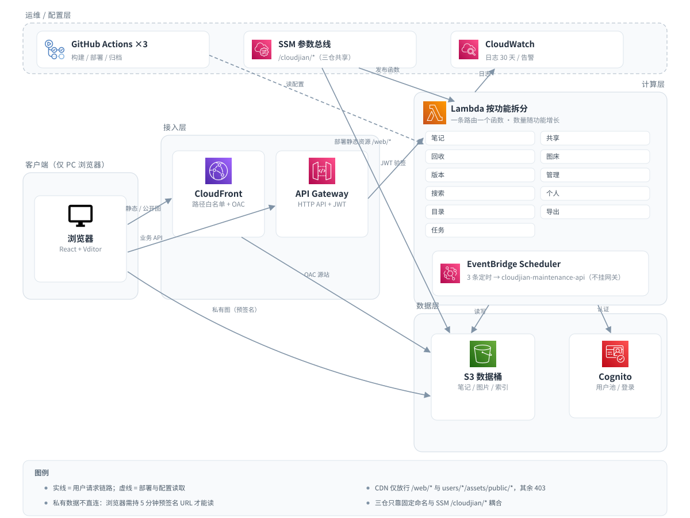
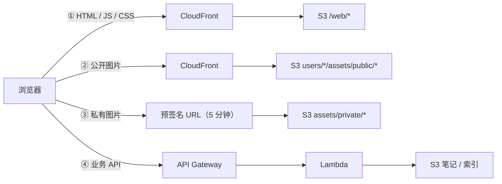
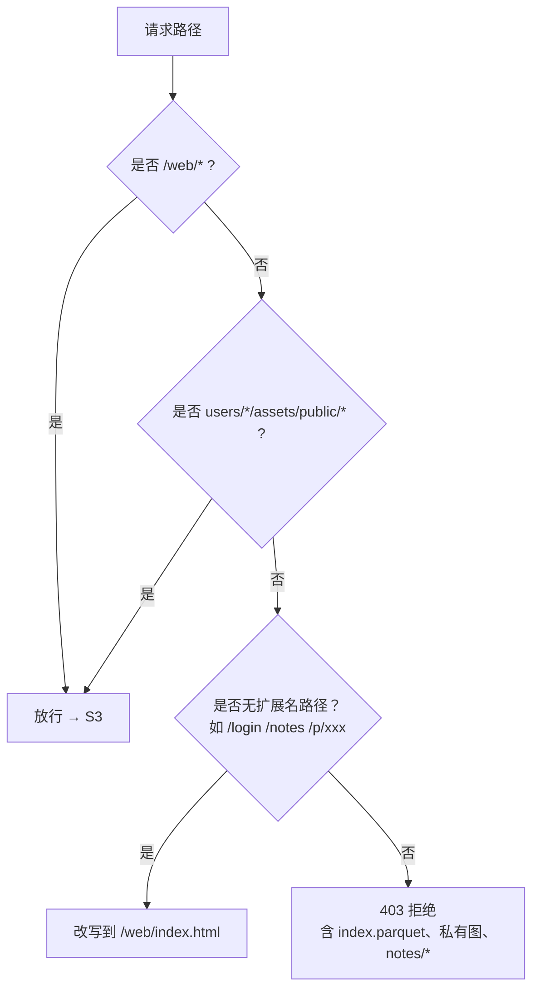
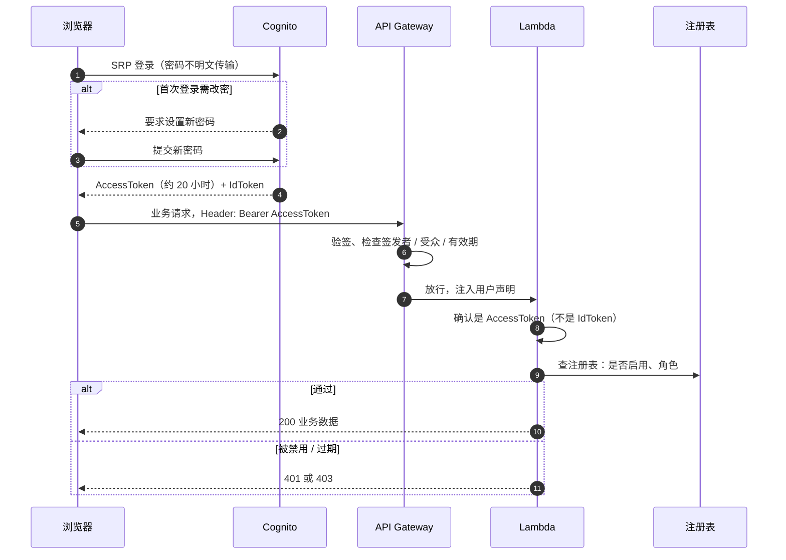
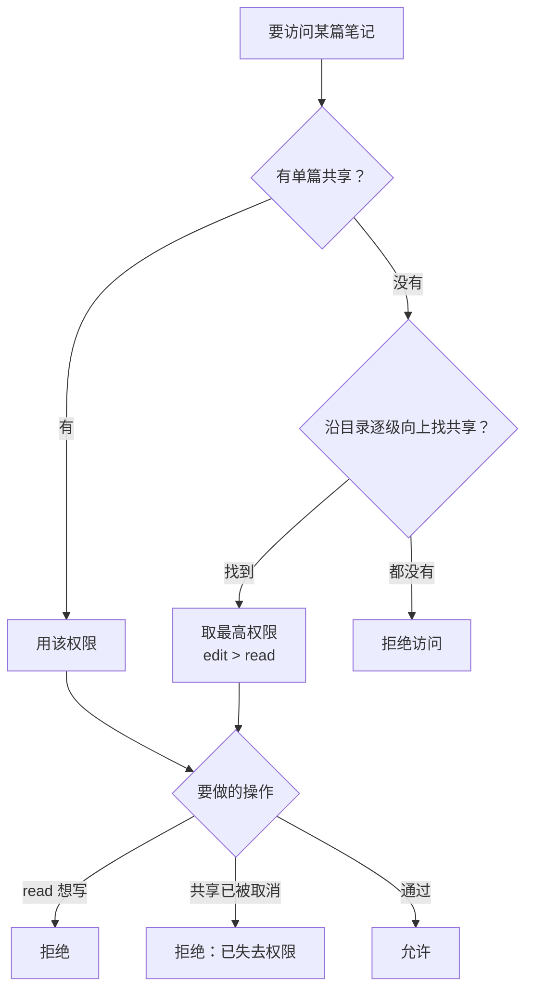
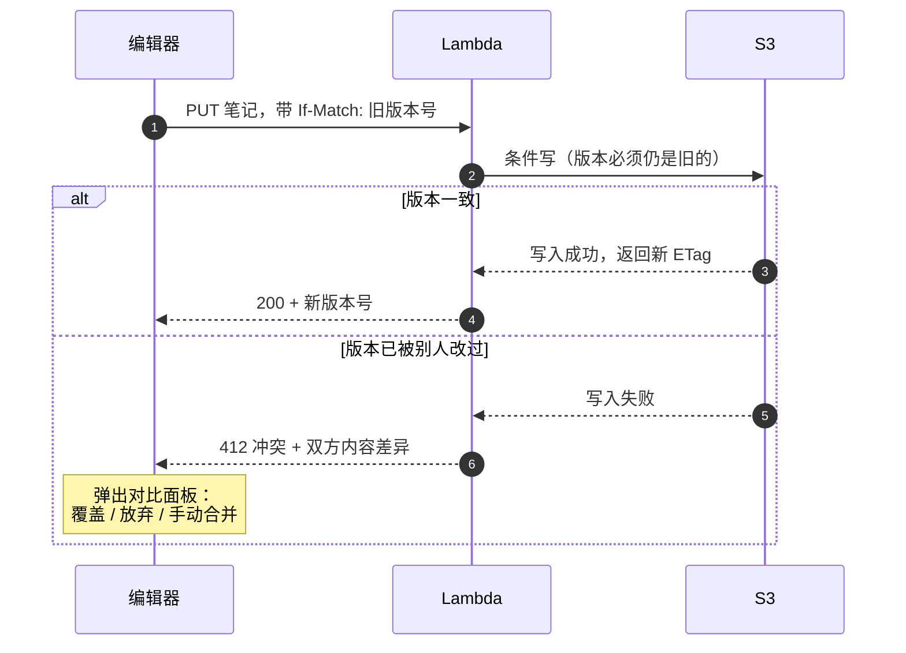
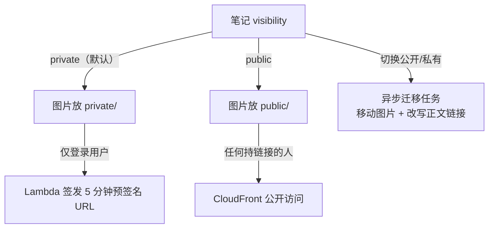
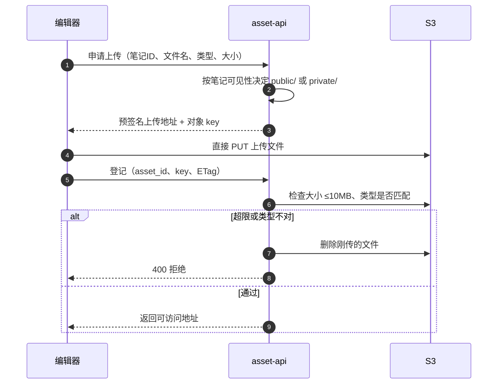
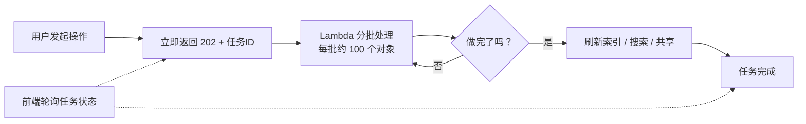
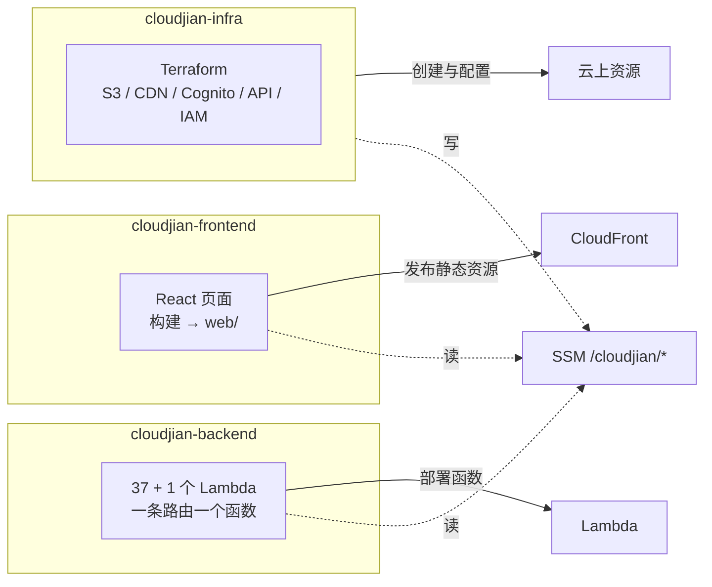

# 云笺 CloudJian · 技术架构

---

## 1. 总体架构

云笺是全 Serverless 架构：没有自建数据库、没有常驻服务器。浏览器只连 CDN 和 API；业务数据全部在 S3；计算在 Lambda。



> 图标为 AWS 官方设计资源。实线是用户请求链路，虚线是部署与配置读取；字段含义见图内图例。

### 1.1 各层职责

| 层 | 组件 | 做什么 | 不做什么 |
|-|-|-|-|
| 接入 | CloudFront + Function | 静态资源、公开图分发；放行白名单路径，其余拒绝 | 不做登录鉴权 |
| 接入 | API Gateway | 路由、验 JWT、统一 CORS、限流 | 不区分 AccessToken / ID Token |
| 计算 | Lambda 37 + 1 | 一条路由一个函数；业务逻辑、权限判定、读写 S3、异步任务 | 不自己验 JWT 签名（信任网关注入） |
| 数据 | S3 | 笔记、图片、索引、静态产物的唯一存储 | 不做业务权限判断 |
| 认证 | Cognito | 账号、登录、发 Token | 不是权限真源（角色以注册表为准） |
| 调度 | Scheduler | 每日对账、索引抽查、每周契约检查 | 不处理用户请求 |
| 配置 | SSM | 三仓共享的参数（URL、域名、池 ID 等） | 不存业务数据 |

### 1.2 Lambda 怎么拆

**一条路由一个函数。** 37 条接口路由对应 37 个函数，另加 1 个定时维护函数；命名 `cloudjian-<域>-<动作>-api`，别名固定 `live`，每个函数一个同名日志组。

| 域 | 函数数 | 例子 |
|-|-|-|
| 笔记 | 7 | `cloudjian-notes-list-api`、`cloudjian-notes-update-api` |
| 回收站 | 1 | `cloudjian-trash-purge-api` |
| 版本 | 3 | `cloudjian-versions-restore-api` |
| 搜索 | 1 | `cloudjian-search-query-api` |
| 目录 | 6 | `cloudjian-dirs-move-api` |
| 任务查询 | 1 | `cloudjian-jobs-get-api` |
| 共享 | 3 | `cloudjian-shares-revoke-api` |
| 图床 | 5 | `cloudjian-assets-presign-api` |
| 管理 | 6 | `cloudjian-admin-users-create-api` |
| 个人设置 | 2 | `cloudjian-profile-put-api` |
| 导出 | 2 | `cloudjian-exports-create-api` |
| 运维 | 1 | `cloudjian-maintenance-api`（定时，不挂网关） |

好处是隔离彻底：改一个接口只发布一个函数，一条路由出错不牵连其他接口。代价是函数数量多，每条路由首次访问各有一次冷启动；100 人规模下可接受。逐条映射见[契约 §2.6](../云笺-ALL-契约-接口契约-v0.1.md)。

---

## 2. 请求链路

### 2.1 四类请求各走各的路



| # | 请求类型 | 路径 | 说明 |
|-|-|-|-|
| ① | 前端静态资源 | CloudFront → `/web/*` | 单页应用入口 |
| ② | 公开图片 | CloudFront → `assets/public/*` | 笔记公开时的图片，可匿名访问 |
| ③ | 私有图片 | 浏览器直连 S3 预签名 URL | **不经 CDN**；5 分钟过期 |
| ④ | 业务接口 | API Gateway → Lambda | 带 AccessToken；写笔记、共享、搜索等 |

**安全边界：** 浏览器永不直接读私有 S3 对象；私有数据必须经 Lambda。CDN 只放行 `/web/*` 和公开图前缀，其余路径一律拒绝。

### 2.2 静态资源 CDN 过滤规则



补充：

- `/web/missing.js` 这类**带扩展名**的缺失文件 → 返回 404，不伪装成页面  
- 不做「403/404 改成 200」的映射，避免和白名单规则互相打架  

---

## 3. 登录与鉴权

### 3.1 登录时序



### 3.2 Token 规则

| Token | 用途 | 注意 |
|-|-|-|
| **AccessToken** | 调业务接口 | 约 20 小时；**唯一可用的 API 凭证** |
| IdToken | 前端展示用户信息 | **不能**调接口 |
| RefreshToken | 不使用 | 到期重新登录 |

登录方式为 **SRP**：密码不会以明文发到服务端。

### 3.3 权限从哪来

```
Token 只回答「你是谁」
        ↓
注册表 _registry.parquet 回答「是否启用 / 什么角色」
        ↓
共享关系回答「对这篇笔记能否读/写」
```

- 管理员禁用用户、调角色 → 改注册表，**最长约 60 秒**生效  
- 用户改密 → 旧 Token 立即作废（比对改密时间）  
- Cognito Group 只影响前端菜单显示；**服务端一律以注册表为准**  

### 3.4 共享权限判定



规则：

- 单篇共享 > 目录共享（递归）> 无；多处命中取**更高**权限  
- `read`：能看、能对比版本，**不能**编辑、回滚、导出  
- `edit`：能编辑正文、回滚版本、在共享目录里新建笔记；**不能**新建子目录、改共享设置  
- 共享给我 → 只读收件箱索引，不遍历别人目录  

---

## 4. 笔记读写与并发

### 4.1 保存笔记（乐观锁）

两人同时改同一篇时，**不覆盖、不丢数据**：



要点：

| 项 | 约定 |
|-|-|
| 冲突状态码 | **412**（不是 500） |
| 响应内容 | 服务端内容、客户端内容、差异、新版本号 |
| 版本号 | 存在笔记 Frontmatter，单调递增 |
| 保存必带 | 请求头 `If-Match`；响应头回新 `ETag` |

### 4.2 数据在 S3 上怎么摆

```
数据桶
├── web/                              ← 前端静态文件
└── users/
    ├── _registry.parquet             ← 全局用户表（状态、角色）
    ├── _share_inbox.parquet          ← 「共享给我」反向索引
    ├── _team_config.json             ← 团队开关（默认可见性等）
    └── {用户UUID}/
        ├── notes/                    ← 笔记 Markdown（真源）
        │   └── 分类路径/slug.md
        ├── trash/                    ← 回收站（30 天后自动清）
        ├── versions/                 ← 历史版本（30 天后自动清）
        ├── assets/
        │   ├── public/               ← 公开图（走 CDN）
        │   ├── private/              ← 私有图（仅预签名）
        │   └── _trash/               ← 随笔记删除暂存
        ├── shares/                   ← 我发出的共享
        ├── search/                   ← 搜索分片（可重建）
        ├── jobs/                     ← 异步任务进度
        ├── exports/                  ← 导出包（1 天后自动清）
        └── index.parquet             ← 笔记列表索引（可重建）
```

| 原则 | 说明 |
|-|-|
| 文件是唯一真源 | 正文、元数据都在 `.md` 的 Frontmatter 里 |
| 索引可丢可建 | `index.parquet`、搜索分片坏了可以从笔记重建 |
| 身份用 note_id | 文件名可以改，`note_id` 永不变 |
| 自动清理靠标签 | `cj:retention=30d` / `1d`，不用路径前缀规则 |

### 4.3 一篇笔记的文件长什么样

```markdown
---
note_id: 01JCF3K8QW7N2R5T9YBX4M6VHA
title: 本周技术笔记
category: 工作/技术
tags: [aws, lambda]
visibility: private
version: 12
updated_at: 2026-11-25T14:30:00+08:00
---

正文 Markdown……
```

---

## 5. 图片上传与可见性

### 5.1 可见性规则（一句话）

**图片跟着笔记走：** 笔记公开 → 里面所有图片也公开；笔记私有 → 图片需登录才能看。没有「单独把某张图设为公开」的开关。



一张图可能被多篇笔记引用：只要**有一篇是公开的**，图就按公开存放（否则公开页会裂图）。

### 5.2 上传流程



### 5.3 私有图怎么显示

正文里写的是占位符 `asset://asset_id`，渲染时向服务端换一个 5 分钟有效的临时地址。权限不足、图片未被该笔记引用、前缀对不上 → 一律拒绝。

---

## 6. 异步任务

大范围操作（移动目录、彻底删除、切换公开、批量导出）不在一次请求里做完，而是：



| 约定 | 说明 |
|-|-|
| 进度可查 | `GET /jobs/{job_id}` |
| 可断点续跑 | 记录已处理列表，超时后接着做 |
| 同一范围互斥 | 同一目录同时只能有一个任务，冲突返回 409 |
| 任务期间只读 | 受影响的目录暂时不能新建/编辑/删除 |
| 失败可重试 | 只重跑失败项，不整单回滚 |

**彻底删除**顺序（先删文件、最后才从索引移除）：避免中途失败后「列表里看不见、文件却还在」。

---

## 7. 定时任务

| 任务 | 频率 | 做什么 |
|-|-|-|
| 收件箱对账 | 每天 | 扫描共享关系，修正「共享给我」索引 |
| 索引抽查 | 每天 | 只读检查索引是否和笔记一致 |
| 契约校验 | 每周 | 检查函数版本、别名、Layer 是否符合约定 |

由 EventBridge Scheduler 调用 `cloudjian-maintenance-api`（**不对外暴露**，不能通过 API 访问）。

---

## 8. 代码仓库与发布

### 8.1 三个仓库



| 仓库 | 负责 | 不碰 |
|-|-|-|
| frontend | 页面、构建、发布到 `web/`、CDN 刷新 | 云资源创建 |
| backend | 函数、Layer、别名、接口实现 | 桶策略、CDN、Cognito、路由表 |
| infra | 存储、分发、认证、路由、权限、流水线 | 创建/修改任何 Lambda |

三仓不共享代码，只通过**固定命名**和 **SSM 参数**通信。

### 8.2 发布流程

```
功能分支 feat/* ──提 PR──▶ release 分支（合并即上线）──提 PR──▶ main（只归档）
                              │
                              └── 自动：检查 → 计划 → 应用
```

| 项 | 约定 |
|-|-|
| 环境 | 只有 **release** 一个环境，合并即生产 |
| 凭证 | CI 用临时身份（OIDC），仓库里不存长期密钥 |
| 合并前 | 格式检查、配置校验、静态检查、安全扫描、脚本校验、变更摘要 |
| 回滚 | 撤销那次合并再发布 |

### 8.3 关键设计取舍

| 决策 | 原因 |
|-|-|
| 不用数据库 | 规模小、文件即数据；省掉一整套运维 |
| 图片跟随笔记 | 两套可见性必然出现「正文锁了图没锁」 |
| CORS 只配在网关 | 避免前后端各写一份导致不一致 |
| 只用 AccessToken | IdToken 不能当接口凭证 |
| 生命周期用标签 | 路径前缀规则会静默匹配不到任何文件 |
| 不删账号只禁用 | 避免误删和数据悬空 |
| 单环境 | 内部工具不值得多套环境，靠合并前检查兜底 |

---

## 9. 运行环境与成本

| 项 | 值 |
|-|-|
| 前端 | Node.js 24 构建；React + TypeScript + Vditor |
| 后端 | Python 3.14；函数内存 512MB、超时 25 秒 |
| 区域 | AWS 东京（ap-northeast-1） |
| 日志 | CloudWatch，保留 30 天 |
| 月成本 | 约 $0.61 / $1.38 / $2.67 三档；预算告警 $5 |
| 免费额度 | Cognito 登录、CloudFront、部分日志在免费层内 |

---

## 10. 与总览的关系

- 产品功能与使用方式见 [01-项目总览.md](01-项目总览.md)  
- 接口字段、路由、错误码以 [接口契约](../云笺-ALL-契约-接口契约-v0.1.md) 为准  
- 完整实现细节见 [技术架构](../云笺-ALL-基线-技术架构-v1.2.md)  
